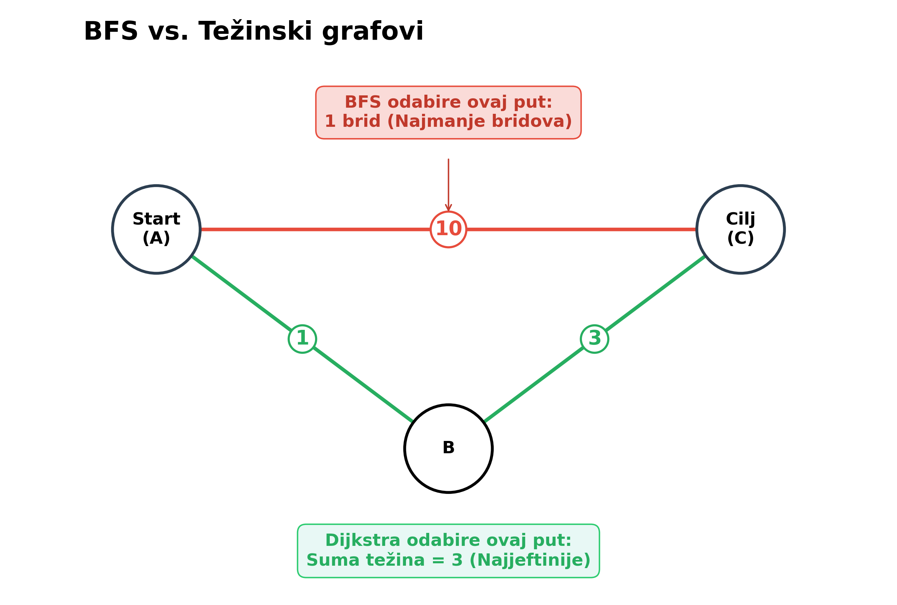
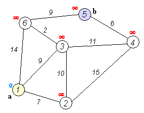
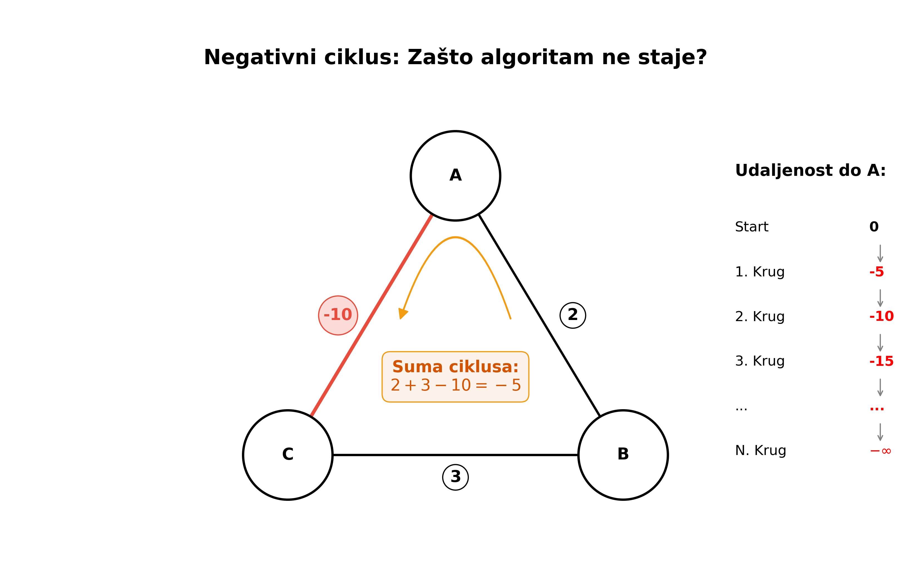
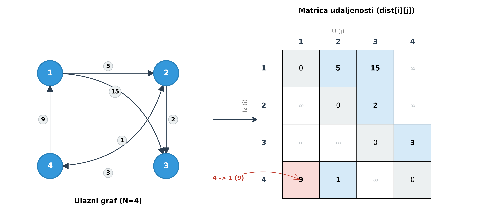

<!-- _paginate: false -->
<!-- _class: title -->

# Algoritmi za najkraći put

## Dijkstra, Bellman-Ford, Floyd-Warshall

---

# Sadržaj

1. **Uvod i motivacija**
   * Problem najkraćeg puta vs. BFS
   * Pregled algoritama
2. **Dijkstrin algoritam**
   * Princip rada (pohlepni pristup)
   * Implementacija (priority queue)
3. **Bellman-Ford algoritam**
   * Rad s negativnim težinama
   * Detekcija negativnih ciklusa
4. **Floyd-Warshall algoritam** (kroz zadatak Shortest Routes II)
5. **Zadaci za vježbu**

---

# Uvod: problem najkraćeg puta

Zadan je **težinski usmjeren graf** $G = (V, E)$ gdje svaka veza $(u, v)$ ima težinu $w(u, v)$.
Cilj: pronaći put minimalne ukupne težine od izvora $s$ do cilja $t$.

**Primjene:**

* **GPS navigacija:** najbrža ruta (vrijeme je težina).
* **Mreže:** routing protokoli (OSPF).
* **Ekonomija:** minimizacija troškova transakcija.

---

# Ključna razlika: BFS vs. težinski grafovi

<div class="twocols">

Zašto ne koristimo BFS?

1. **BFS (Breadth-First Search):**
   * Nalazi put s **najmanjim brojem bridova**.
   * Pretpostavlja da svaki brid ima težinu 1.

2. **Težinski algoritmi (Dijkstra/Bellman-Ford):**
   * Nalaze put s **najmanjom sumom težina**.
   * Put s više bridova može biti "jeftiniji" od puta s jednim bridom.

<p class="break"></p>



</div>

---

# Pregled algoritama

Koji algoritam odabrati?

| Algoritam | Težine bridova | Složenost | Napomena |
| :--- | :--- | :--- | :--- |
| **Dijkstra** | **Samo nenegativne** ($w \ge 0$) | $O(M \log N)$ | Standardni izbor. Vrlo brz. |
| **Bellman-Ford** | Mogu biti **negativne** | $O(N \cdot M)$ | Sporiji. Detektira negativne cikluse. |
| **Floyd-Warshall** | Mogu biti **negativne** | $O(N^3)$ | Svi parovi čvorova. Samo za male grafove. |

---

<!-- _class: title -->

# Dijkstrin algoritam

## Najbrži algoritam za nenegativne težine

---

# Dijkstra: intuicija (1/2)

Dijkstra je **pohlepni algoritam**.
Princip rada sličan je širenju vala ili "kruga poznatog teritorija" iz izvora $S$.

**Postupak:**

1. Održavamo trenutne najkraće udaljenosti (`dist`) do svih čvorova (start = 0, ostali = $\infty$).
2. U svakom koraku biramo **neobrađeni** čvor $U$ s **najmanjom** trenutnom udaljenosti.
3. Fiksiramo udaljenost do $U$ (ona se više neće mijenjati).
4. **Relaksiramo** sve susjede čvora $U$:
   * Ako je `dist[U] + w(U, V) < dist[V]`, ažuriramo `dist[V]`.

---

# Dijkstra: intuicija (2/2)



Izvor: [Dijkstra's algorithm](https://en.wikipedia.org/wiki/Dijkstra%27s_algorithm)

---

# Dijkstra: implementacija (C++)

```cpp
const long long INF = 1e18;
vector<long long> dist(n + 1, INF);  // Ne "distance": sudara se sa std::distance
priority_queue<pair<long long, int>> q;
dist[start] = 0;
q.push({0, start});

while (!q.empty()) {
    long long d = -q.top().first; // Vraćamo pozitivnu vrijednost
    int u = q.top().second;
    q.pop();

    if (d > dist[u]) continue; // Već smo ranije našli bolji put

    for (auto [v, w] : adj[u]) {
        if (dist[u] + w < dist[v]) {
            dist[v] = dist[u] + w;
            q.push({-dist[v], v});
        }
    }
}
```

*Trik:* C++ `priority_queue` je max-heap, pa spremamo `{-udaljenost, čvor}`.

---

# Dijkstra korak po korak

Iz reda uvijek vadimo par s najmanjom udaljenosti. Zeleni čvorovi su gotovi, prekriženi zapisi u redu su zastarjeli.

<style scoped>
.sp-dijkstra { margin-top: 0.3em; }
.sp-dijkstra .chips { font-size: 20px; margin-bottom: 0.4em; }
.sp-dijkstra .chip { display: inline-block; min-width: 32px; text-align: center; padding: 2px 10px; margin: 0 0 6px 6px; border: 2px solid #141414; border-radius: 16px; font-weight: bold; font-size: 18px; }
.sp-dijkstra .chip.take { background: #9fdc9f; }
.sp-dijkstra .chip.skip, .sp-dijkstra .chip.stale { color: #b5b5b5; border-color: #ccc; text-decoration: line-through; }
.sp-dijkstra .chip.on { background: var(--main); border-color: var(--main); color: #fff; }
.sp-dijkstra .muted { color: #6e6e6e; font-style: italic; margin-left: 6px; }
.sp-dijkstra .row { display: flex; gap: 6px; }
.sp-dijkstra .cell { width: 62px; text-align: center; border: 2px solid #141414; border-radius: 6px; transition: background-color .25s, color .25s; }
.sp-dijkstra .idx { font-size: 15px; color: #6e6e6e; border-bottom: 1px solid #ccc; }
.sp-dijkstra .val { font-size: 24px; height: 38px; line-height: 38px; font-weight: bold; }
.sp-dijkstra .cell.todo .val { color: #b5b5b5; }
.sp-dijkstra .cell.rng { background: #d6e6f5; }
.sp-dijkstra .cell.best { background: #9fdc9f; }
.sp-dijkstra .cell.src { background: #f5db7e; }
.sp-dijkstra .cell.cur { background: var(--main); color: #fff; }
.sp-dijkstra .cell.cur .idx, .sp-dijkstra .cell.cur .val { color: #fff; }
.sp-dijkstra .lbl { font-size: 18px; font-weight: bold; color: #6e6e6e; margin: 0.4em 0 0.2em; }
.sp-dijkstra .wrap { display: flex; gap: 28px; align-items: flex-start; }
.sp-dijkstra .side { padding-top: 6px; }
.sp-dijkstra .gsvg { display: block; overflow: visible; }
.sp-dijkstra .e line { stroke: #9a9a9a; stroke-width: 3; transition: stroke .25s; }
.sp-dijkstra .e polygon { fill: #9a9a9a; }
.sp-dijkstra .e .w { font-size: 19px; font-weight: bold; fill: #141414; text-anchor: middle; dominant-baseline: central; paint-order: stroke; stroke: #fff; stroke-width: 6px; }
.sp-dijkstra .e.tree line { stroke: #2f9e44; stroke-width: 6; }
.sp-dijkstra .e.tree polygon { fill: #2f9e44; }
.sp-dijkstra .e.off line { stroke: #d5d5d5; stroke-dasharray: 6 6; }
.sp-dijkstra .e.off polygon { fill: #d5d5d5; }
.sp-dijkstra .e.off .w { fill: #b5b5b5; }
.sp-dijkstra .e.hid { opacity: 0; }
.sp-dijkstra .e.bad line { stroke: #e03131; stroke-width: 6; }
.sp-dijkstra .e.bad polygon { fill: #e03131; }
.sp-dijkstra .e.on line { stroke: var(--main); stroke-width: 6; }
.sp-dijkstra .e.on polygon { fill: var(--main); }
.sp-dijkstra .n circle { fill: #fff; stroke: #141414; stroke-width: 2.5; transition: fill .25s; }
.sp-dijkstra .n .id { font-size: 21px; font-weight: bold; text-anchor: middle; dominant-baseline: central; fill: #141414; }
.sp-dijkstra .n .sub { font-size: 19px; font-weight: bold; text-anchor: middle; dominant-baseline: central; fill: var(--main); paint-order: stroke; stroke: #fff; stroke-width: 6px; }
.sp-dijkstra .n.c1 circle { fill: #ffd8a8; } .sp-dijkstra .n.c2 circle { fill: #a5d8ff; } .sp-dijkstra .n.c3 circle { fill: #b2f2bb; }
.sp-dijkstra .n.c4 circle { fill: #fcc2d7; } .sp-dijkstra .n.c5 circle { fill: #d0bfff; } .sp-dijkstra .n.c6 circle { fill: #ffec99; }
.sp-dijkstra .n.done circle { fill: #9fdc9f; }
.sp-dijkstra .n.src circle { fill: #f5db7e; }
.sp-dijkstra .n.cur circle { fill: var(--main); stroke: var(--main); }
.sp-dijkstra .n.cur .id { fill: #fff; }
.sp-dijkstra .tbl { display: grid; gap: 5px; }
.sp-dijkstra .th { height: 40px; line-height: 40px; text-align: center; font-size: 20px; font-weight: bold; color: #6e6e6e; border-radius: 6px; }
.sp-dijkstra .th.hl { background: var(--main); color: #fff; }
.sp-dijkstra .tc { height: 40px; line-height: 36px; text-align: center; font-size: 22px; font-weight: bold; border: 2px solid #141414; border-radius: 6px; transition: background-color .25s, color .25s; }
.sp-dijkstra .tc.none { border-color: transparent; }
.sp-dijkstra .tc.k { background: #e3ecf6; }
.sp-dijkstra .tc.best { background: #9fdc9f; }
.sp-dijkstra .tc.src { background: #f5db7e; }
.sp-dijkstra .tc.cur { background: var(--main); color: #fff; }
.sp-dijkstra .line1, .sp-dijkstra .line2 { font-family: monospace; font-size: 21px; min-height: 1.35em; }
.sp-dijkstra .line1 { margin-top: 0.5em; }
.sp-dijkstra .line2 { font-weight: bold; }
.sp-dijkstra .ctrl { margin-top: 0.5em; }
.sp-dijkstra button { font: inherit; font-size: 18px; padding: 4px 14px; margin-right: 8px; border: 2px solid var(--main); border-radius: 6px; background: #fff; color: var(--main); cursor: pointer; }
.sp-dijkstra button:hover { background: var(--main); color: #fff; }
.sp-dijkstra .hint { font-size: 16px; color: #6e6e6e; }
</style>

<div class="sp-dijkstra" data-start="1" data-pos="50,150 210,45 210,255 390,45 390,255 550,150" data-edges="1-2:4,1-3:2,3-2:1,2-4:5,3-5:10,4-5:2,4-6:6,5-6:3">
  <div class="wrap">
    <div class="graph"></div>
    <div class="side">
      <div class="lbl">dist</div>
      <div class="row"></div>
      <div class="pq chips"></div>
    </div>
  </div>
  <div class="line1"></div>
  <div class="line2"></div>
  <div class="ctrl">
    <button data-act="prev">← Korak</button><button data-act="next">Korak →</button><button data-act="auto">Auto</button><button data-act="reset">Reset</button>
    <span class="hint">← / → koračaju kroz animaciju, Shift + ← / → mijenja slajd</span>
  </div>
</div>

<script>
(function () {
  // Ovaj blok namjerno ne sadrži znakove manje-od, veće-od ni ampersand,
  // jer ih build pretvara u HTML entitete i ruši skriptu.
  document.querySelectorAll('.sp-dijkstra').forEach(function (root) {
    var slide = root.closest('svg');
    var line1 = root.querySelector('.line1');
    var line2 = root.querySelector('.line2');
    var NS = 'http://www.w3.org/2000/svg';
    function mk(tag, cls, text) {
      var e = document.createElement(tag);
      if (cls) e.className = cls;
      if (text !== undefined) e.textContent = text;
      return e;
    }
    function sv(tag, attrs, parent) {
      var e = document.createElementNS(NS, tag);
      Object.keys(attrs).forEach(function (k) { e.setAttribute(k, attrs[k]); });
      if (parent) parent.appendChild(e);
      return e;
    }
    function setc(el, cls) { el.setAttribute('class', cls); }
    function show(v) { return v === Infinity ? '∞' : (v === -Infinity ? '−∞' : String(v)); }
    function lt(a, b) { return a !== b ? Math.min(a, b) === a : false; }
    function le(a, b) { return Math.min(a, b) === a; }
    function fw(w) { return lt(w, 0) ? '(' + w + ')' : String(w); }
    function makeRow(box, count, base) {
      var cells = [], vals = [];
      for (var k = 0; k !== count; k++) {
        var cell = mk('div', 'cell');
        cell.appendChild(mk('div', 'idx', k + (base || 0)));
        var v = mk('div', 'val');
        cell.appendChild(v);
        box.appendChild(cell);
        cells.push(cell);
        vals.push(v);
      }
      return { cells: cells, vals: vals };
    }
    function parsePos(s) {
      return s.trim().split(/\s+/).map(function (p) {
        var q = p.split(',').map(Number);
        return { x: q[0], y: q[1] };
      });
    }
    function parseEdges(s) {
      return s.split(',').map(function (t) {
        var q = t.trim().split(':'), ab = q[0].split('-');
        return { a: Number(ab[0]), b: Number(ab[1]), w: q.length === 2 ? Number(q[1]) : 0 };
      });
    }
    // Crta graf u SVG-u: čvorovi su numerirani od 1, bridovi su {a, b, w}
    function drawGraph(box, pos, edges, opt) {
      var R = opt.r || 22;
      var svg = sv('svg', { viewBox: '0 0 ' + opt.w + ' ' + opt.h, width: opt.w, height: opt.h, 'class': 'gsvg' }, box);
      var gE = sv('g', {}, svg), gN = sv('g', {}, svg);
      var E = edges.map(function (e) {
        var A = pos[e.a - 1], B = pos[e.b - 1];
        var dx = B.x - A.x, dy = B.y - A.y, L = Math.sqrt(dx * dx + dy * dy);
        var ux = dx / L, uy = dy / L;
        var x1 = A.x + ux * R, y1 = A.y + uy * R, x2 = B.x - ux * R, y2 = B.y - uy * R;
        var g = sv('g', { 'class': 'e' }, gE);
        sv('line', { x1: x1, y1: y1, x2: x2, y2: y2 }, g);
        if (opt.directed) {
          var bx = x2 - ux * 15, by = y2 - uy * 15;
          sv('polygon', { points: x2 + ',' + y2 + ' ' + (bx - uy * 7) + ',' + (by + ux * 7) + ' ' + (bx + uy * 7) + ',' + (by - ux * 7) }, g);
        }
        if (opt.weights) {
          var t = sv('text', { x: (A.x + B.x) / 2 - uy * 15, y: (A.y + B.y) / 2 + ux * 15, 'class': 'w' }, g);
          t.textContent = e.w;
        }
        return { g: g };
      });
      var N = pos.map(function (p, i) {
        var g = sv('g', { 'class': 'n' }, gN);
        sv('circle', { cx: p.x, cy: p.y, r: R }, g);
        var t = sv('text', { x: p.x, y: p.y, 'class': 'id' }, g);
        t.textContent = i + 1;
        var sub = sv('text', { x: p.x + (opt.subdx || 0), y: p.y + (opt.subdy === undefined ? -R - 13 : opt.subdy), 'class': 'sub' }, g);
        return { g: g, sub: sub };
      });
      return { E: E, N: N, svg: svg };
    }

    var pos = parsePos(root.dataset.pos);
    var edges = parseEdges(root.dataset.edges);
    var n = pos.length, S = Number(root.dataset.start);
    var G = drawGraph(root.querySelector('.graph'), pos, edges, { w: 600, h: 300, directed: true, weights: true });
    var R = makeRow(root.querySelector('.row'), n, 1);
    var pqBox = root.querySelector('.pq');
    var adj = [], dist = [], done = [], par = [];
    for (var i = 0; i !== n + 1; i++) { adj.push([]); dist.push(Infinity); done.push(false); par.push(-1); }
    edges.forEach(function (e, k) { adj[e.a].push(k); });
    dist[S] = 0;
    var pq = [{ d: 0, v: S }];
    function byKey(a, b) { return a.d - b.d || a.v - b.v; }
    function snap(extra) {
      var s = { dist: dist.slice(), done: done.slice(), cur: -1, tgt: -1, edge: -1, tree: [], l1: '', l2: '',
        pq: pq.slice().sort(byKey).map(function (p) { return { d: p.d, v: p.v, stale: p.d !== dist[p.v] }; }) };
      Object.keys(extra).forEach(function (k) { s[k] = extra[k]; });
      return s;
    }
    var snaps = [snap({ l1: 'Početno stanje: dist[' + S + '] = 0, ostali ∞. U redu je (0, ' + S + ').' })];
    while (pq.length) {
      pq.sort(byKey);
      var top = pq.shift(), u = top.v, d = top.d;
      if (d !== dist[u]) {
        snaps.push(snap({ cur: u, l1: 'Vadimo (' + d + ', ' + u + '): zastarjeli zapis jer je dist[' + u + '] = ' + dist[u],
          l2: 'Uvjet d veće od dist[u] je ispunjen, preskačemo (continue)' }));
        continue;
      }
      done[u] = true;
      snaps.push(snap({ cur: u, l1: 'Vadimo (' + d + ', ' + u + '): najmanja udaljenost u redu',
        l2: 'dist[' + u + '] = ' + d + ' je konačna' + (adj[u].length ? ', relaksiramo susjede' : ', čvor nema izlaznih bridova') }));
      adj[u].forEach(function (k) {
        var e = edges[k], v = e.b, nd = d + e.w, old = dist[v], better = lt(nd, old);
        if (better) { dist[v] = nd; par[v] = k; pq.push({ d: nd, v: v }); }
        snaps.push(snap({ cur: u, tgt: v, edge: k,
          l1: 'Brid ' + u + ' → ' + v + ':  dist[' + u + '] + ' + e.w + ' = ' + nd + (better ? ' manje je od ' : ' nije manje od ') + show(old),
          l2: better ? 'dist[' + v + '] = ' + nd + ', u red dodajemo (' + nd + ', ' + v + ')' : 'Ne mijenjamo ništa' }));
      });
    }
    var tree = [];
    par.forEach(function (k) { if (k !== -1) tree.push(k); });
    snaps.push(snap({ tree: tree, l1: 'Red je prazan. Zeleni bridovi čine stablo najkraćih putova.',
      l2: 'dist = [' + dist.slice(1).map(show).join(', ') + ']   ✓' }));

    function draw(s) {
      G.N.forEach(function (nd, i) {
        var v = i + 1, c = 'n';
        if (s.done[v]) c += ' done';
        if (v === s.tgt) c += ' src';
        if (v === s.cur) c += ' cur';
        setc(nd.g, c);
        nd.sub.textContent = show(s.dist[v]);
      });
      G.E.forEach(function (e, k) {
        var c = 'e';
        if (s.tree.indexOf(k) !== -1) c += ' tree';
        if (k === s.edge) c += ' on';
        setc(e.g, c);
      });
      R.cells.forEach(function (cell, k) {
        var v = k + 1, c = s.dist[v] === Infinity ? 'cell todo' : 'cell';
        if (s.done[v]) c += ' best';
        if (v === s.tgt) c += ' src';
        if (v === s.cur) c += ' cur';
        setc(cell, c);
        R.vals[k].textContent = show(s.dist[v]);
      });
      pqBox.textContent = 'Red:';
      if (s.pq.length === 0) pqBox.appendChild(mk('span', 'muted', 'prazan'));
      s.pq.forEach(function (p) { pqBox.appendChild(mk('span', p.stale ? 'chip stale' : 'chip', '(' + p.d + ', ' + p.v + ')')); });
    }

    var step = 0, timer = null, lastStep = snaps.length - 1;
    function render() {
      var s = snaps[step];
      draw(s);
      line1.textContent = s.l1;
      line2.textContent = s.l2;
    }
    function stopAuto() { clearInterval(timer); timer = null; }
    function next() { if (step !== lastStep) { step++; render(); return true; } stopAuto(); return false; }
    function prev() { if (step !== 0) { step--; render(); return true; } return false; }
    function reset() { stopAuto(); step = 0; render(); }
    var actions = {
      next: next, prev: prev, reset: reset,
      auto: function () { if (timer) stopAuto(); else timer = setInterval(next, 900); }
    };

    root.querySelectorAll('button').forEach(function (b) {
      b.addEventListener('click', function (e) {
        e.stopPropagation(); b.blur(); actions[b.dataset.act]();
      });
    });

    // Strelice / razmaknica / klikač prvo koračaju kroz animaciju, a tek na kraju mijenjaju slajd
    window.addEventListener('keydown', function (e) {
      if (e.shiftKey || !slide || !slide.classList.contains('bespoke-marp-active')) return;
      var fwd = ['ArrowRight', 'ArrowDown', 'PageDown', ' '].indexOf(e.key) !== -1;
      var back = ['ArrowLeft', 'ArrowUp', 'PageUp'].indexOf(e.key) !== -1;
      var moved = false;
      if (fwd) moved = next();
      if (back) moved = prev();
      if (moved) {
        e.preventDefault();
        e.stopImmediatePropagation();
      }
    }, true);

    render();
  });
})();
</script>

---

# Dijkstra: analiza složenosti

* Svaki čvor obrađujemo jednom (zbog provjere `d > dist[u]`), pa svaki brid relaksiramo jednom.
* Svaki čvor dodajemo u prioritetni red najviše onoliko puta koliko ima ulaznih bridova.
* Operacije s redom (`push`/`pop`) traju $O(\log N)$.

**Ukupna složenost:**
$$ O(M \log N) $$
(gdje je $N$ broj čvorova, a $M$ broj bridova).

---

<!-- _class: title -->

# Bellman-Ford algoritam

## Rad s negativnim težinama i ciklusi

---

# Bellman-Ford: intuicija

Što ako imamo negativne težine? Pohlepni pristup (Dijkstra) ne radi jer "skupi" put kasnije može postati "jeftin" prolaskom kroz negativni brid.

**Ideja (dinamičko programiranje):**

* Najkraći put bez ciklusa može imati najviše $N-1$ bridova.
* U $i$-toj iteraciji nalazimo sve najkraće putove koji koriste najviše $i$ bridova.

**Algoritam:**
Ponavljamo $N-1$ puta: prolazimo kroz **SVE bridove** $(u, v)$ u grafu i pokušavamo ih relaksirati:
`dist[v] = min(dist[v], dist[u] + w)`

---

# Detekcija negativnih ciklusa

<div class="twocols">

**Negativni ciklus:** ciklus čija je suma težina $< 0$.
Ako postoji, možemo se vrtjeti u krug i smanjivati udaljenost do $-\infty$. Najkraći put nije definiran.

**Kako ga detektirati?**
Nakon $N-1$ iteracija svi bi putovi trebali biti konačni.
Pokrenemo **$N$-tu iteraciju**.

* Ako se ijedna udaljenost **smanji**, postoji negativni ciklus dostupan iz izvora.

<p class="break"></p>



</div>

---

# Bellman-Ford: implementacija

Koristimo listu bridova (`struct Edge { int a, b, w; }`).

```cpp
vector<long long> dist(n + 1, INF);
dist[start] = 0;

// 1. Relaksacija N-1 puta
for (int i = 0; i < n - 1; ++i) {
    for (auto e : edges) {
        if (dist[e.a] != INF && dist[e.a] + e.w < dist[e.b]) {
            dist[e.b] = dist[e.a] + e.w;
        }
    }
}

// 2. Detekcija negativnog ciklusa
bool neg_cycle = false;
for (auto e : edges) {
    if (dist[e.a] != INF && dist[e.a] + e.w < dist[e.b]) {
        neg_cycle = true;
        break;
    }
}
```

**Složenost:** $O(N \cdot M)$

---

# Bellman-Ford korak po korak

Svaka iteracija prolazi kroz sve bridove istim redom. Zadnji prolaz samo provjerava postoji li još neko poboljšanje.

<style scoped>
.sp-bellman { margin-top: 0.3em; }
.sp-bellman .chips { font-size: 20px; margin-bottom: 0.4em; }
.sp-bellman .chip { display: inline-block; min-width: 32px; text-align: center; padding: 2px 10px; margin: 0 0 6px 6px; border: 2px solid #141414; border-radius: 16px; font-weight: bold; font-size: 18px; }
.sp-bellman .chip.take { background: #9fdc9f; }
.sp-bellman .chip.skip, .sp-bellman .chip.stale { color: #b5b5b5; border-color: #ccc; text-decoration: line-through; }
.sp-bellman .chip.on { background: var(--main); border-color: var(--main); color: #fff; }
.sp-bellman .muted { color: #6e6e6e; font-style: italic; margin-left: 6px; }
.sp-bellman .row { display: flex; gap: 6px; }
.sp-bellman .cell { width: 62px; text-align: center; border: 2px solid #141414; border-radius: 6px; transition: background-color .25s, color .25s; }
.sp-bellman .idx { font-size: 15px; color: #6e6e6e; border-bottom: 1px solid #ccc; }
.sp-bellman .val { font-size: 24px; height: 38px; line-height: 38px; font-weight: bold; }
.sp-bellman .cell.todo .val { color: #b5b5b5; }
.sp-bellman .cell.rng { background: #d6e6f5; }
.sp-bellman .cell.best { background: #9fdc9f; }
.sp-bellman .cell.src { background: #f5db7e; }
.sp-bellman .cell.cur { background: var(--main); color: #fff; }
.sp-bellman .cell.cur .idx, .sp-bellman .cell.cur .val { color: #fff; }
.sp-bellman .lbl { font-size: 18px; font-weight: bold; color: #6e6e6e; margin: 0.4em 0 0.2em; }
.sp-bellman .wrap { display: flex; gap: 28px; align-items: flex-start; }
.sp-bellman .side { padding-top: 6px; }
.sp-bellman .gsvg { display: block; overflow: visible; }
.sp-bellman .e line { stroke: #9a9a9a; stroke-width: 3; transition: stroke .25s; }
.sp-bellman .e polygon { fill: #9a9a9a; }
.sp-bellman .e .w { font-size: 19px; font-weight: bold; fill: #141414; text-anchor: middle; dominant-baseline: central; paint-order: stroke; stroke: #fff; stroke-width: 6px; }
.sp-bellman .e.tree line { stroke: #2f9e44; stroke-width: 6; }
.sp-bellman .e.tree polygon { fill: #2f9e44; }
.sp-bellman .e.off line { stroke: #d5d5d5; stroke-dasharray: 6 6; }
.sp-bellman .e.off polygon { fill: #d5d5d5; }
.sp-bellman .e.off .w { fill: #b5b5b5; }
.sp-bellman .e.hid { opacity: 0; }
.sp-bellman .e.bad line { stroke: #e03131; stroke-width: 6; }
.sp-bellman .e.bad polygon { fill: #e03131; }
.sp-bellman .e.on line { stroke: var(--main); stroke-width: 6; }
.sp-bellman .e.on polygon { fill: var(--main); }
.sp-bellman .n circle { fill: #fff; stroke: #141414; stroke-width: 2.5; transition: fill .25s; }
.sp-bellman .n .id { font-size: 21px; font-weight: bold; text-anchor: middle; dominant-baseline: central; fill: #141414; }
.sp-bellman .n .sub { font-size: 19px; font-weight: bold; text-anchor: middle; dominant-baseline: central; fill: var(--main); paint-order: stroke; stroke: #fff; stroke-width: 6px; }
.sp-bellman .n.c1 circle { fill: #ffd8a8; } .sp-bellman .n.c2 circle { fill: #a5d8ff; } .sp-bellman .n.c3 circle { fill: #b2f2bb; }
.sp-bellman .n.c4 circle { fill: #fcc2d7; } .sp-bellman .n.c5 circle { fill: #d0bfff; } .sp-bellman .n.c6 circle { fill: #ffec99; }
.sp-bellman .n.done circle { fill: #9fdc9f; }
.sp-bellman .n.src circle { fill: #f5db7e; }
.sp-bellman .n.cur circle { fill: var(--main); stroke: var(--main); }
.sp-bellman .n.cur .id { fill: #fff; }
.sp-bellman .tbl { display: grid; gap: 5px; }
.sp-bellman .th { height: 40px; line-height: 40px; text-align: center; font-size: 20px; font-weight: bold; color: #6e6e6e; border-radius: 6px; }
.sp-bellman .th.hl { background: var(--main); color: #fff; }
.sp-bellman .tc { height: 40px; line-height: 36px; text-align: center; font-size: 22px; font-weight: bold; border: 2px solid #141414; border-radius: 6px; transition: background-color .25s, color .25s; }
.sp-bellman .tc.none { border-color: transparent; }
.sp-bellman .tc.k { background: #e3ecf6; }
.sp-bellman .tc.best { background: #9fdc9f; }
.sp-bellman .tc.src { background: #f5db7e; }
.sp-bellman .tc.cur { background: var(--main); color: #fff; }
.sp-bellman .line1, .sp-bellman .line2 { font-family: monospace; font-size: 21px; min-height: 1.35em; }
.sp-bellman .line1 { margin-top: 0.5em; }
.sp-bellman .line2 { font-weight: bold; }
.sp-bellman .ctrl { margin-top: 0.5em; }
.sp-bellman button { font: inherit; font-size: 18px; padding: 4px 14px; margin-right: 8px; border: 2px solid var(--main); border-radius: 6px; background: #fff; color: var(--main); cursor: pointer; }
.sp-bellman button:hover { background: var(--main); color: #fff; }
.sp-bellman .hint { font-size: 16px; color: #6e6e6e; }
.sp-bellman .side { max-width: 470px; }
</style>

<div class="sp-bellman" data-start="1" data-pos="50,150 230,45 230,255 410,150 590,45" data-edges="4-5:3,2-4:-1,3-4:4,3-2:-2,1-2:6,1-3:5,2-5:5">
  <div class="wrap">
    <div class="graph"></div>
    <div class="side">
      <div class="lbl">dist</div>
      <div class="row"></div>
      <div class="pq chips"></div>
    </div>
  </div>
  <div class="line1"></div>
  <div class="line2"></div>
  <div class="ctrl">
    <button data-act="prev">← Korak</button><button data-act="next">Korak →</button><button data-act="auto">Auto</button><button data-act="reset">Reset</button>
    <span class="hint">← / → koračaju kroz animaciju, Shift + ← / → mijenja slajd</span>
  </div>
</div>

<script>
(function () {
  // Ovaj blok namjerno ne sadrži znakove manje-od, veće-od ni ampersand,
  // jer ih build pretvara u HTML entitete i ruši skriptu.
  document.querySelectorAll('.sp-bellman').forEach(function (root) {
    var slide = root.closest('svg');
    var line1 = root.querySelector('.line1');
    var line2 = root.querySelector('.line2');
    var NS = 'http://www.w3.org/2000/svg';
    function mk(tag, cls, text) {
      var e = document.createElement(tag);
      if (cls) e.className = cls;
      if (text !== undefined) e.textContent = text;
      return e;
    }
    function sv(tag, attrs, parent) {
      var e = document.createElementNS(NS, tag);
      Object.keys(attrs).forEach(function (k) { e.setAttribute(k, attrs[k]); });
      if (parent) parent.appendChild(e);
      return e;
    }
    function setc(el, cls) { el.setAttribute('class', cls); }
    function show(v) { return v === Infinity ? '∞' : (v === -Infinity ? '−∞' : String(v)); }
    function lt(a, b) { return a !== b ? Math.min(a, b) === a : false; }
    function le(a, b) { return Math.min(a, b) === a; }
    function fw(w) { return lt(w, 0) ? '(' + w + ')' : String(w); }
    function makeRow(box, count, base) {
      var cells = [], vals = [];
      for (var k = 0; k !== count; k++) {
        var cell = mk('div', 'cell');
        cell.appendChild(mk('div', 'idx', k + (base || 0)));
        var v = mk('div', 'val');
        cell.appendChild(v);
        box.appendChild(cell);
        cells.push(cell);
        vals.push(v);
      }
      return { cells: cells, vals: vals };
    }
    function parsePos(s) {
      return s.trim().split(/\s+/).map(function (p) {
        var q = p.split(',').map(Number);
        return { x: q[0], y: q[1] };
      });
    }
    function parseEdges(s) {
      return s.split(',').map(function (t) {
        var q = t.trim().split(':'), ab = q[0].split('-');
        return { a: Number(ab[0]), b: Number(ab[1]), w: q.length === 2 ? Number(q[1]) : 0 };
      });
    }
    // Crta graf u SVG-u: čvorovi su numerirani od 1, bridovi su {a, b, w}
    function drawGraph(box, pos, edges, opt) {
      var R = opt.r || 22;
      var svg = sv('svg', { viewBox: '0 0 ' + opt.w + ' ' + opt.h, width: opt.w, height: opt.h, 'class': 'gsvg' }, box);
      var gE = sv('g', {}, svg), gN = sv('g', {}, svg);
      var E = edges.map(function (e) {
        var A = pos[e.a - 1], B = pos[e.b - 1];
        var dx = B.x - A.x, dy = B.y - A.y, L = Math.sqrt(dx * dx + dy * dy);
        var ux = dx / L, uy = dy / L;
        var x1 = A.x + ux * R, y1 = A.y + uy * R, x2 = B.x - ux * R, y2 = B.y - uy * R;
        var g = sv('g', { 'class': 'e' }, gE);
        sv('line', { x1: x1, y1: y1, x2: x2, y2: y2 }, g);
        if (opt.directed) {
          var bx = x2 - ux * 15, by = y2 - uy * 15;
          sv('polygon', { points: x2 + ',' + y2 + ' ' + (bx - uy * 7) + ',' + (by + ux * 7) + ' ' + (bx + uy * 7) + ',' + (by - ux * 7) }, g);
        }
        if (opt.weights) {
          var t = sv('text', { x: (A.x + B.x) / 2 - uy * 15, y: (A.y + B.y) / 2 + ux * 15, 'class': 'w' }, g);
          t.textContent = e.w;
        }
        return { g: g };
      });
      var N = pos.map(function (p, i) {
        var g = sv('g', { 'class': 'n' }, gN);
        sv('circle', { cx: p.x, cy: p.y, r: R }, g);
        var t = sv('text', { x: p.x, y: p.y, 'class': 'id' }, g);
        t.textContent = i + 1;
        var sub = sv('text', { x: p.x + (opt.subdx || 0), y: p.y + (opt.subdy === undefined ? -R - 13 : opt.subdy), 'class': 'sub' }, g);
        return { g: g, sub: sub };
      });
      return { E: E, N: N, svg: svg };
    }

    var pos = parsePos(root.dataset.pos);
    var edges = parseEdges(root.dataset.edges);
    var n = pos.length, S = Number(root.dataset.start);
    var G = drawGraph(root.querySelector('.graph'), pos, edges, { w: 620, h: 300, directed: true, weights: true });
    var R = makeRow(root.querySelector('.row'), n, 1);
    var box = root.querySelector('.pq');
    var dist = [], par = [];
    for (var i = 0; i !== n + 1; i++) { dist.push(Infinity); par.push(-1); }
    dist[S] = 0;
    var bad = [];
    function snap(extra) {
      var s = { dist: dist.slice(), cur: -1, tgt: -1, edge: -1, tree: [], bad: bad.slice(), it: 0, l1: '', l2: '' };
      Object.keys(extra).forEach(function (k) { s[k] = extra[k]; });
      return s;
    }
    var snaps = [snap({ l1: 'Početno stanje: dist[' + S + '] = 0, ostali ∞', l2: 'Radimo N − 1 = ' + (n - 1) + ' iteracija, svaka prolazi kroz sve bridove redom' })];
    for (var it = 1; it !== n + 1; it++) {
      var check = it === n, changes = 0;
      edges.forEach(function (e, k) {
        var l1, l2, last = k === edges.length - 1;
        var head = check ? 'Provjera (' + n + '. iteracija)' : 'Iteracija ' + it + ' od ' + (n - 1);
        if (dist[e.a] === Infinity) {
          l1 = 'Brid ' + e.a + ' → ' + e.b + ':  dist[' + e.a + '] = ∞, preskačemo';
        } else {
          var nd = dist[e.a] + e.w, old = dist[e.b], better = lt(nd, old);
          l1 = 'Brid ' + e.a + ' → ' + e.b + ':  dist[' + e.a + '] + ' + fw(e.w) + ' = ' + nd + (better ? ' manje je od ' : ' nije manje od ') + show(old);
          if (better) {
            changes++;
            if (check) bad.push(k);
            else { dist[e.b] = nd; par[e.b] = k; }
          }
        }
        l2 = head + (last ? ':  kraj, broj promjena = ' + changes : '');
        if (check) {
          if (last) l2 = changes ? 'Provjera: udaljenost se još može smanjiti, postoji negativni ciklus!' : 'Provjera: nijedna udaljenost se više ne smanjuje, nema negativnog ciklusa   ✓';
        }
        snaps.push(snap({ cur: e.a, tgt: e.b, edge: k, it: it, l1: l1, l2: l2 }));
      });
    }
    if (bad.length === 0) {
      var tree = [];
      par.forEach(function (k) { if (k !== -1) tree.push(k); });
      snaps.push(snap({ tree: tree, it: n + 1, l1: 'Zeleni bridovi čine stablo najkraćih putova (negativni brid je u redu, ciklusa nema).',
        l2: 'dist = [' + dist.slice(1).map(show).join(', ') + ']   ✓' }));
    }
    var chips = edges.map(function (e) { return mk('span', 'chip', e.a + '→' + e.b + ' (' + e.w + ')'); });
    function draw(s) {
      G.N.forEach(function (nd, i) {
        var v = i + 1, c = 'n';
        if (v === s.tgt) c += ' src';
        if (v === s.cur) c += ' cur';
        setc(nd.g, c);
        nd.sub.textContent = show(s.dist[v]);
      });
      G.E.forEach(function (e, k) {
        var c = 'e';
        if (s.tree.indexOf(k) !== -1) c += ' tree';
        if (s.bad.indexOf(k) !== -1) c += ' bad';
        if (k === s.edge) c += ' on';
        setc(e.g, c);
      });
      R.cells.forEach(function (cell, k) {
        var v = k + 1, c = s.dist[v] === Infinity ? 'cell todo' : 'cell';
        if (v === s.tgt) c += ' src';
        if (v === s.cur) c += ' cur';
        setc(cell, c);
        R.vals[k].textContent = show(s.dist[v]);
      });
      box.textContent = 'Bridovi:';
      chips.forEach(function (ch, k) { setc(ch, k === s.edge ? 'chip on' : 'chip'); box.appendChild(ch); });
    }

    var step = 0, timer = null, lastStep = snaps.length - 1;
    function render() {
      var s = snaps[step];
      draw(s);
      line1.textContent = s.l1;
      line2.textContent = s.l2;
    }
    function stopAuto() { clearInterval(timer); timer = null; }
    function next() { if (step !== lastStep) { step++; render(); return true; } stopAuto(); return false; }
    function prev() { if (step !== 0) { step--; render(); return true; } return false; }
    function reset() { stopAuto(); step = 0; render(); }
    var actions = {
      next: next, prev: prev, reset: reset,
      auto: function () { if (timer) stopAuto(); else timer = setInterval(next, 700); }
    };

    root.querySelectorAll('button').forEach(function (b) {
      b.addEventListener('click', function (e) {
        e.stopPropagation(); b.blur(); actions[b.dataset.act]();
      });
    });

    // Strelice / razmaknica / klikač prvo koračaju kroz animaciju, a tek na kraju mijenjaju slajd
    window.addEventListener('keydown', function (e) {
      if (e.shiftKey || !slide || !slide.classList.contains('bespoke-marp-active')) return;
      var fwd = ['ArrowRight', 'ArrowDown', 'PageDown', ' '].indexOf(e.key) !== -1;
      var back = ['ArrowLeft', 'ArrowUp', 'PageUp'].indexOf(e.key) !== -1;
      var moved = false;
      if (fwd) moved = next();
      if (back) moved = prev();
      if (moved) {
        e.preventDefault();
        e.stopImmediatePropagation();
      }
    }, true);

    render();
  });
})();
</script>

---

# Zadaci za vježbu (CSES)

1. **[Shortest Routes I](https://cses.fi/problemset/task/1671)**
   * Klasična Dijkstra. Pazite na `long long` za udaljenosti!
2. **[Shortest Routes II](https://cses.fi/problemset/task/1672)**
   * $N \le 500$, traže se svi parovi $\to$ Floyd-Warshall.
3. **[High Score](https://cses.fi/problemset/task/1673)**
   * Traži se **najduži** put.
   * Trik: sve težine pomnožimo s $-1$ i tražimo najkraći put Bellman-Fordom.
   * Pazite na pozitivne cikluse (koji nakon množenja s $-1$ postaju negativni).
4. **[Flight Discount](https://cses.fi/problemset/task/1195)**
   * Dijkstra na "state-space" grafu. Čvor nije samo `u`, već `(u, iskoristio_popust)`.

---

<!-- _class: title -->

# Zadaci za vježbu

## CSES Problem Set

---

# Shortest Routes I (CSES)

**Problem:**
Zadan je graf s $N$ gradova i $M$ letova (bridova). Svaki let ima određenu duljinu.
Treba pronaći najkraći put od grada 1 do svih ostalih gradova.

**Ograničenja:**

* $N \le 10^5$, $M \le 2 \cdot 10^5$.
* Težine bridova su $\ge 0$.
* Graf je usmjeren.

---

# Shortest Routes I: intuicija

Budući da su težine **nenegativne**, ovo je klasičan primjer za **Dijkstrin algoritam**.

**Ključne točke za implementaciju:**

1. **Veliki brojevi:** duljina puta može premašiti $2^{31}-1$. Obavezno koristite `long long` za udaljenosti.
2. **Prioritetni red:** C++ `priority_queue` po defaultu vadi najveći element.
   * Opcija A: `priority_queue<pair<ll, int>, vector<pair<ll, int>>, greater<pair<ll, int>>>`.
   * Opcija B (trik): ubacujemo `{-dist, u}`. Najmanja udaljenost postaje najveći (najmanje negativan) broj, pa je na vrhu heapa (npr. $-1 > -100$). Pri vađenju uzimamo `d = -q.top().first`.

---

# Shortest Routes I: kod

```cpp
vector<long long> dist(n + 1, INF);
priority_queue<pair<long long, int>> q;  // { -udaljenost, čvor }
dist[1] = 0;
q.push({0, 1});

while (!q.empty()) {
    long long d = -q.top().first;
    int u = q.top().second;
    q.pop();

    if (d > dist[u]) continue; // Već smo našli bolji put

    for (auto [v, w] : adj[u]) {
        if (dist[u] + w < dist[v]) {
            dist[v] = dist[u] + w;
            q.push({-dist[v], v});
        }
    }
}

for (int i = 1; i <= n; i++) cout << dist[i] << " ";
cout << "\n";
```

---

# Sažetak: Shortest Routes I

1. **Tipovi podataka su bitni:** u grafovima s težinama suma vrlo brzo prijeđe $2 \cdot 10^9$. Za udaljenosti uvijek koristite `long long`.
2. **Priority queue trik:** ubacivanje negativnih brojeva `{-dist, u}` standardni je trik u C++ natjecateljskom programiranju jer je `priority_queue` *max-heap*, a nama treba najmanja udaljenost.
   * Alternativa je `greater<...>`, ali trik je brži za napisati.

---

# Shortest Routes II (CSES)

**Problem:**
Zadan je graf s gradovima i (dvosmjernim) cestama. Treba odgovoriti na $Q$ upita.
Svaki upit traži najkraću udaljenost između dva grada $(a, b)$, ili $-1$ ako put ne postoji.

**Ograničenja:**

* $N \le 500$, $M \le N^2$.
* $Q \le 10^5$ (puno upita!).

---

# Shortest Routes II: intuicija (1/2)

1. **Zašto ne Dijkstra?**
   Pokretanje Dijkstre za svaki upit trajalo bi $Q \cdot O(M \log N)$.
   $10^5 \cdot 500^2 \dots$ Presporo!

2. **Floyd-Warshall:**
   Budući da je $N$ malen ($500$), udaljenosti između **svih parova** čvorova možemo izračunati unaprijed u $O(N^3)$.
   $500^3 = 1,25 \cdot 10^8$, što prolazi unutar vremenskog limita.
   Nakon toga svaki upit rješavamo u $O(1)$ čitanjem iz matrice.

**Pazite na:**

* Inicijalizaciju matrice (INF, dijagonala 0).
* Višestruke bridove između istih čvorova (uzimamo minimum).

---

# Shortest Routes II: intuicija (2/2)



---

# Shortest Routes II: inicijalizacija

```cpp
// 1. Inicijalizacija matrice
for (int i = 1; i <= n; i++) {
    for (int j = 1; j <= n; j++) {
        if (i == j) d[i][j] = 0;
        else d[i][j] = INF;
    }
}

// 2. Učitavanje (pazite na višestruke bridove!)
for (int i = 0; i < m; i++) {
    int u, v; long long w; cin >> u >> v >> w;
    d[u][v] = min(d[u][v], w);
    d[v][u] = min(d[v][u], w); // Ceste su dvosmjerne
}
```

---

# Shortest Routes II: kod (Floyd-Warshall)

```cpp
// 3. Algoritam (k je VANJSKA petlja!)
for (int k = 1; k <= n; k++) {
    for (int i = 1; i <= n; i++) {
        for (int j = 1; j <= n; j++) {
            if (d[i][k] < INF && d[k][j] < INF) // Pazimo na overflow
                d[i][j] = min(d[i][j], d[i][k] + d[k][j]);
        }
    }
}

// 4. Upiti
while (q--) {
    int a, b; cin >> a >> b;
    cout << (d[a][b] == INF ? -1 : d[a][b]) << "\n";
}
```

---

# Floyd-Warshall korak po korak

Žuta polja su `d[i][k]` i `d[k][j]`, plavo polje je `d[i][j]` koje pokušavamo poboljšati. Istaknuti su redak i stupac `k`.

<style scoped>
.sp-floyd { margin-top: 0.3em; }
.sp-floyd .chips { font-size: 20px; margin-bottom: 0.4em; }
.sp-floyd .chip { display: inline-block; min-width: 32px; text-align: center; padding: 2px 10px; margin: 0 0 6px 6px; border: 2px solid #141414; border-radius: 16px; font-weight: bold; font-size: 18px; }
.sp-floyd .chip.take { background: #9fdc9f; }
.sp-floyd .chip.skip, .sp-floyd .chip.stale { color: #b5b5b5; border-color: #ccc; text-decoration: line-through; }
.sp-floyd .chip.on { background: var(--main); border-color: var(--main); color: #fff; }
.sp-floyd .muted { color: #6e6e6e; font-style: italic; margin-left: 6px; }
.sp-floyd .row { display: flex; gap: 6px; }
.sp-floyd .cell { width: 62px; text-align: center; border: 2px solid #141414; border-radius: 6px; transition: background-color .25s, color .25s; }
.sp-floyd .idx { font-size: 15px; color: #6e6e6e; border-bottom: 1px solid #ccc; }
.sp-floyd .val { font-size: 24px; height: 38px; line-height: 38px; font-weight: bold; }
.sp-floyd .cell.todo .val { color: #b5b5b5; }
.sp-floyd .cell.rng { background: #d6e6f5; }
.sp-floyd .cell.best { background: #9fdc9f; }
.sp-floyd .cell.src { background: #f5db7e; }
.sp-floyd .cell.cur { background: var(--main); color: #fff; }
.sp-floyd .cell.cur .idx, .sp-floyd .cell.cur .val { color: #fff; }
.sp-floyd .lbl { font-size: 18px; font-weight: bold; color: #6e6e6e; margin: 0.4em 0 0.2em; }
.sp-floyd .wrap { display: flex; gap: 28px; align-items: flex-start; }
.sp-floyd .side { padding-top: 6px; }
.sp-floyd .gsvg { display: block; overflow: visible; }
.sp-floyd .e line { stroke: #9a9a9a; stroke-width: 3; transition: stroke .25s; }
.sp-floyd .e polygon { fill: #9a9a9a; }
.sp-floyd .e .w { font-size: 19px; font-weight: bold; fill: #141414; text-anchor: middle; dominant-baseline: central; paint-order: stroke; stroke: #fff; stroke-width: 6px; }
.sp-floyd .e.tree line { stroke: #2f9e44; stroke-width: 6; }
.sp-floyd .e.tree polygon { fill: #2f9e44; }
.sp-floyd .e.off line { stroke: #d5d5d5; stroke-dasharray: 6 6; }
.sp-floyd .e.off polygon { fill: #d5d5d5; }
.sp-floyd .e.off .w { fill: #b5b5b5; }
.sp-floyd .e.hid { opacity: 0; }
.sp-floyd .e.bad line { stroke: #e03131; stroke-width: 6; }
.sp-floyd .e.bad polygon { fill: #e03131; }
.sp-floyd .e.on line { stroke: var(--main); stroke-width: 6; }
.sp-floyd .e.on polygon { fill: var(--main); }
.sp-floyd .n circle { fill: #fff; stroke: #141414; stroke-width: 2.5; transition: fill .25s; }
.sp-floyd .n .id { font-size: 21px; font-weight: bold; text-anchor: middle; dominant-baseline: central; fill: #141414; }
.sp-floyd .n .sub { font-size: 19px; font-weight: bold; text-anchor: middle; dominant-baseline: central; fill: var(--main); paint-order: stroke; stroke: #fff; stroke-width: 6px; }
.sp-floyd .n.c1 circle { fill: #ffd8a8; } .sp-floyd .n.c2 circle { fill: #a5d8ff; } .sp-floyd .n.c3 circle { fill: #b2f2bb; }
.sp-floyd .n.c4 circle { fill: #fcc2d7; } .sp-floyd .n.c5 circle { fill: #d0bfff; } .sp-floyd .n.c6 circle { fill: #ffec99; }
.sp-floyd .n.done circle { fill: #9fdc9f; }
.sp-floyd .n.src circle { fill: #f5db7e; }
.sp-floyd .n.cur circle { fill: var(--main); stroke: var(--main); }
.sp-floyd .n.cur .id { fill: #fff; }
.sp-floyd .tbl { display: grid; gap: 5px; }
.sp-floyd .th { height: 40px; line-height: 40px; text-align: center; font-size: 20px; font-weight: bold; color: #6e6e6e; border-radius: 6px; }
.sp-floyd .th.hl { background: var(--main); color: #fff; }
.sp-floyd .tc { height: 40px; line-height: 36px; text-align: center; font-size: 22px; font-weight: bold; border: 2px solid #141414; border-radius: 6px; transition: background-color .25s, color .25s; }
.sp-floyd .tc.none { border-color: transparent; }
.sp-floyd .tc.k { background: #e3ecf6; }
.sp-floyd .tc.best { background: #9fdc9f; }
.sp-floyd .tc.src { background: #f5db7e; }
.sp-floyd .tc.cur { background: var(--main); color: #fff; }
.sp-floyd .line1, .sp-floyd .line2 { font-family: monospace; font-size: 21px; min-height: 1.35em; }
.sp-floyd .line1 { margin-top: 0.5em; }
.sp-floyd .line2 { font-weight: bold; }
.sp-floyd .ctrl { margin-top: 0.5em; }
.sp-floyd button { font: inherit; font-size: 18px; padding: 4px 14px; margin-right: 8px; border: 2px solid var(--main); border-radius: 6px; background: #fff; color: var(--main); cursor: pointer; }
.sp-floyd button:hover { background: var(--main); color: #fff; }
.sp-floyd .hint { font-size: 16px; color: #6e6e6e; }
.sp-floyd .wrap { gap: 60px; }
</style>

<div class="sp-floyd" data-pos="45,45 275,45 275,255 45,255" data-edges="1-2:2,2-3:3,1-4:9,3-4:1,1-3:7">
  <div class="wrap">
    <div class="graph"></div>
    <div class="tbl"></div>
  </div>
  <div class="line1"></div>
  <div class="line2"></div>
  <div class="ctrl">
    <button data-act="prev">← Korak</button><button data-act="next">Korak →</button><button data-act="auto">Auto</button><button data-act="reset">Reset</button>
    <span class="hint">← / → koračaju kroz animaciju, Shift + ← / → mijenja slajd</span>
  </div>
</div>

<script>
(function () {
  // Ovaj blok namjerno ne sadrži znakove manje-od, veće-od ni ampersand,
  // jer ih build pretvara u HTML entitete i ruši skriptu.
  document.querySelectorAll('.sp-floyd').forEach(function (root) {
    var slide = root.closest('svg');
    var line1 = root.querySelector('.line1');
    var line2 = root.querySelector('.line2');
    var NS = 'http://www.w3.org/2000/svg';
    function mk(tag, cls, text) {
      var e = document.createElement(tag);
      if (cls) e.className = cls;
      if (text !== undefined) e.textContent = text;
      return e;
    }
    function sv(tag, attrs, parent) {
      var e = document.createElementNS(NS, tag);
      Object.keys(attrs).forEach(function (k) { e.setAttribute(k, attrs[k]); });
      if (parent) parent.appendChild(e);
      return e;
    }
    function setc(el, cls) { el.setAttribute('class', cls); }
    function show(v) { return v === Infinity ? '∞' : (v === -Infinity ? '−∞' : String(v)); }
    function lt(a, b) { return a !== b ? Math.min(a, b) === a : false; }
    function le(a, b) { return Math.min(a, b) === a; }
    function fw(w) { return lt(w, 0) ? '(' + w + ')' : String(w); }
    function makeRow(box, count, base) {
      var cells = [], vals = [];
      for (var k = 0; k !== count; k++) {
        var cell = mk('div', 'cell');
        cell.appendChild(mk('div', 'idx', k + (base || 0)));
        var v = mk('div', 'val');
        cell.appendChild(v);
        box.appendChild(cell);
        cells.push(cell);
        vals.push(v);
      }
      return { cells: cells, vals: vals };
    }
    function parsePos(s) {
      return s.trim().split(/\s+/).map(function (p) {
        var q = p.split(',').map(Number);
        return { x: q[0], y: q[1] };
      });
    }
    function parseEdges(s) {
      return s.split(',').map(function (t) {
        var q = t.trim().split(':'), ab = q[0].split('-');
        return { a: Number(ab[0]), b: Number(ab[1]), w: q.length === 2 ? Number(q[1]) : 0 };
      });
    }
    // Crta graf u SVG-u: čvorovi su numerirani od 1, bridovi su {a, b, w}
    function drawGraph(box, pos, edges, opt) {
      var R = opt.r || 22;
      var svg = sv('svg', { viewBox: '0 0 ' + opt.w + ' ' + opt.h, width: opt.w, height: opt.h, 'class': 'gsvg' }, box);
      var gE = sv('g', {}, svg), gN = sv('g', {}, svg);
      var E = edges.map(function (e) {
        var A = pos[e.a - 1], B = pos[e.b - 1];
        var dx = B.x - A.x, dy = B.y - A.y, L = Math.sqrt(dx * dx + dy * dy);
        var ux = dx / L, uy = dy / L;
        var x1 = A.x + ux * R, y1 = A.y + uy * R, x2 = B.x - ux * R, y2 = B.y - uy * R;
        var g = sv('g', { 'class': 'e' }, gE);
        sv('line', { x1: x1, y1: y1, x2: x2, y2: y2 }, g);
        if (opt.directed) {
          var bx = x2 - ux * 15, by = y2 - uy * 15;
          sv('polygon', { points: x2 + ',' + y2 + ' ' + (bx - uy * 7) + ',' + (by + ux * 7) + ' ' + (bx + uy * 7) + ',' + (by - ux * 7) }, g);
        }
        if (opt.weights) {
          var t = sv('text', { x: (A.x + B.x) / 2 - uy * 15, y: (A.y + B.y) / 2 + ux * 15, 'class': 'w' }, g);
          t.textContent = e.w;
        }
        return { g: g };
      });
      var N = pos.map(function (p, i) {
        var g = sv('g', { 'class': 'n' }, gN);
        sv('circle', { cx: p.x, cy: p.y, r: R }, g);
        var t = sv('text', { x: p.x, y: p.y, 'class': 'id' }, g);
        t.textContent = i + 1;
        var sub = sv('text', { x: p.x + (opt.subdx || 0), y: p.y + (opt.subdy === undefined ? -R - 13 : opt.subdy), 'class': 'sub' }, g);
        return { g: g, sub: sub };
      });
      return { E: E, N: N, svg: svg };
    }

    var pos = parsePos(root.dataset.pos);
    var edges = parseEdges(root.dataset.edges);
    var n = pos.length;
    var G = drawGraph(root.querySelector('.graph'), pos, edges, { w: 320, h: 300, directed: false, weights: true });
    var tbl = root.querySelector('.tbl');
    tbl.style.gridTemplateColumns = 'repeat(' + (n + 1) + ', 66px)';
    var colH = [null], rowH = [null], T = [null];
    tbl.appendChild(mk('div', 'th', ''));
    for (var c0 = 1; c0 !== n + 1; c0++) colH.push(tbl.appendChild(mk('div', 'th', c0)));
    for (var r0 = 1; r0 !== n + 1; r0++) {
      rowH.push(tbl.appendChild(mk('div', 'th', r0)));
      var rr = [null];
      for (var c1 = 1; c1 !== n + 1; c1++) rr.push(tbl.appendChild(mk('div', 'tc')));
      T.push(rr);
    }
    var d = [];
    for (var a = 0; a !== n + 1; a++) {
      var row = [];
      for (var b = 0; b !== n + 1; b++) row.push(a === b ? 0 : Infinity);
      d.push(row);
    }
    edges.forEach(function (e) {
      d[e.a][e.b] = Math.min(d[e.a][e.b], e.w);
      d[e.b][e.a] = Math.min(d[e.b][e.a], e.w);
    });
    function copy() { return d.map(function (r) { return r.slice(); }); }
    var snaps = [{ d: copy(), k: -1, i: -1, j: -1, l1: 'Početna matrica: 0 na dijagonali, težine bridova, ostalo ∞', l2: 'Vanjska petlja je k: čvor kroz koji smijemo prolaziti' }];
    for (var k = 1; k !== n + 1; k++) {
      snaps.push({ d: copy(), k: k, i: -1, j: -1, l1: 'k = ' + k + ':  sada dopuštamo putove kroz čvor ' + k, l2: 'Za svaki par (i, j) provjeravamo d[i][' + k + '] + d[' + k + '][j]' });
      for (var i = 1; i !== n + 1; i++) {
        for (var j = 1; j !== n + 1; j++) {
          if (i === j ? true : (i === k ? true : j === k)) continue;
          var old = d[i][j], cand = d[i][k] + d[k][j], better = lt(cand, old);
          if (better) d[i][j] = cand;
          snaps.push({ d: copy(), k: k, i: i, j: j,
            l1: 'd[' + i + '][' + j + '] = min(' + show(old) + ', d[' + i + '][' + k + '] + d[' + k + '][' + j + '] = ' + show(d[i][k]) + ' + ' + show(d[k][j]) + ' = ' + show(cand) + ')',
            l2: better ? '→ ' + cand + '   (put ' + i + ' → … → ' + k + ' → … → ' + j + ' je kraći)' : '→ ostaje ' + show(old) });
        }
      }
    }
    snaps.push({ d: copy(), k: -1, i: -1, j: -1, l1: 'Gotovo: matrica sadrži najkraće udaljenosti za sve parove', l2: 'Svaki upit (a, b) sada je samo čitanje d[a][b] u O(1)   ✓' });
    function draw(s) {
      for (var i = 1; i !== n + 1; i++) {
        for (var j = 1; j !== n + 1; j++) {
          var c = 'tc';
          if (i === s.k ? true : j === s.k) c += ' k';
          if (s.i !== -1) {
            if (i === s.i ? j === s.k : false) c += ' src';
            if (i === s.k ? j === s.j : false) c += ' src';
            if (i === s.i ? j === s.j : false) c += ' cur';
          }
          setc(T[i][j], c);
          T[i][j].textContent = show(s.d[i][j]);
        }
        setc(rowH[i], i === s.k ? 'th hl' : 'th');
        setc(colH[i], i === s.k ? 'th hl' : 'th');
      }
      G.N.forEach(function (nd, x) {
        var v = x + 1, c = 'n';
        if (v === s.i ? true : v === s.j) c += ' src';
        if (v === s.k) c += ' cur';
        setc(nd.g, c);
      });
    }

    var step = 0, timer = null, lastStep = snaps.length - 1;
    function render() {
      var s = snaps[step];
      draw(s);
      line1.textContent = s.l1;
      line2.textContent = s.l2;
    }
    function stopAuto() { clearInterval(timer); timer = null; }
    function next() { if (step !== lastStep) { step++; render(); return true; } stopAuto(); return false; }
    function prev() { if (step !== 0) { step--; render(); return true; } return false; }
    function reset() { stopAuto(); step = 0; render(); }
    var actions = {
      next: next, prev: prev, reset: reset,
      auto: function () { if (timer) stopAuto(); else timer = setInterval(next, 800); }
    };

    root.querySelectorAll('button').forEach(function (b) {
      b.addEventListener('click', function (e) {
        e.stopPropagation(); b.blur(); actions[b.dataset.act]();
      });
    });

    // Strelice / razmaknica / klikač prvo koračaju kroz animaciju, a tek na kraju mijenjaju slajd
    window.addEventListener('keydown', function (e) {
      if (e.shiftKey || !slide || !slide.classList.contains('bespoke-marp-active')) return;
      var fwd = ['ArrowRight', 'ArrowDown', 'PageDown', ' '].indexOf(e.key) !== -1;
      var back = ['ArrowLeft', 'ArrowUp', 'PageUp'].indexOf(e.key) !== -1;
      var moved = false;
      if (fwd) moved = next();
      if (back) moved = prev();
      if (moved) {
        e.preventDefault();
        e.stopImmediatePropagation();
      }
    }, true);

    render();
  });
})();
</script>

---

# Sažetak: Shortest Routes II

**Kako prepoznati Floyd-Warshall?**

Ključ nije u težini zadatka, već u **ograničenjima (constraints)**.

* Ako vidite **$N \le 500$**, to je jak signal za algoritam složenosti **$O(N^3)$**.
* Ako se traže udaljenosti između **svih parova** (All-Pairs Shortest Path).
* Ako ima puno upita ($Q$) na koje treba odgovoriti u $O(1)$.

> **Pazite:** ako pri inicijalizaciji matrice postoje višestruki bridovi između dva grada, uvijek zadržite onaj s **minimalnom** težinom!

---

# 3. High Score (CSES)

**Problem:**
Želimo putovati od sobe 1 do sobe $N$. Svaki tunel povećava naš rezultat za $x$.
Želimo postići **maksimalan** mogući rezultat.
Kroz sobe možemo prolaziti više puta. Ispisujemo $-1$ ako možemo postići proizvoljno velik rezultat (pozitivni ciklus).

**Analiza:**

* Tražimo **najduži put**.
* Standardni algoritmi traže najkraći put.
* **Trik:** sve težine pomnožimo s $-1$. Sada tražimo **najkraći put**.
* "Beskonačno velik rezultat" u originalu $\Leftrightarrow$ "beskonačno mali put" (negativni ciklus) u novom grafu.

---

# High Score: strategija

Koristimo **Bellman-Ford** jer tražimo najkraći put u grafu s negativnim težinama.

**Problem ciklusa:**
Samo postojanje negativnog ciklusa nije dovoljno da ispišemo $-1$.
Taj ciklus mora:

1. Biti dohvatljiv iz početnog čvora (1).
2. Moći doseći ciljni čvor ($N$).

**Rješenje:**

1. Pokrenemo Bellman-Ford $N-1$ puta.
2. Pokrenemo još $N-1$ iteracija. Ako se u nekom koraku udaljenost do čvora $v$ smanji, postavimo `dist[v] = -INF`.
3. Taj `-INF` "proširi" se na sve čvorove do kojih ciklus može doći.
4. Na kraju, ako je `dist[N] == -INF`, rješenje je $-1$.

---

# High Score: kod

```cpp
// Pri učitavanju spremamo bridove kao (u, v, -x)
vector<tuple<int, int, long long>> edges;

vector<long long> dist(n + 1, INF);
dist[1] = 0;

// Prvih N-1 iteracija (standardni Bellman-Ford)
for (int i = 1; i < n; ++i)
    for (auto [u, v, w] : edges)
        if (dist[u] != INF && dist[u] + w < dist[v])
            dist[v] = dist[u] + w;

// Dodatne iteracije: sve što se još može smanjiti dio je ciklusa -> -INF
for (int i = 1; i < n; ++i) {
    for (auto [u, v, w] : edges) {
        if (dist[u] == INF) continue;
        if (dist[u] == -INF) dist[v] = -INF;           // Propagacija
        else if (dist[u] + w < dist[v]) dist[v] = -INF; // Detektiran ciklus
    }
}

if (dist[n] == -INF) cout << -1 << "\n";
else cout << -dist[n] << "\n"; // Vraćamo u pozitivno
```

---

# Sažetak: High Score

**Transformacija problema**

Problemi "najduljeg puta" ili "maksimalnog profita" često se rješavaju pretvaranjem u **najkraći put s negativnim težinama** ($w' = -w$).

**Zamka "nedostižnog ciklusa"**

Nije svaki negativni ciklus bitan!

* Ako postoji negativni ciklus, ali do njega **ne možemo doći** iz starta $\to$ ne utječe na rješenje.
* Ako postoji negativni ciklus, ali iz njega **ne možemo doći** do cilja $\to$ ne utječe na rješenje.
* Zato u kodu provjeravamo dostižnost (propagaciju `-INF`).

---

# 4. Flight Discount (CSES)

**Problem:**
Put od grada 1 do $N$. Imamo kupon za **50% popusta** (zaokruženo nadolje) na točno jedan let.
Treba naći minimalnu cijenu.

**Intuicija: slojeviti graf (layered graph)**
Možemo zamisliti da se nalazimo u jednom od dva stanja:

1. `stanje 0`: još nismo iskoristili kupon.
2. `stanje 1`: iskoristili smo kupon.

**Prijelazi:**

* Iz `(u, 0)` u `(v, 0)`: cijena $w$ (ne koristimo kupon).
* Iz `(u, 0)` u `(v, 1)`: cijena $\lfloor w/2 \rfloor$ (koristimo kupon sada).
* Iz `(u, 1)` u `(v, 1)`: cijena $w$ (kupon je već iskorišten).

---

# Flight Discount: implementacija

Ovo je **Dijkstra** na grafu s $2N$ čvorova. Udaljenosti pamtimo kao `dist[čvor][stanje]`.

```cpp
// dist[u][0] i dist[u][1] inicijalizirani na INF
priority_queue<tuple<long long, int, int>> q; // {-cijena, u, stanje}
dist[1][0] = 0;
q.push({0, 1, 0});

while (!q.empty()) {
    auto [d, u, state] = q.top(); q.pop();
    d = -d;
    if (d > dist[u][state]) continue;

    for (auto [v, w] : adj[u]) {
        // Opcija 1: ne koristimo kupon (stanje ostaje isto)
        if (dist[u][state] + w < dist[v][state]) {
            dist[v][state] = dist[u][state] + w;
            q.push({-dist[v][state], v, state});
        }
        // Opcija 2: koristimo kupon (samo iz stanja 0)
        if (state == 0 && dist[u][0] + w / 2 < dist[v][1]) {
            dist[v][1] = dist[u][0] + w / 2;
            q.push({-dist[v][1], v, 1});
        }
    }
}
// Kupon nikad ne povećava cijenu, pa je dist[n][1] <= dist[n][0]
cout << dist[n][1] << "\n";
```

---

# Flight Discount korak po korak

Dijkstra na stanjima `(čvor, kupon)`. Iz stanja 0 svaki brid daje dvije opcije: punu cijenu ili `⌊w/2⌋` uz prelazak u stanje 1.

<style scoped>
.sp-flight { margin-top: 0.3em; }
.sp-flight .chips { font-size: 20px; margin-bottom: 0.4em; }
.sp-flight .chip { display: inline-block; min-width: 32px; text-align: center; padding: 2px 10px; margin: 0 0 6px 6px; border: 2px solid #141414; border-radius: 16px; font-weight: bold; font-size: 18px; }
.sp-flight .chip.take { background: #9fdc9f; }
.sp-flight .chip.skip, .sp-flight .chip.stale { color: #b5b5b5; border-color: #ccc; text-decoration: line-through; }
.sp-flight .chip.on { background: var(--main); border-color: var(--main); color: #fff; }
.sp-flight .muted { color: #6e6e6e; font-style: italic; margin-left: 6px; }
.sp-flight .row { display: flex; gap: 6px; }
.sp-flight .cell { width: 62px; text-align: center; border: 2px solid #141414; border-radius: 6px; transition: background-color .25s, color .25s; }
.sp-flight .idx { font-size: 15px; color: #6e6e6e; border-bottom: 1px solid #ccc; }
.sp-flight .val { font-size: 24px; height: 38px; line-height: 38px; font-weight: bold; }
.sp-flight .cell.todo .val { color: #b5b5b5; }
.sp-flight .cell.rng { background: #d6e6f5; }
.sp-flight .cell.best { background: #9fdc9f; }
.sp-flight .cell.src { background: #f5db7e; }
.sp-flight .cell.cur { background: var(--main); color: #fff; }
.sp-flight .cell.cur .idx, .sp-flight .cell.cur .val { color: #fff; }
.sp-flight .lbl { font-size: 18px; font-weight: bold; color: #6e6e6e; margin: 0.4em 0 0.2em; }
.sp-flight .wrap { display: flex; gap: 28px; align-items: flex-start; }
.sp-flight .side { padding-top: 6px; }
.sp-flight .gsvg { display: block; overflow: visible; }
.sp-flight .e line { stroke: #9a9a9a; stroke-width: 3; transition: stroke .25s; }
.sp-flight .e polygon { fill: #9a9a9a; }
.sp-flight .e .w { font-size: 19px; font-weight: bold; fill: #141414; text-anchor: middle; dominant-baseline: central; paint-order: stroke; stroke: #fff; stroke-width: 6px; }
.sp-flight .e.tree line { stroke: #2f9e44; stroke-width: 6; }
.sp-flight .e.tree polygon { fill: #2f9e44; }
.sp-flight .e.off line { stroke: #d5d5d5; stroke-dasharray: 6 6; }
.sp-flight .e.off polygon { fill: #d5d5d5; }
.sp-flight .e.off .w { fill: #b5b5b5; }
.sp-flight .e.hid { opacity: 0; }
.sp-flight .e.bad line { stroke: #e03131; stroke-width: 6; }
.sp-flight .e.bad polygon { fill: #e03131; }
.sp-flight .e.on line { stroke: var(--main); stroke-width: 6; }
.sp-flight .e.on polygon { fill: var(--main); }
.sp-flight .n circle { fill: #fff; stroke: #141414; stroke-width: 2.5; transition: fill .25s; }
.sp-flight .n .id { font-size: 21px; font-weight: bold; text-anchor: middle; dominant-baseline: central; fill: #141414; }
.sp-flight .n .sub { font-size: 19px; font-weight: bold; text-anchor: middle; dominant-baseline: central; fill: var(--main); paint-order: stroke; stroke: #fff; stroke-width: 6px; }
.sp-flight .n.c1 circle { fill: #ffd8a8; } .sp-flight .n.c2 circle { fill: #a5d8ff; } .sp-flight .n.c3 circle { fill: #b2f2bb; }
.sp-flight .n.c4 circle { fill: #fcc2d7; } .sp-flight .n.c5 circle { fill: #d0bfff; } .sp-flight .n.c6 circle { fill: #ffec99; }
.sp-flight .n.done circle { fill: #9fdc9f; }
.sp-flight .n.src circle { fill: #f5db7e; }
.sp-flight .n.cur circle { fill: var(--main); stroke: var(--main); }
.sp-flight .n.cur .id { fill: #fff; }
.sp-flight .tbl { display: grid; gap: 5px; }
.sp-flight .th { height: 40px; line-height: 40px; text-align: center; font-size: 20px; font-weight: bold; color: #6e6e6e; border-radius: 6px; }
.sp-flight .th.hl { background: var(--main); color: #fff; }
.sp-flight .tc { height: 40px; line-height: 36px; text-align: center; font-size: 22px; font-weight: bold; border: 2px solid #141414; border-radius: 6px; transition: background-color .25s, color .25s; }
.sp-flight .tc.none { border-color: transparent; }
.sp-flight .tc.k { background: #e3ecf6; }
.sp-flight .tc.best { background: #9fdc9f; }
.sp-flight .tc.src { background: #f5db7e; }
.sp-flight .tc.cur { background: var(--main); color: #fff; }
.sp-flight .line1, .sp-flight .line2 { font-family: monospace; font-size: 21px; min-height: 1.35em; }
.sp-flight .line1 { margin-top: 0.5em; }
.sp-flight .line2 { font-weight: bold; }
.sp-flight .ctrl { margin-top: 0.5em; }
.sp-flight button { font: inherit; font-size: 18px; padding: 4px 14px; margin-right: 8px; border: 2px solid var(--main); border-radius: 6px; background: #fff; color: var(--main); cursor: pointer; }
.sp-flight button:hover { background: var(--main); color: #fff; }
.sp-flight .hint { font-size: 16px; color: #6e6e6e; }
.sp-flight .pq { margin-top: 0.8em; max-width: 560px; }
.sp-flight .th { font-size: 18px; }
</style>

<div class="sp-flight" data-pos="50,150 260,45 260,255 470,150" data-edges="1-2:12,2-4:1,1-3:4,3-4:9">
  <div class="wrap">
    <div class="graph"></div>
    <div class="side">
      <div class="tbl"></div>
      <div class="pq chips"></div>
    </div>
  </div>
  <div class="line1"></div>
  <div class="line2"></div>
  <div class="ctrl">
    <button data-act="prev">← Korak</button><button data-act="next">Korak →</button><button data-act="auto">Auto</button><button data-act="reset">Reset</button>
    <span class="hint">← / → koračaju kroz animaciju, Shift + ← / → mijenja slajd</span>
  </div>
</div>

<script>
(function () {
  // Ovaj blok namjerno ne sadrži znakove manje-od, veće-od ni ampersand,
  // jer ih build pretvara u HTML entitete i ruši skriptu.
  document.querySelectorAll('.sp-flight').forEach(function (root) {
    var slide = root.closest('svg');
    var line1 = root.querySelector('.line1');
    var line2 = root.querySelector('.line2');
    var NS = 'http://www.w3.org/2000/svg';
    function mk(tag, cls, text) {
      var e = document.createElement(tag);
      if (cls) e.className = cls;
      if (text !== undefined) e.textContent = text;
      return e;
    }
    function sv(tag, attrs, parent) {
      var e = document.createElementNS(NS, tag);
      Object.keys(attrs).forEach(function (k) { e.setAttribute(k, attrs[k]); });
      if (parent) parent.appendChild(e);
      return e;
    }
    function setc(el, cls) { el.setAttribute('class', cls); }
    function show(v) { return v === Infinity ? '∞' : (v === -Infinity ? '−∞' : String(v)); }
    function lt(a, b) { return a !== b ? Math.min(a, b) === a : false; }
    function le(a, b) { return Math.min(a, b) === a; }
    function fw(w) { return lt(w, 0) ? '(' + w + ')' : String(w); }
    function makeRow(box, count, base) {
      var cells = [], vals = [];
      for (var k = 0; k !== count; k++) {
        var cell = mk('div', 'cell');
        cell.appendChild(mk('div', 'idx', k + (base || 0)));
        var v = mk('div', 'val');
        cell.appendChild(v);
        box.appendChild(cell);
        cells.push(cell);
        vals.push(v);
      }
      return { cells: cells, vals: vals };
    }
    function parsePos(s) {
      return s.trim().split(/\s+/).map(function (p) {
        var q = p.split(',').map(Number);
        return { x: q[0], y: q[1] };
      });
    }
    function parseEdges(s) {
      return s.split(',').map(function (t) {
        var q = t.trim().split(':'), ab = q[0].split('-');
        return { a: Number(ab[0]), b: Number(ab[1]), w: q.length === 2 ? Number(q[1]) : 0 };
      });
    }
    // Crta graf u SVG-u: čvorovi su numerirani od 1, bridovi su {a, b, w}
    function drawGraph(box, pos, edges, opt) {
      var R = opt.r || 22;
      var svg = sv('svg', { viewBox: '0 0 ' + opt.w + ' ' + opt.h, width: opt.w, height: opt.h, 'class': 'gsvg' }, box);
      var gE = sv('g', {}, svg), gN = sv('g', {}, svg);
      var E = edges.map(function (e) {
        var A = pos[e.a - 1], B = pos[e.b - 1];
        var dx = B.x - A.x, dy = B.y - A.y, L = Math.sqrt(dx * dx + dy * dy);
        var ux = dx / L, uy = dy / L;
        var x1 = A.x + ux * R, y1 = A.y + uy * R, x2 = B.x - ux * R, y2 = B.y - uy * R;
        var g = sv('g', { 'class': 'e' }, gE);
        sv('line', { x1: x1, y1: y1, x2: x2, y2: y2 }, g);
        if (opt.directed) {
          var bx = x2 - ux * 15, by = y2 - uy * 15;
          sv('polygon', { points: x2 + ',' + y2 + ' ' + (bx - uy * 7) + ',' + (by + ux * 7) + ' ' + (bx + uy * 7) + ',' + (by - ux * 7) }, g);
        }
        if (opt.weights) {
          var t = sv('text', { x: (A.x + B.x) / 2 - uy * 15, y: (A.y + B.y) / 2 + ux * 15, 'class': 'w' }, g);
          t.textContent = e.w;
        }
        return { g: g };
      });
      var N = pos.map(function (p, i) {
        var g = sv('g', { 'class': 'n' }, gN);
        sv('circle', { cx: p.x, cy: p.y, r: R }, g);
        var t = sv('text', { x: p.x, y: p.y, 'class': 'id' }, g);
        t.textContent = i + 1;
        var sub = sv('text', { x: p.x + (opt.subdx || 0), y: p.y + (opt.subdy === undefined ? -R - 13 : opt.subdy), 'class': 'sub' }, g);
        return { g: g, sub: sub };
      });
      return { E: E, N: N, svg: svg };
    }

    var pos = parsePos(root.dataset.pos);
    var edges = parseEdges(root.dataset.edges);
    var n = pos.length;
    var G = drawGraph(root.querySelector('.graph'), pos, edges, { w: 500, h: 300, directed: true, weights: true });
    var tbl = root.querySelector('.tbl');
    tbl.style.gridTemplateColumns = '150px repeat(' + n + ', 62px)';
    tbl.appendChild(mk('div', 'th', 'čvor'));
    for (var c0 = 1; c0 !== n + 1; c0++) tbl.appendChild(mk('div', 'th', c0));
    var T = [[], []];
    ['bez kupona (0)', 's kuponom (1)'].forEach(function (lab, st) {
      tbl.appendChild(mk('div', 'th', lab));
      T[st].push(null);
      for (var c1 = 1; c1 !== n + 1; c1++) T[st].push(tbl.appendChild(mk('div', 'tc')));
    });
    var pqBox = root.querySelector('.pq');
    var adj = [], dist = [[], []], done = [[], []];
    for (var i = 0; i !== n + 1; i++) { adj.push([]); [0, 1].forEach(function (s) { dist[s].push(Infinity); done[s].push(false); }); }
    edges.forEach(function (e, k) { adj[e.a].push(k); });
    dist[0][1] = 0;
    var pq = [{ d: 0, v: 1, s: 0 }];
    function byKey(a, b) { return a.d - b.d || a.v - b.v || a.s - b.s; }
    function cp2(x) { return [x[0].slice(), x[1].slice()]; }
    function snap(extra) {
      var o = { dist: cp2(dist), done: cp2(done), cur: null, tgt: null, edge: -1, l1: '', l2: '',
        pq: pq.slice().sort(byKey).map(function (p) { return { d: p.d, v: p.v, s: p.s, stale: p.d !== dist[p.s][p.v] }; }) };
      Object.keys(extra).forEach(function (k) { o[k] = extra[k]; });
      return o;
    }
    var snaps = [snap({ l1: 'Stanje je (čvor, iskoristio kupon). Start: dist[1][0] = 0', l2: 'U redu je (0, 1, 0)' })];
    while (pq.length) {
      pq.sort(byKey);
      var top = pq.shift(), u = top.v, st = top.s, d = top.d;
      if (d !== dist[st][u]) {
        snaps.push(snap({ cur: [u, st], l1: 'Vadimo (' + d + ', ' + u + ', ' + st + '): zastarjeli zapis, preskačemo', l2: '' }));
        continue;
      }
      done[st][u] = true;
      snaps.push(snap({ cur: [u, st], l1: 'Vadimo (' + d + ', ' + u + ', ' + st + '): dist[' + u + '][' + st + '] = ' + d + ' je konačna',
        l2: st === 0 ? 'Kupon još imamo: za svaki brid probamo obje opcije' : 'Kupon je iskorišten: samo puna cijena' }));
      adj[u].forEach(function (k) {
        var e = edges[k], v = e.b;
        var opts = st === 0 ? [[0, e.w, 'bez kupona'], [1, Math.floor(e.w / 2), 'kupon sada']] : [[1, e.w, 'kupon je već iskorišten']];
        opts.forEach(function (o) {
          var ns = o[0], nd = d + o[1], old = dist[ns][v], better = lt(nd, old);
          if (better) { dist[ns][v] = nd; pq.push({ d: nd, v: v, s: ns }); }
          snaps.push(snap({ cur: [u, st], tgt: [v, ns], edge: k,
            l1: 'Brid ' + u + ' → ' + v + ' (' + e.w + '), ' + o[2] + ':  ' + d + ' + ' + o[1] + ' = ' + nd + (better ? ' manje je od ' : ' nije manje od ') + show(old),
            l2: better ? 'dist[' + v + '][' + ns + '] = ' + nd + ', u red (' + nd + ', ' + v + ', ' + ns + ')' : 'Ne mijenjamo ništa' }));
        });
      });
    }
    snaps.push(snap({ l1: 'Red je prazan. Bez kupona: dist[' + n + '][0] = ' + show(dist[0][n]),
      l2: 'Rješenje: dist[' + n + '][1] = ' + show(dist[1][n]) + '   ✓' }));
    function draw(s) {
      [0, 1].forEach(function (st) {
        for (var v = 1; v !== n + 1; v++) {
          var c = 'tc';
          if (s.done[st][v]) c += ' best';
          if (s.tgt ? (s.tgt[0] === v ? s.tgt[1] === st : false) : false) c += ' src';
          if (s.cur ? (s.cur[0] === v ? s.cur[1] === st : false) : false) c += ' cur';
          setc(T[st][v], c);
          T[st][v].textContent = show(s.dist[st][v]);
        }
      });
      G.N.forEach(function (nd, x) {
        var v = x + 1, c = 'n';
        if (s.tgt ? s.tgt[0] === v : false) c += ' src';
        if (s.cur ? s.cur[0] === v : false) c += ' cur';
        setc(nd.g, c);
      });
      G.E.forEach(function (e, k) { setc(e.g, k === s.edge ? 'e on' : 'e'); });
      pqBox.textContent = 'Red:';
      if (s.pq.length === 0) pqBox.appendChild(mk('span', 'muted', 'prazan'));
      s.pq.forEach(function (p) { pqBox.appendChild(mk('span', p.stale ? 'chip stale' : 'chip', '(' + p.d + ', ' + p.v + ', ' + p.s + ')')); });
    }

    var step = 0, timer = null, lastStep = snaps.length - 1;
    function render() {
      var s = snaps[step];
      draw(s);
      line1.textContent = s.l1;
      line2.textContent = s.l2;
    }
    function stopAuto() { clearInterval(timer); timer = null; }
    function next() { if (step !== lastStep) { step++; render(); return true; } stopAuto(); return false; }
    function prev() { if (step !== 0) { step--; render(); return true; } return false; }
    function reset() { stopAuto(); step = 0; render(); }
    var actions = {
      next: next, prev: prev, reset: reset,
      auto: function () { if (timer) stopAuto(); else timer = setInterval(next, 900); }
    };

    root.querySelectorAll('button').forEach(function (b) {
      b.addEventListener('click', function (e) {
        e.stopPropagation(); b.blur(); actions[b.dataset.act]();
      });
    });

    // Strelice / razmaknica / klikač prvo koračaju kroz animaciju, a tek na kraju mijenjaju slajd
    window.addEventListener('keydown', function (e) {
      if (e.shiftKey || !slide || !slide.classList.contains('bespoke-marp-active')) return;
      var fwd = ['ArrowRight', 'ArrowDown', 'PageDown', ' '].indexOf(e.key) !== -1;
      var back = ['ArrowLeft', 'ArrowUp', 'PageUp'].indexOf(e.key) !== -1;
      var moved = false;
      if (fwd) moved = next();
      if (back) moved = prev();
      if (moved) {
        e.preventDefault();
        e.stopImmediatePropagation();
      }
    }, true);

    render();
  });
})();
</script>

---

# Osvrt: Flight Discount

**Tehnika: proširenje prostora stanja (State-Space Expansion)**

Ovo je jedna od najvažnijih tehnika za teže grafovske zadatke.

Kada se pravila kretanja promijene (npr. "imamo 1 kupon", "možemo preskočiti 2 zida", "auto ima goriva za K km"), čvor više nije samo `u`.
**Čvor postaje `(u, stanje)`**.

* Broj čvorova raste s $N$ na $N \cdot S$, gdje je $S$ broj stanja.
* Ako je broj stanja malen (ovdje 2), Dijkstra radi savršeno.

---

<!-- _class: title -->

# Zaključak

## Što smo danas naučili?

---

# Algoritam: stablo odlučivanja

Kada dobijete zadatak s grafom, postavite si ova pitanja redom:

1. **Jesu li težine bridova 1 (ili ne postoje)?**
   $\rightarrow$ Koristite **BFS** ($O(N+M)$).
2. **Jesu li težine bridova $\ge 0$?**
   $\rightarrow$ Koristite **Dijkstru** ($O(M \log N)$).
3. **Ima li negativnih težina (a $N$ je velik)?**
   $\rightarrow$ Koristite **Bellman-Ford** ($O(N \cdot M)$).
4. **Je li $N$ malen ($N \le 500$) i trebaju li nam svi parovi?**
   $\rightarrow$ Koristite **Floyd-Warshall** ($O(N^3)$).
5. **Postoje li posebna pravila (kuponi, gorivo, stanja)?**
   $\rightarrow$ Modificirajte Dijkstru na **slojevitom grafu**.