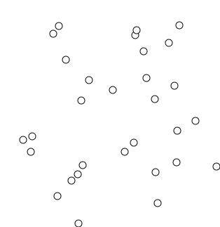
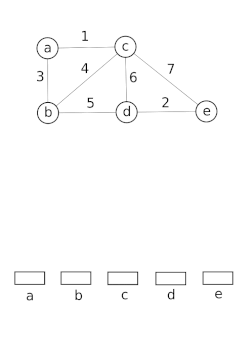
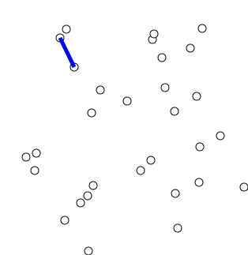

<!-- _paginate: false -->
<!-- _class: title  -->
# Minimalno razapinjuće stablo (MST)

Programiranje za rješavanje složenih problema

---

# Problem minimalnog razapinjućeg stabla (MST) (1/2)


**Prikaz razlike između grafa i MST-a**

Izvor: [Discrete Mathematics - Spanning Trees](https://www.tutorialspoint.com/discrete_mathematics/discrete_mathematics_spanning_trees.htm)

---

# Problem minimalnog razapinjućeg stabla (MST) (2/2)

**Motivacija:** povezivanje $n$ gradova uz **minimalan ukupan trošak**.

**Definicija:**

- **Ulaz:** neusmjeren, težinski graf.
- **Razapinjuće stablo:** podgraf koji povezuje sve čvorove i nema ciklusa.
- **MST:** razapinjuće stablo čiji je zbroj težina bridova najmanji moguć.

**Algoritmi koje radimo:**

1. **Kruskalov:** dodajemo najlakši brid koji ne stvara ciklus.
2. **Primov:** širimo stablo od početnog čvora prema najbližim susjedima.

---

# Preporučena literatura

- **Competitive Programmer's Handbook (CPH):**
  - Poglavlje 15: *Spanning trees*
- **CLRS (Introduction to Algorithms):**
  - Poglavlje 23: *Minimum Spanning Trees*
  - Poglavlje 21: *Data Structures for Disjoint Sets*

---

<!-- _class: lead -->

# Minimalno razapinjuće stablo (MST) (1/4)

## Kruskalov algoritam

**Pohlepna strategija:**
> "Na svakom koraku dodajemo najlakši brid u grafu koji ne stvara ciklus."

**Postupak:**

1. Sortiramo sve bridove po težini (uzlazno).
2. Iteriramo kroz bridove $(u, v)$:
   - Ako su $u$ i $v$ već u istoj komponenti: preskačemo (stvorio bi se ciklus).
   - Inače: dodajemo brid u MST i spajamo komponente.
3. Ponavljamo dok ne spojimo sve čvorove.

---

# Minimalno razapinjuće stablo (MST) (2/4)

**Kruskalov algoritam**


**Vizualizacija Kruskalova algoritma**
Izvor: [Kruskal's algorithm](https://en.wikipedia.org/wiki/Kruskal%27s_algorithm)

---

# Minimalno razapinjuće stablo (MST) (3/4)

**Izazov implementacije: detekcija ciklusa**

Lako je reći "ako ne stvara ciklus", ali kako to efikasno provjeriti u kodu?

**Opcija A: BFS/DFS pretraga**

- Prije dodavanja brida $(u, v)$ pokrenemo BFS da vidimo postoji li već put od $u$ do $v$.
- **Problem:** presporo! Za svaki brid moramo prolaziti graf. Složenost bi bila $O(M \cdot N)$.

**Opcija B: praćenje skupova (DSU)**

- Pamtimo "skupove" povezanih čvorova.
- Ako su $u$ i $v$ u istom skupu $\rightarrow$ imamo ciklus.
- Ovo je praktički **trenutna** provjera. Zato koristimo **Union-Find**.

---

# Minimalno razapinjuće stablo (MST) (4/4)

**Rješenje: Union-Find (DSU) struktura**

Da bi Kruskal bio brz, koristimo strukturu koja podržava dvije operacije:

1. **`Find` (pronađi):** Tko je "šef" komponente kojoj čvor pripada?
   - *Služi za provjeru:* `find(u) == find(v)` znači da su već povezani.
2. **`Union` (unija):** Spajanje dviju komponenata u jednu.
   - *Služi za gradnju:* kad dodamo brid, spajamo skupove.

---

# Union-Find: intuicija (1/2)

**Vizualizacija spajanja**


Izvor: [Disjoint-set data structure](https://en.wikipedia.org/wiki/Disjoint-set_data_structure)

---

# Union-Find: intuicija (2/2)

**"Tko je ovdje šef?"**

Zamislite da je na početku svaki grad (čvor) zasebna "ekipa" i sam je svoj šef.

- Kada spajamo dva grada, jedan šef postaje podređen drugome.
- Svi gradovi u jednoj komponenti imaju **istog glavnog šefa** (predstavnika).

**Optimizacije koje strukturu čine brzom ($O(\alpha(n))$):**

1. **Path compression:** svi zaposlenici direktno pamte glavnog šefa.
2. **Union by size:** manja ekipa se uvijek pripaja većoj.

---

# Implementacija Kruskalovog algoritma

```cpp
struct Edge { int u, v, weight; };
bool usporediBridove(const Edge& a, const Edge& b) { return a.weight < b.weight; }

// ... DSU funkcije find_set i unite_sets ...

sort(edges.begin(), edges.end(), usporediBridove);

long long total_weight = 0;
for (Edge e : edges) {
    if (find_set(e.u) != find_set(e.v)) { // Ako nisu u istoj komponenti
        total_weight += e.weight;
        unite_sets(e.u, e.v);             // Spajamo ih
    }
}
```

**Složenost:** $O(m \log m)$ (zbog sortiranja).

---

# Kruskal korak po korak

Bridove uzimamo od najlakšeg. Boja čvora je njegova komponenta, a `parent` je DSU niz (plavo: čvor nije korijen).

<style scoped>
.mst-kruskal { margin-top: 0.3em; }
.mst-kruskal .chips { font-size: 20px; margin-bottom: 0.4em; }
.mst-kruskal .chip { display: inline-block; min-width: 32px; text-align: center; padding: 2px 10px; margin: 0 0 6px 6px; border: 2px solid #141414; border-radius: 16px; font-weight: bold; font-size: 18px; }
.mst-kruskal .chip.take { background: #9fdc9f; }
.mst-kruskal .chip.skip, .mst-kruskal .chip.stale { color: #b5b5b5; border-color: #ccc; text-decoration: line-through; }
.mst-kruskal .chip.on { background: var(--main); border-color: var(--main); color: #fff; }
.mst-kruskal .muted { color: #6e6e6e; font-style: italic; margin-left: 6px; }
.mst-kruskal .row { display: flex; gap: 6px; }
.mst-kruskal .cell { width: 62px; text-align: center; border: 2px solid #141414; border-radius: 6px; transition: background-color .25s, color .25s; }
.mst-kruskal .idx { font-size: 15px; color: #6e6e6e; border-bottom: 1px solid #ccc; }
.mst-kruskal .val { font-size: 24px; height: 38px; line-height: 38px; font-weight: bold; }
.mst-kruskal .cell.todo .val { color: #b5b5b5; }
.mst-kruskal .cell.rng { background: #d6e6f5; }
.mst-kruskal .cell.best { background: #9fdc9f; }
.mst-kruskal .cell.src { background: #f5db7e; }
.mst-kruskal .cell.cur { background: var(--main); color: #fff; }
.mst-kruskal .cell.cur .idx, .mst-kruskal .cell.cur .val { color: #fff; }
.mst-kruskal .lbl { font-size: 18px; font-weight: bold; color: #6e6e6e; margin: 0.4em 0 0.2em; }
.mst-kruskal .wrap { display: flex; gap: 28px; align-items: flex-start; }
.mst-kruskal .side { padding-top: 6px; }
.mst-kruskal .gsvg { display: block; overflow: visible; }
.mst-kruskal .e line { stroke: #9a9a9a; stroke-width: 3; transition: stroke .25s; }
.mst-kruskal .e polygon { fill: #9a9a9a; }
.mst-kruskal .e .w { font-size: 19px; font-weight: bold; fill: #141414; text-anchor: middle; dominant-baseline: central; paint-order: stroke; stroke: #fff; stroke-width: 6px; }
.mst-kruskal .e.tree line { stroke: #2f9e44; stroke-width: 6; }
.mst-kruskal .e.tree polygon { fill: #2f9e44; }
.mst-kruskal .e.off line { stroke: #d5d5d5; stroke-dasharray: 6 6; }
.mst-kruskal .e.off polygon { fill: #d5d5d5; }
.mst-kruskal .e.off .w { fill: #b5b5b5; }
.mst-kruskal .e.hid { opacity: 0; }
.mst-kruskal .e.bad line { stroke: #e03131; stroke-width: 6; }
.mst-kruskal .e.bad polygon { fill: #e03131; }
.mst-kruskal .e.on line { stroke: var(--main); stroke-width: 6; }
.mst-kruskal .e.on polygon { fill: var(--main); }
.mst-kruskal .n circle { fill: #fff; stroke: #141414; stroke-width: 2.5; transition: fill .25s; }
.mst-kruskal .n .id { font-size: 21px; font-weight: bold; text-anchor: middle; dominant-baseline: central; fill: #141414; }
.mst-kruskal .n .sub { font-size: 19px; font-weight: bold; text-anchor: middle; dominant-baseline: central; fill: var(--main); paint-order: stroke; stroke: #fff; stroke-width: 6px; }
.mst-kruskal .n.c1 circle { fill: #ffd8a8; } .mst-kruskal .n.c2 circle { fill: #a5d8ff; } .mst-kruskal .n.c3 circle { fill: #b2f2bb; }
.mst-kruskal .n.c4 circle { fill: #fcc2d7; } .mst-kruskal .n.c5 circle { fill: #d0bfff; } .mst-kruskal .n.c6 circle { fill: #ffec99; }
.mst-kruskal .n.done circle { fill: #9fdc9f; }
.mst-kruskal .n.src circle { fill: #f5db7e; }
.mst-kruskal .n.cur circle { fill: var(--main); stroke: var(--main); }
.mst-kruskal .n.cur .id { fill: #fff; }
.mst-kruskal .tbl { display: grid; gap: 5px; }
.mst-kruskal .th { height: 40px; line-height: 40px; text-align: center; font-size: 20px; font-weight: bold; color: #6e6e6e; border-radius: 6px; }
.mst-kruskal .th.hl { background: var(--main); color: #fff; }
.mst-kruskal .tc { height: 40px; line-height: 36px; text-align: center; font-size: 22px; font-weight: bold; border: 2px solid #141414; border-radius: 6px; transition: background-color .25s, color .25s; }
.mst-kruskal .tc.none { border-color: transparent; }
.mst-kruskal .tc.k { background: #e3ecf6; }
.mst-kruskal .tc.best { background: #9fdc9f; }
.mst-kruskal .tc.src { background: #f5db7e; }
.mst-kruskal .tc.cur { background: var(--main); color: #fff; }
.mst-kruskal .line1, .mst-kruskal .line2 { font-family: monospace; font-size: 21px; min-height: 1.35em; }
.mst-kruskal .line1 { margin-top: 0.5em; }
.mst-kruskal .line2 { font-weight: bold; }
.mst-kruskal .ctrl { margin-top: 0.5em; }
.mst-kruskal button { font: inherit; font-size: 18px; padding: 4px 14px; margin-right: 8px; border: 2px solid var(--main); border-radius: 6px; background: #fff; color: var(--main); cursor: pointer; }
.mst-kruskal button:hover { background: var(--main); color: #fff; }
.mst-kruskal .hint { font-size: 16px; color: #6e6e6e; }
.mst-kruskal .side { max-width: 470px; }
.mst-kruskal .pq { margin-top: 0.8em; }
</style>

<div class="mst-kruskal" data-pos="50,150 210,45 210,255 390,45 390,255 550,150" data-edges="1-2:3,1-3:5,2-3:4,2-4:7,3-5:6,4-5:2,4-6:5,5-6:9,2-5:8">
  <div class="wrap">
    <div class="graph"></div>
    <div class="side">
      <div class="lbl">parent</div>
      <div class="row"></div>
      <div class="pq chips"></div>
    </div>
  </div>
  <div class="line1"></div>
  <div class="line2"></div>
  <div class="ctrl">
    <button data-act="prev">← Korak</button><button data-act="next">Korak →</button><button data-act="auto">Auto</button><button data-act="reset">Reset</button>
    <span class="hint">← / → koračaju kroz animaciju, Shift + ← / → mijenja slajd</span>
  </div>
</div>

<script>
(function () {
  // Ovaj blok namjerno ne sadrži znakove manje-od, veće-od ni ampersand,
  // jer ih build pretvara u HTML entitete i ruši skriptu.
  document.querySelectorAll('.mst-kruskal').forEach(function (root) {
    var slide = root.closest('svg');
    var line1 = root.querySelector('.line1');
    var line2 = root.querySelector('.line2');
    var NS = 'http://www.w3.org/2000/svg';
    function mk(tag, cls, text) {
      var e = document.createElement(tag);
      if (cls) e.className = cls;
      if (text !== undefined) e.textContent = text;
      return e;
    }
    function sv(tag, attrs, parent) {
      var e = document.createElementNS(NS, tag);
      Object.keys(attrs).forEach(function (k) { e.setAttribute(k, attrs[k]); });
      if (parent) parent.appendChild(e);
      return e;
    }
    function setc(el, cls) { el.setAttribute('class', cls); }
    function show(v) { return v === Infinity ? '∞' : (v === -Infinity ? '−∞' : String(v)); }
    function lt(a, b) { return a !== b ? Math.min(a, b) === a : false; }
    function le(a, b) { return Math.min(a, b) === a; }
    function fw(w) { return lt(w, 0) ? '(' + w + ')' : String(w); }
    function makeRow(box, count, base) {
      var cells = [], vals = [];
      for (var k = 0; k !== count; k++) {
        var cell = mk('div', 'cell');
        cell.appendChild(mk('div', 'idx', k + (base || 0)));
        var v = mk('div', 'val');
        cell.appendChild(v);
        box.appendChild(cell);
        cells.push(cell);
        vals.push(v);
      }
      return { cells: cells, vals: vals };
    }
    function parsePos(s) {
      return s.trim().split(/\s+/).map(function (p) {
        var q = p.split(',').map(Number);
        return { x: q[0], y: q[1] };
      });
    }
    function parseEdges(s) {
      return s.split(',').map(function (t) {
        var q = t.trim().split(':'), ab = q[0].split('-');
        return { a: Number(ab[0]), b: Number(ab[1]), w: q.length === 2 ? Number(q[1]) : 0 };
      });
    }
    // Crta graf u SVG-u: čvorovi su numerirani od 1, bridovi su {a, b, w}
    function drawGraph(box, pos, edges, opt) {
      var R = opt.r || 22;
      var svg = sv('svg', { viewBox: '0 0 ' + opt.w + ' ' + opt.h, width: opt.w, height: opt.h, 'class': 'gsvg' }, box);
      var gE = sv('g', {}, svg), gN = sv('g', {}, svg);
      var E = edges.map(function (e) {
        var A = pos[e.a - 1], B = pos[e.b - 1];
        var dx = B.x - A.x, dy = B.y - A.y, L = Math.sqrt(dx * dx + dy * dy);
        var ux = dx / L, uy = dy / L;
        var x1 = A.x + ux * R, y1 = A.y + uy * R, x2 = B.x - ux * R, y2 = B.y - uy * R;
        var g = sv('g', { 'class': 'e' }, gE);
        sv('line', { x1: x1, y1: y1, x2: x2, y2: y2 }, g);
        if (opt.directed) {
          var bx = x2 - ux * 15, by = y2 - uy * 15;
          sv('polygon', { points: x2 + ',' + y2 + ' ' + (bx - uy * 7) + ',' + (by + ux * 7) + ' ' + (bx + uy * 7) + ',' + (by - ux * 7) }, g);
        }
        if (opt.weights) {
          var t = sv('text', { x: (A.x + B.x) / 2 - uy * 15, y: (A.y + B.y) / 2 + ux * 15, 'class': 'w' }, g);
          t.textContent = e.w;
        }
        return { g: g };
      });
      var N = pos.map(function (p, i) {
        var g = sv('g', { 'class': 'n' }, gN);
        sv('circle', { cx: p.x, cy: p.y, r: R }, g);
        var t = sv('text', { x: p.x, y: p.y, 'class': 'id' }, g);
        t.textContent = i + 1;
        var sub = sv('text', { x: p.x + (opt.subdx || 0), y: p.y + (opt.subdy === undefined ? -R - 13 : opt.subdy), 'class': 'sub' }, g);
        return { g: g, sub: sub };
      });
      return { E: E, N: N, svg: svg };
    }

    function comp(v, rootOf) { return ' c' + (((rootOf - 1) % 6) + 1); }

    var pos = parsePos(root.dataset.pos);
    var edges = parseEdges(root.dataset.edges);
    var n = pos.length;
    var G = drawGraph(root.querySelector('.graph'), pos, edges, { w: 600, h: 300, directed: false, weights: true });
    var R = makeRow(root.querySelector('.row'), n, 1);
    var box = root.querySelector('.pq');
    var parent = [], sz = [];
    for (var i = 0; i !== n + 1; i++) { parent.push(i); sz.push(1); }
    function find(v) { if (v === parent[v]) return v; parent[v] = find(parent[v]); return parent[v]; }
    function roots() { var r = [0]; for (var v = 1; v !== n + 1; v++) r.push(find(v)); return r; }
    var order = edges.map(function (e, k) { return k; });
    order.sort(function (x, y) { return edges[x].w - edges[y].w || x - y; });
    var state = edges.map(function () { return ''; });
    var total = 0, cnt = 0;
    function snap(extra) {
      var s = { par: parent.slice(), roots: roots(), state: state.slice(), sorted: false, cur: -1, a: -1, b: -1, l1: '', l2: '' };
      Object.keys(extra).forEach(function (k) { s[k] = extra[k]; });
      return s;
    }
    var snaps = [snap({ l1: 'Na početku je svaki čvor sam svoja komponenta (sam svoj šef)', l2: 'Boja čvora označava komponentu' })];
    snaps.push(snap({ sorted: true, l1: 'Sortiramo bridove po težini (uzlazno)', l2: 'MST: 0 od ' + (n - 1) + ' bridova, težina 0' }));
    order.forEach(function (k) {
      var e = edges[k], ra = find(e.a), rb = find(e.b), l1;
      if (ra === rb) {
        state[k] = 'skip';
        l1 = 'Brid ' + e.a + '–' + e.b + ' (' + e.w + '):  find(' + e.a + ') = find(' + e.b + ') = ' + ra + '  → ciklus, preskačemo';
      } else {
        if (lt(sz[ra], sz[rb])) { var t = ra; ra = rb; rb = t; }
        parent[rb] = ra; sz[ra] += sz[rb];
        state[k] = 'take'; total += e.w; cnt++;
        l1 = 'Brid ' + e.a + '–' + e.b + ' (' + e.w + '):  find(' + e.a + ') i find(' + e.b + ') su različiti  → uzimamo brid, spajamo komponente';
      }
      snaps.push(snap({ sorted: true, cur: k, a: e.a, b: e.b, l1: l1,
        l2: 'MST: ' + cnt + ' od ' + (n - 1) + ' bridova, težina ' + total + (cnt === n - 1 ? '   ✓' : '') }));
    });
    snaps.push(snap({ sorted: true, l1: 'Svi bridovi su obrađeni. Zeleni bridovi čine minimalno razapinjuće stablo.',
      l2: 'Ukupna težina MST-a = ' + total + '   ✓' }));
    var chips = order.map(function (k) { var e = edges[k]; return mk('span', 'chip', e.a + '–' + e.b + ' (' + e.w + ')'); });
    function draw(s) {
      G.N.forEach(function (nd, x) {
        var v = x + 1, c = 'n' + comp(v, s.roots[v]);
        if (v === s.a ? true : v === s.b) c += ' src';
        setc(nd.g, c);
        nd.sub.textContent = '';
      });
      G.E.forEach(function (e, k) {
        var c = 'e';
        if (s.state[k] === 'take') c += ' tree';
        if (s.state[k] === 'skip') c += ' off';
        if (k === s.cur) c += ' on';
        setc(e.g, c);
      });
      R.cells.forEach(function (cell, k) {
        setc(cell, s.par[k + 1] === k + 1 ? 'cell' : 'cell rng');
        R.vals[k].textContent = s.par[k + 1];
      });
      box.textContent = s.sorted ? 'Sortirani bridovi:' : 'Bridovi:';
      (s.sorted ? order : edges.map(function (e, k) { return k; })).forEach(function (k) {
        var ch = chips[order.indexOf(k)];
        var c = 'chip';
        if (s.state[k]) c += ' ' + s.state[k];
        if (k === s.cur) c += ' on';
        setc(ch, c);
        box.appendChild(ch);
      });
    }

    var step = 0, timer = null, lastStep = snaps.length - 1;
    function render() {
      var s = snaps[step];
      draw(s);
      line1.textContent = s.l1;
      line2.textContent = s.l2;
    }
    function stopAuto() { clearInterval(timer); timer = null; }
    function next() { if (step !== lastStep) { step++; render(); return true; } stopAuto(); return false; }
    function prev() { if (step !== 0) { step--; render(); return true; } return false; }
    function reset() { stopAuto(); step = 0; render(); }
    var actions = {
      next: next, prev: prev, reset: reset,
      auto: function () { if (timer) stopAuto(); else timer = setInterval(next, 900); }
    };

    root.querySelectorAll('button').forEach(function (b) {
      b.addEventListener('click', function (e) {
        e.stopPropagation(); b.blur(); actions[b.dataset.act]();
      });
    });

    // Strelice / razmaknica / klikač prvo koračaju kroz animaciju, a tek na kraju mijenjaju slajd
    window.addEventListener('keydown', function (e) {
      if (e.shiftKey || !slide || !slide.classList.contains('bespoke-marp-active')) return;
      var fwd = ['ArrowRight', 'ArrowDown', 'PageDown', ' '].indexOf(e.key) !== -1;
      var back = ['ArrowLeft', 'ArrowUp', 'PageUp'].indexOf(e.key) !== -1;
      var moved = false;
      if (fwd) moved = next();
      if (back) moved = prev();
      if (moved) {
        e.preventDefault();
        e.stopImmediatePropagation();
      }
    }, true);

    render();
  });
})();
</script>

---

# Primov algoritam (1/2)

**Pohlepna strategija:**
> "Gradimo stablo počevši od jednog čvora, šireći se na najbliže susjede."

**Sličnost s Dijkstrom:**

- Koristi **priority queue**.
- Razlika: kod Dijkstre je ključ *ukupna udaljenost od starta*, a kod Prima *težina brida* kojim se spajamo na postojeće stablo.

**Algoritam:**

1. Proizvoljni čvor stavimo u PQ s cijenom 0.
2. Dok PQ nije prazan: uzmemo najjeftiniji čvor $u$.
3. Ako $u$ nije posjećen: označimo ga, dodamo cijenu u sumu i dodamo sve njegove susjede u PQ.

---

# Primov algoritam (2/2)


**Vizualizacija Primovog algoritma**
Izvor: [Prim's algorithm](https://en.wikipedia.org/wiki/Prim%27s_algorithm)

---

# Implementacija: Primov algoritam

```cpp
priority_queue<pair<long long, int>> q; // {-težina, čvor}
vector<bool> visited(n + 1, false);

q.push({0, 1}); // Počinjemo od čvora 1
long long total_weight = 0;

while (!q.empty()) {
    long long w = -q.top().first; // Vraćamo iz minusa u plus
    int u = q.top().second;
    q.pop();

    if (visited[u]) continue;
    visited[u] = true;
    total_weight += w;

    for (auto [v, cost] : adj[u]) {   // adj[u] sadrži parove {susjed, težina}
        if (!visited[v]) {
            q.push({-cost, v});       // Težinu dodajemo kao negativnu vrijednost
        }
    }
}
```

**Složenost:** $O(M \log N)$, kao i Dijkstra.

---

# Prim korak po korak

Stablo raste iz čvora 1. Iz reda vadimo najlakši brid prema čvoru koji još nije u stablu.

<style scoped>
.mst-prim { margin-top: 0.3em; }
.mst-prim .chips { font-size: 20px; margin-bottom: 0.4em; }
.mst-prim .chip { display: inline-block; min-width: 32px; text-align: center; padding: 2px 10px; margin: 0 0 6px 6px; border: 2px solid #141414; border-radius: 16px; font-weight: bold; font-size: 18px; }
.mst-prim .chip.take { background: #9fdc9f; }
.mst-prim .chip.skip, .mst-prim .chip.stale { color: #b5b5b5; border-color: #ccc; text-decoration: line-through; }
.mst-prim .chip.on { background: var(--main); border-color: var(--main); color: #fff; }
.mst-prim .muted { color: #6e6e6e; font-style: italic; margin-left: 6px; }
.mst-prim .row { display: flex; gap: 6px; }
.mst-prim .cell { width: 62px; text-align: center; border: 2px solid #141414; border-radius: 6px; transition: background-color .25s, color .25s; }
.mst-prim .idx { font-size: 15px; color: #6e6e6e; border-bottom: 1px solid #ccc; }
.mst-prim .val { font-size: 24px; height: 38px; line-height: 38px; font-weight: bold; }
.mst-prim .cell.todo .val { color: #b5b5b5; }
.mst-prim .cell.rng { background: #d6e6f5; }
.mst-prim .cell.best { background: #9fdc9f; }
.mst-prim .cell.src { background: #f5db7e; }
.mst-prim .cell.cur { background: var(--main); color: #fff; }
.mst-prim .cell.cur .idx, .mst-prim .cell.cur .val { color: #fff; }
.mst-prim .lbl { font-size: 18px; font-weight: bold; color: #6e6e6e; margin: 0.4em 0 0.2em; }
.mst-prim .wrap { display: flex; gap: 28px; align-items: flex-start; }
.mst-prim .side { padding-top: 6px; }
.mst-prim .gsvg { display: block; overflow: visible; }
.mst-prim .e line { stroke: #9a9a9a; stroke-width: 3; transition: stroke .25s; }
.mst-prim .e polygon { fill: #9a9a9a; }
.mst-prim .e .w { font-size: 19px; font-weight: bold; fill: #141414; text-anchor: middle; dominant-baseline: central; paint-order: stroke; stroke: #fff; stroke-width: 6px; }
.mst-prim .e.tree line { stroke: #2f9e44; stroke-width: 6; }
.mst-prim .e.tree polygon { fill: #2f9e44; }
.mst-prim .e.off line { stroke: #d5d5d5; stroke-dasharray: 6 6; }
.mst-prim .e.off polygon { fill: #d5d5d5; }
.mst-prim .e.off .w { fill: #b5b5b5; }
.mst-prim .e.hid { opacity: 0; }
.mst-prim .e.bad line { stroke: #e03131; stroke-width: 6; }
.mst-prim .e.bad polygon { fill: #e03131; }
.mst-prim .e.on line { stroke: var(--main); stroke-width: 6; }
.mst-prim .e.on polygon { fill: var(--main); }
.mst-prim .n circle { fill: #fff; stroke: #141414; stroke-width: 2.5; transition: fill .25s; }
.mst-prim .n .id { font-size: 21px; font-weight: bold; text-anchor: middle; dominant-baseline: central; fill: #141414; }
.mst-prim .n .sub { font-size: 19px; font-weight: bold; text-anchor: middle; dominant-baseline: central; fill: var(--main); paint-order: stroke; stroke: #fff; stroke-width: 6px; }
.mst-prim .n.c1 circle { fill: #ffd8a8; } .mst-prim .n.c2 circle { fill: #a5d8ff; } .mst-prim .n.c3 circle { fill: #b2f2bb; }
.mst-prim .n.c4 circle { fill: #fcc2d7; } .mst-prim .n.c5 circle { fill: #d0bfff; } .mst-prim .n.c6 circle { fill: #ffec99; }
.mst-prim .n.done circle { fill: #9fdc9f; }
.mst-prim .n.src circle { fill: #f5db7e; }
.mst-prim .n.cur circle { fill: var(--main); stroke: var(--main); }
.mst-prim .n.cur .id { fill: #fff; }
.mst-prim .tbl { display: grid; gap: 5px; }
.mst-prim .th { height: 40px; line-height: 40px; text-align: center; font-size: 20px; font-weight: bold; color: #6e6e6e; border-radius: 6px; }
.mst-prim .th.hl { background: var(--main); color: #fff; }
.mst-prim .tc { height: 40px; line-height: 36px; text-align: center; font-size: 22px; font-weight: bold; border: 2px solid #141414; border-radius: 6px; transition: background-color .25s, color .25s; }
.mst-prim .tc.none { border-color: transparent; }
.mst-prim .tc.k { background: #e3ecf6; }
.mst-prim .tc.best { background: #9fdc9f; }
.mst-prim .tc.src { background: #f5db7e; }
.mst-prim .tc.cur { background: var(--main); color: #fff; }
.mst-prim .line1, .mst-prim .line2 { font-family: monospace; font-size: 21px; min-height: 1.35em; }
.mst-prim .line1 { margin-top: 0.5em; }
.mst-prim .line2 { font-weight: bold; }
.mst-prim .ctrl { margin-top: 0.5em; }
.mst-prim button { font: inherit; font-size: 18px; padding: 4px 14px; margin-right: 8px; border: 2px solid var(--main); border-radius: 6px; background: #fff; color: var(--main); cursor: pointer; }
.mst-prim button:hover { background: var(--main); color: #fff; }
.mst-prim .hint { font-size: 16px; color: #6e6e6e; }
.mst-prim .side { max-width: 470px; padding-top: 20px; }
.mst-prim .e.cand line { stroke: #e8b923; stroke-width: 5; }
</style>

<div class="mst-prim" data-pos="50,150 210,45 210,255 390,45 390,255 550,150" data-edges="1-2:3,1-3:5,2-3:4,2-4:7,3-5:6,4-5:2,4-6:5,5-6:9,2-5:8">
  <div class="wrap">
    <div class="graph"></div>
    <div class="side">
      <div class="pq chips"></div>
    </div>
  </div>
  <div class="line1"></div>
  <div class="line2"></div>
  <div class="ctrl">
    <button data-act="prev">← Korak</button><button data-act="next">Korak →</button><button data-act="auto">Auto</button><button data-act="reset">Reset</button>
    <span class="hint">← / → koračaju kroz animaciju, Shift + ← / → mijenja slajd</span>
  </div>
</div>

<script>
(function () {
  // Ovaj blok namjerno ne sadrži znakove manje-od, veće-od ni ampersand,
  // jer ih build pretvara u HTML entitete i ruši skriptu.
  document.querySelectorAll('.mst-prim').forEach(function (root) {
    var slide = root.closest('svg');
    var line1 = root.querySelector('.line1');
    var line2 = root.querySelector('.line2');
    var NS = 'http://www.w3.org/2000/svg';
    function mk(tag, cls, text) {
      var e = document.createElement(tag);
      if (cls) e.className = cls;
      if (text !== undefined) e.textContent = text;
      return e;
    }
    function sv(tag, attrs, parent) {
      var e = document.createElementNS(NS, tag);
      Object.keys(attrs).forEach(function (k) { e.setAttribute(k, attrs[k]); });
      if (parent) parent.appendChild(e);
      return e;
    }
    function setc(el, cls) { el.setAttribute('class', cls); }
    function show(v) { return v === Infinity ? '∞' : (v === -Infinity ? '−∞' : String(v)); }
    function lt(a, b) { return a !== b ? Math.min(a, b) === a : false; }
    function le(a, b) { return Math.min(a, b) === a; }
    function fw(w) { return lt(w, 0) ? '(' + w + ')' : String(w); }
    function makeRow(box, count, base) {
      var cells = [], vals = [];
      for (var k = 0; k !== count; k++) {
        var cell = mk('div', 'cell');
        cell.appendChild(mk('div', 'idx', k + (base || 0)));
        var v = mk('div', 'val');
        cell.appendChild(v);
        box.appendChild(cell);
        cells.push(cell);
        vals.push(v);
      }
      return { cells: cells, vals: vals };
    }
    function parsePos(s) {
      return s.trim().split(/\s+/).map(function (p) {
        var q = p.split(',').map(Number);
        return { x: q[0], y: q[1] };
      });
    }
    function parseEdges(s) {
      return s.split(',').map(function (t) {
        var q = t.trim().split(':'), ab = q[0].split('-');
        return { a: Number(ab[0]), b: Number(ab[1]), w: q.length === 2 ? Number(q[1]) : 0 };
      });
    }
    // Crta graf u SVG-u: čvorovi su numerirani od 1, bridovi su {a, b, w}
    function drawGraph(box, pos, edges, opt) {
      var R = opt.r || 22;
      var svg = sv('svg', { viewBox: '0 0 ' + opt.w + ' ' + opt.h, width: opt.w, height: opt.h, 'class': 'gsvg' }, box);
      var gE = sv('g', {}, svg), gN = sv('g', {}, svg);
      var E = edges.map(function (e) {
        var A = pos[e.a - 1], B = pos[e.b - 1];
        var dx = B.x - A.x, dy = B.y - A.y, L = Math.sqrt(dx * dx + dy * dy);
        var ux = dx / L, uy = dy / L;
        var x1 = A.x + ux * R, y1 = A.y + uy * R, x2 = B.x - ux * R, y2 = B.y - uy * R;
        var g = sv('g', { 'class': 'e' }, gE);
        sv('line', { x1: x1, y1: y1, x2: x2, y2: y2 }, g);
        if (opt.directed) {
          var bx = x2 - ux * 15, by = y2 - uy * 15;
          sv('polygon', { points: x2 + ',' + y2 + ' ' + (bx - uy * 7) + ',' + (by + ux * 7) + ' ' + (bx + uy * 7) + ',' + (by - ux * 7) }, g);
        }
        if (opt.weights) {
          var t = sv('text', { x: (A.x + B.x) / 2 - uy * 15, y: (A.y + B.y) / 2 + ux * 15, 'class': 'w' }, g);
          t.textContent = e.w;
        }
        return { g: g };
      });
      var N = pos.map(function (p, i) {
        var g = sv('g', { 'class': 'n' }, gN);
        sv('circle', { cx: p.x, cy: p.y, r: R }, g);
        var t = sv('text', { x: p.x, y: p.y, 'class': 'id' }, g);
        t.textContent = i + 1;
        var sub = sv('text', { x: p.x + (opt.subdx || 0), y: p.y + (opt.subdy === undefined ? -R - 13 : opt.subdy), 'class': 'sub' }, g);
        return { g: g, sub: sub };
      });
      return { E: E, N: N, svg: svg };
    }

    var pos = parsePos(root.dataset.pos);
    var edges = parseEdges(root.dataset.edges);
    var n = pos.length;
    var G = drawGraph(root.querySelector('.graph'), pos, edges, { w: 600, h: 300, directed: false, weights: true });
    var pqBox = root.querySelector('.pq');
    var adj = [], vis = [];
    for (var i = 0; i !== n + 1; i++) { adj.push([]); vis.push(false); }
    edges.forEach(function (e, k) { adj[e.a].push([e.b, k]); adj[e.b].push([e.a, k]); });
    var pq = [{ w: 0, v: 1, e: -1 }], tree = [], total = 0;
    function byKey(a, b) { return a.w - b.w || a.v - b.v; }
    function snap(extra) {
      var s = { vis: vis.slice(), tree: tree.slice(), cur: -1, edge: -1, pushed: [], l1: '', l2: '',
        pq: pq.slice().sort(byKey).map(function (p) { return { w: p.w, v: p.v, stale: vis[p.v] }; }) };
      Object.keys(extra).forEach(function (k) { s[k] = extra[k]; });
      return s;
    }
    var snaps = [snap({ l1: 'Počinjemo od čvora 1: u red stavljamo (0, 1)', l2: 'Ukupna težina = 0' })];
    while (pq.length) {
      pq.sort(byKey);
      var top = pq.shift(), u = top.v;
      if (vis[u]) {
        snaps.push(snap({ cur: u, edge: top.e, l1: 'Vadimo (' + top.w + ', ' + u + '): čvor ' + u + ' je već u stablu, preskačemo', l2: 'Ukupna težina = ' + total }));
        continue;
      }
      vis[u] = true; total += top.w;
      if (top.e !== -1) tree.push(top.e);
      snaps.push(snap({ cur: u, edge: top.e,
        l1: 'Vadimo (' + top.w + ', ' + u + '): najjeftiniji brid prema novom čvoru, dodajemo ' + u + ' u stablo',
        l2: 'Ukupna težina = ' + total }));
      var pushed = [];
      adj[u].forEach(function (p) {
        if (!vis[p[0]]) { pq.push({ w: edges[p[1]].w, v: p[0], e: p[1] }); pushed.push(p[1]); }
      });
      if (pushed.length) {
        snaps.push(snap({ cur: u, pushed: pushed,
          l1: 'Susjede izvan stabla dodajemo u red: ' + pushed.map(function (k) {
            var e = edges[k]; return '(' + e.w + ', ' + (e.a === u ? e.b : e.a) + ')'; }).join(', '),
          l2: 'Ukupna težina = ' + total }));
      }
    }
    snaps.push(snap({ l1: 'Red je prazan, svi čvorovi su u stablu.', l2: 'Ukupna težina MST-a = ' + total + '   ✓' }));
    function draw(s) {
      G.N.forEach(function (nd, x) {
        var v = x + 1, c = 'n';
        if (s.vis[v]) c += ' done';
        if (v === s.cur) c += ' cur';
        setc(nd.g, c);
        nd.sub.textContent = '';
      });
      G.E.forEach(function (e, k) {
        var c = 'e';
        if (s.tree.indexOf(k) !== -1) c += ' tree';
        if (s.pushed.indexOf(k) !== -1) c += ' cand';
        if (k === s.edge) c += ' on';
        setc(e.g, c);
      });
      pqBox.textContent = 'Red (težina, čvor):';
      if (s.pq.length === 0) pqBox.appendChild(mk('span', 'muted', 'prazan'));
      s.pq.forEach(function (p) { pqBox.appendChild(mk('span', p.stale ? 'chip stale' : 'chip', '(' + p.w + ', ' + p.v + ')')); });
    }

    var step = 0, timer = null, lastStep = snaps.length - 1;
    function render() {
      var s = snaps[step];
      draw(s);
      line1.textContent = s.l1;
      line2.textContent = s.l2;
    }
    function stopAuto() { clearInterval(timer); timer = null; }
    function next() { if (step !== lastStep) { step++; render(); return true; } stopAuto(); return false; }
    function prev() { if (step !== 0) { step--; render(); return true; } return false; }
    function reset() { stopAuto(); step = 0; render(); }
    var actions = {
      next: next, prev: prev, reset: reset,
      auto: function () { if (timer) stopAuto(); else timer = setInterval(next, 900); }
    };

    root.querySelectorAll('button').forEach(function (b) {
      b.addEventListener('click', function (e) {
        e.stopPropagation(); b.blur(); actions[b.dataset.act]();
      });
    });

    // Strelice / razmaknica / klikač prvo koračaju kroz animaciju, a tek na kraju mijenjaju slajd
    window.addEventListener('keydown', function (e) {
      if (e.shiftKey || !slide || !slide.classList.contains('bespoke-marp-active')) return;
      var fwd = ['ArrowRight', 'ArrowDown', 'PageDown', ' '].indexOf(e.key) !== -1;
      var back = ['ArrowLeft', 'ArrowUp', 'PageUp'].indexOf(e.key) !== -1;
      var moved = false;
      if (fwd) moved = next();
      if (back) moved = prev();
      if (moved) {
        e.preventDefault();
        e.stopImmediatePropagation();
      }
    }, true);

    render();
  });
})();
</script>

---

<!-- _class: lead -->

# Zadaci za vježbu

## CSES Problem Set

- **[Road Reparation](https://cses.fi/problemset/task/1675)**
  - Klasičan MST (Prim ili Kruskal).
- **[Road Construction](https://cses.fi/problemset/task/1676)**
  - Praćenje veličine komponenata (Union-Find).

---

<!-- _class: title -->

# Road Reparation (CSES)

## Analiza i rješenje problema

---

# Analiza zadatka: Road Reparation (1/2)

**Definiranje problema**

Imamo $n$ gradova i $m$ cesta, svaka ima cijenu popravka.
Cilj je odabrati skup cesta tako da su **svi gradovi povezani**, a ukupna cijena popravka **minimalna**.

**Intuicija**

1. Moramo povezati $n$ čvorova.
2. Najefikasniji način povezivanja $n$ čvorova bez suvišnih bridova je **stablo** ($n-1$ bridova).
3. Tražimo stablo s najmanjom sumom težina.

**Zaključak:** ovo je klasičan primjer **MST** problema.

---

# Analiza zadatka: Road Reparation (2/2)


**Odbacivanje brida**
Izvor: [Kruskal’s Algorithm: Key to Minimum Spanning Tree [MST]](https://www.simplilearn.com/tutorials/data-structure-tutorial/kruskal-algorithm)

---

# Strategija rješavanja: Kruskalov algoritam

Za ovaj problem Kruskalov algoritam je vrlo intuitivan:

1. **Sortiramo** sve ceste po cijeni (od najmanje do najveće).
2. **Pohlepni pristup:** uzimamo ceste redom.
3. Ako cesta povezuje dva grada koji **već jesu povezani** (direktno ili indirektno), odbacujemo je (stvara ciklus i nepotreban trošak).
4. Ako cesta povezuje dva nepovezana skupa gradova, **kupujemo je** i spajamo skupove.

**Struktura podataka**

Za efikasnu provjeru jesu li gradovi već povezani koristimo **Union-Find (DSU)**.

---

# Rubni slučajevi i zamke

**1. Nemoguće rješenje (ispis `IMPOSSIBLE`)**

Što ako je graf nepovezan (npr. otok do kojeg ne vodi nijedna cesta)?

- Ako nakon prolaska kroz sve ceste broj odabranih bridova nije $n-1$, rješenje ne postoji.
- Alternativno: provjerimo je li veličina glavne komponente u DSU-u jednaka $n$.

**2. Veliki brojevi**

- Cijena ceste $c$ može biti do $10^9$.
- Ukupna cijena može biti $10^5 \times 10^9 = 10^{14}$.
- Za sumu cijena koristite `long long`.

---

# Implementacija: strukture i usporediBridove

```cpp
#include <iostream>
#include <vector>
#include <algorithm>

using namespace std;

struct Edge {
    int u, v, weight;
};

bool usporediBridove(const Edge& a, const Edge& b) {
    return a.weight < b.weight;
}
```

---

# Union-Find (DSU)

```cpp
// Union-Find (DSU) struktura
vector<int> parent, sz;

int find_set(int v) {
    if (v == parent[v]) return v;
    return parent[v] = find_set(parent[v]); // Path compression
}

void unite_sets(int a, int b) {
    a = find_set(a);
    b = find_set(b);
    if (a != b) {
        if (sz[a] < sz[b]) swap(a, b);      // Union by size
        parent[b] = a;
        sz[a] += sz[b];
    }
}
```

---

# Implementacija: glavni dio (1/2)

```cpp
int main() {
    int n, m;
    cin >> n >> m;

    vector<Edge> edges(m);
    for (int i = 0; i < m; i++) {
        cin >> edges[i].u >> edges[i].v >> edges[i].weight;
    }

    // Sortiranje bridova
    sort(edges.begin(), edges.end(), usporediBridove);

    // Inicijalizacija DSU-a
    parent.resize(n + 1);  // Svaki čvor je sam svoj šef
    sz.resize(n + 1, 1);   // Veličina svake komponente je 1
    for (int i = 1; i <= n; i++) parent[i] = i;
```

---

# Implementacija: glavni dio (2/2)

```cpp
    long long total_cost = 0;
    int edges_count = 0;

    // Kruskalov algoritam
    for (const auto& edge : edges) {
        if (find_set(edge.u) != find_set(edge.v)) {
            unite_sets(edge.u, edge.v);
            total_cost += edge.weight;
            edges_count++;
        }
    }

    // MST mora imati točno n-1 bridova da bi povezao n čvorova
    // (za n = 1 to je 0 bridova, pa i taj slučaj prolazi)
    if (edges_count == n - 1) cout << total_cost << "\n";
    else cout << "IMPOSSIBLE\n";

    return 0;
}
```

---

# Sažetak rješenja (Road Reparation)

1. **Prepoznajte MST:** ključne riječi "connect all cities", "minimum cost".
2. **Kruskal:** sortiranje bridova + Union-Find.
3. **Pazite na tipove:** `long long` za cijenu.
4. **Pazite na nepovezanost:** provjerite jesu li spojeni svi čvorovi (broj bridova ili veličina komponente).

---

<!-- _class: title -->

# Road Construction (CSES)

## Praćenje komponenata u stvarnom vremenu

---

# Analiza zadatka: Road Construction

**Definiranje problema**

Imamo $n$ gradova i **nema cesta**. Svaki dan gradi se jedna nova cesta (ukupno $m$ dana).
Nakon gradnje **svake** ceste moramo ispisati:

1. **Broj komponenata:** koliko ima odvojenih grupa gradova?
2. **Veličinu najveće komponente:** koliko gradova ima u najvećoj povezanoj grupi?

**Zašto je ovo drugačije od prethodnog?**

U "Road Reparation" (MST) zanimalo nas je konačno stanje.
Ovdje nas zanima **stanje nakon svake promjene**. Ovo je problem **dinamičke povezanosti** (samo dodavanje bridova).

---

# Intuicija i praćenje stanja

Počinjemo s $N$ izoliranih gradova.

- **Broj komponenata:** $N$
- **Najveća komponenta:** 1 (svatko je sam)

Kada dodamo cestu između grada $A$ i grada $B$:

1. Provjerimo jesu li već povezani (`find(A) == find(B)`).
   - Ako **JESU**: ništa se ne mijenja. Broj komponenata i veličine ostaju isti.
2. Ako **NISU**:
   - Spajamo ih (`unite`). Dvije grupe postaju jedna.
   - **Broj komponenata:** smanjuje se za 1.
   - **Veličina:** nova veličina je zbroj veličina obaju korijena, `sz[find(A)] + sz[find(B)]`. Provjerimo je li to novi rekord.

---

# Prilagodba Union-Find (DSU) strukture

Niz `sz[]` već imamo zbog union by size: `sz[i]` pamti koliko čvorova ima u stablu čiji je korijen `i`.
(Zovemo ga `sz`, a ne `size`, jer se `size` sudara sa `std::size`.)

Dodajemo samo dva brojača:

1. **`num_components`:** inicijalno $N$. Smanjujemo ga kad god uspješno spojimo dva različita skupa.
2. **`max_component_size`:** inicijalno 1. Ažuriramo ga pri spajanju.

---

# Implementacija: varijable i inicijalizacija (1/2)

**Varijable**

```cpp
#include <iostream>
#include <vector>
#include <algorithm>

using namespace std;

// Globalne varijable za DSU i praćenje stanja
vector<int> parent, sz;
int num_components;
int max_component_size = 1;
```

---

# Implementacija: varijable i inicijalizacija (2/2)

**Inicijalizacija**

```cpp
void init_dsu(int n) {
    num_components = n;
    max_component_size = 1;
    parent.resize(n + 1);
    sz.resize(n + 1, 1); // Svaka komponenta je veličine 1
    for (int i = 1; i <= n; i++) parent[i] = i;
}

int find_set(int v) {
    if (v == parent[v]) return v;
    return parent[v] = find_set(parent[v]);
}
```

---

# Implementacija: logika spajanja (unite)

Ovo je glavni dio rješenja. Ovdje ažuriramo tražene vrijednosti.

```cpp
void unite_sets(int a, int b) {
    a = find_set(a);
    b = find_set(b);

    if (a != b) {
        // Union by size: manje stablo ide pod veće
        if (sz[a] < sz[b]) swap(a, b);

        parent[b] = a;  // Spajamo b pod a
        sz[a] += sz[b]; // Ažuriramo veličinu korijena a

        // Ažuriranje globalnih brojača
        num_components--; // Jedna komponenta manje
        max_component_size = max(max_component_size, sz[a]);
    }
}
```

---

# Implementacija: glavni program

```cpp
int main() {
    ios_base::sync_with_stdio(false); // Brzi I/O
    cin.tie(NULL);

    int n, m;
    cin >> n >> m;

    init_dsu(n);

    for (int i = 0; i < m; i++) {
        int u, v;
        cin >> u >> v;

        // Pokušamo spojiti i odmah ažuriramo stanja
        unite_sets(u, v);

        // Nakon svake ceste ispisujemo trenutačno stanje
        cout << num_components << " " << max_component_size << "\n";
    }

    return 0;
}
```

---

# Road Construction korak po korak

Cesta po cesta: `find` traži korijene, `unite` spaja manju komponentu pod veću. Desno je ispis nakon svake ceste.

<style scoped>
.mst-dsu { margin-top: 0.3em; }
.mst-dsu .chips { font-size: 20px; margin-bottom: 0.4em; }
.mst-dsu .chip { display: inline-block; min-width: 32px; text-align: center; padding: 2px 10px; margin: 0 0 6px 6px; border: 2px solid #141414; border-radius: 16px; font-weight: bold; font-size: 18px; }
.mst-dsu .chip.take { background: #9fdc9f; }
.mst-dsu .chip.skip, .mst-dsu .chip.stale { color: #b5b5b5; border-color: #ccc; text-decoration: line-through; }
.mst-dsu .chip.on { background: var(--main); border-color: var(--main); color: #fff; }
.mst-dsu .muted { color: #6e6e6e; font-style: italic; margin-left: 6px; }
.mst-dsu .row { display: flex; gap: 6px; }
.mst-dsu .cell { width: 62px; text-align: center; border: 2px solid #141414; border-radius: 6px; transition: background-color .25s, color .25s; }
.mst-dsu .idx { font-size: 15px; color: #6e6e6e; border-bottom: 1px solid #ccc; }
.mst-dsu .val { font-size: 24px; height: 38px; line-height: 38px; font-weight: bold; }
.mst-dsu .cell.todo .val { color: #b5b5b5; }
.mst-dsu .cell.rng { background: #d6e6f5; }
.mst-dsu .cell.best { background: #9fdc9f; }
.mst-dsu .cell.src { background: #f5db7e; }
.mst-dsu .cell.cur { background: var(--main); color: #fff; }
.mst-dsu .cell.cur .idx, .mst-dsu .cell.cur .val { color: #fff; }
.mst-dsu .lbl { font-size: 18px; font-weight: bold; color: #6e6e6e; margin: 0.4em 0 0.2em; }
.mst-dsu .wrap { display: flex; gap: 28px; align-items: flex-start; }
.mst-dsu .side { padding-top: 6px; }
.mst-dsu .gsvg { display: block; overflow: visible; }
.mst-dsu .e line { stroke: #9a9a9a; stroke-width: 3; transition: stroke .25s; }
.mst-dsu .e polygon { fill: #9a9a9a; }
.mst-dsu .e .w { font-size: 19px; font-weight: bold; fill: #141414; text-anchor: middle; dominant-baseline: central; paint-order: stroke; stroke: #fff; stroke-width: 6px; }
.mst-dsu .e.tree line { stroke: #2f9e44; stroke-width: 6; }
.mst-dsu .e.tree polygon { fill: #2f9e44; }
.mst-dsu .e.off line { stroke: #d5d5d5; stroke-dasharray: 6 6; }
.mst-dsu .e.off polygon { fill: #d5d5d5; }
.mst-dsu .e.off .w { fill: #b5b5b5; }
.mst-dsu .e.hid { opacity: 0; }
.mst-dsu .e.bad line { stroke: #e03131; stroke-width: 6; }
.mst-dsu .e.bad polygon { fill: #e03131; }
.mst-dsu .e.on line { stroke: var(--main); stroke-width: 6; }
.mst-dsu .e.on polygon { fill: var(--main); }
.mst-dsu .n circle { fill: #fff; stroke: #141414; stroke-width: 2.5; transition: fill .25s; }
.mst-dsu .n .id { font-size: 21px; font-weight: bold; text-anchor: middle; dominant-baseline: central; fill: #141414; }
.mst-dsu .n .sub { font-size: 19px; font-weight: bold; text-anchor: middle; dominant-baseline: central; fill: var(--main); paint-order: stroke; stroke: #fff; stroke-width: 6px; }
.mst-dsu .n.c1 circle { fill: #ffd8a8; } .mst-dsu .n.c2 circle { fill: #a5d8ff; } .mst-dsu .n.c3 circle { fill: #b2f2bb; }
.mst-dsu .n.c4 circle { fill: #fcc2d7; } .mst-dsu .n.c5 circle { fill: #d0bfff; } .mst-dsu .n.c6 circle { fill: #ffec99; }
.mst-dsu .n.done circle { fill: #9fdc9f; }
.mst-dsu .n.src circle { fill: #f5db7e; }
.mst-dsu .n.cur circle { fill: var(--main); stroke: var(--main); }
.mst-dsu .n.cur .id { fill: #fff; }
.mst-dsu .tbl { display: grid; gap: 5px; }
.mst-dsu .th { height: 40px; line-height: 40px; text-align: center; font-size: 20px; font-weight: bold; color: #6e6e6e; border-radius: 6px; }
.mst-dsu .th.hl { background: var(--main); color: #fff; }
.mst-dsu .tc { height: 40px; line-height: 36px; text-align: center; font-size: 22px; font-weight: bold; border: 2px solid #141414; border-radius: 6px; transition: background-color .25s, color .25s; }
.mst-dsu .tc.none { border-color: transparent; }
.mst-dsu .tc.k { background: #e3ecf6; }
.mst-dsu .tc.best { background: #9fdc9f; }
.mst-dsu .tc.src { background: #f5db7e; }
.mst-dsu .tc.cur { background: var(--main); color: #fff; }
.mst-dsu .line1, .mst-dsu .line2 { font-family: monospace; font-size: 21px; min-height: 1.35em; }
.mst-dsu .line1 { margin-top: 0.5em; }
.mst-dsu .line2 { font-weight: bold; }
.mst-dsu .ctrl { margin-top: 0.5em; }
.mst-dsu button { font: inherit; font-size: 18px; padding: 4px 14px; margin-right: 8px; border: 2px solid var(--main); border-radius: 6px; background: #fff; color: var(--main); cursor: pointer; }
.mst-dsu button:hover { background: var(--main); color: #fff; }
.mst-dsu .hint { font-size: 16px; color: #6e6e6e; }
.mst-dsu .out { font-family: monospace; font-size: 22px; line-height: 1.3; }
.mst-dsu .cell { width: 56px; }
</style>

<div class="mst-dsu" data-pos="60,45 230,45 60,235 230,235 400,45 400,235" data-roads="1-2,3-4,2-4,5-6,1-4,4-5">
  <div class="wrap">
    <div class="graph"></div>
    <div class="side">
      <div class="lbl">parent</div>
      <div class="row rp"></div>
      <div class="lbl">sz</div>
      <div class="row rs"></div>
    </div>
    <div class="side">
      <div class="lbl">Ispis</div>
      <div class="out"></div>
    </div>
  </div>
  <div class="line1"></div>
  <div class="line2"></div>
  <div class="ctrl">
    <button data-act="prev">← Korak</button><button data-act="next">Korak →</button><button data-act="auto">Auto</button><button data-act="reset">Reset</button>
    <span class="hint">← / → koračaju kroz animaciju, Shift + ← / → mijenja slajd</span>
  </div>
</div>

<script>
(function () {
  // Ovaj blok namjerno ne sadrži znakove manje-od, veće-od ni ampersand,
  // jer ih build pretvara u HTML entitete i ruši skriptu.
  document.querySelectorAll('.mst-dsu').forEach(function (root) {
    var slide = root.closest('svg');
    var line1 = root.querySelector('.line1');
    var line2 = root.querySelector('.line2');
    var NS = 'http://www.w3.org/2000/svg';
    function mk(tag, cls, text) {
      var e = document.createElement(tag);
      if (cls) e.className = cls;
      if (text !== undefined) e.textContent = text;
      return e;
    }
    function sv(tag, attrs, parent) {
      var e = document.createElementNS(NS, tag);
      Object.keys(attrs).forEach(function (k) { e.setAttribute(k, attrs[k]); });
      if (parent) parent.appendChild(e);
      return e;
    }
    function setc(el, cls) { el.setAttribute('class', cls); }
    function show(v) { return v === Infinity ? '∞' : (v === -Infinity ? '−∞' : String(v)); }
    function lt(a, b) { return a !== b ? Math.min(a, b) === a : false; }
    function le(a, b) { return Math.min(a, b) === a; }
    function fw(w) { return lt(w, 0) ? '(' + w + ')' : String(w); }
    function makeRow(box, count, base) {
      var cells = [], vals = [];
      for (var k = 0; k !== count; k++) {
        var cell = mk('div', 'cell');
        cell.appendChild(mk('div', 'idx', k + (base || 0)));
        var v = mk('div', 'val');
        cell.appendChild(v);
        box.appendChild(cell);
        cells.push(cell);
        vals.push(v);
      }
      return { cells: cells, vals: vals };
    }
    function parsePos(s) {
      return s.trim().split(/\s+/).map(function (p) {
        var q = p.split(',').map(Number);
        return { x: q[0], y: q[1] };
      });
    }
    function parseEdges(s) {
      return s.split(',').map(function (t) {
        var q = t.trim().split(':'), ab = q[0].split('-');
        return { a: Number(ab[0]), b: Number(ab[1]), w: q.length === 2 ? Number(q[1]) : 0 };
      });
    }
    // Crta graf u SVG-u: čvorovi su numerirani od 1, bridovi su {a, b, w}
    function drawGraph(box, pos, edges, opt) {
      var R = opt.r || 22;
      var svg = sv('svg', { viewBox: '0 0 ' + opt.w + ' ' + opt.h, width: opt.w, height: opt.h, 'class': 'gsvg' }, box);
      var gE = sv('g', {}, svg), gN = sv('g', {}, svg);
      var E = edges.map(function (e) {
        var A = pos[e.a - 1], B = pos[e.b - 1];
        var dx = B.x - A.x, dy = B.y - A.y, L = Math.sqrt(dx * dx + dy * dy);
        var ux = dx / L, uy = dy / L;
        var x1 = A.x + ux * R, y1 = A.y + uy * R, x2 = B.x - ux * R, y2 = B.y - uy * R;
        var g = sv('g', { 'class': 'e' }, gE);
        sv('line', { x1: x1, y1: y1, x2: x2, y2: y2 }, g);
        if (opt.directed) {
          var bx = x2 - ux * 15, by = y2 - uy * 15;
          sv('polygon', { points: x2 + ',' + y2 + ' ' + (bx - uy * 7) + ',' + (by + ux * 7) + ' ' + (bx + uy * 7) + ',' + (by - ux * 7) }, g);
        }
        if (opt.weights) {
          var t = sv('text', { x: (A.x + B.x) / 2 - uy * 15, y: (A.y + B.y) / 2 + ux * 15, 'class': 'w' }, g);
          t.textContent = e.w;
        }
        return { g: g };
      });
      var N = pos.map(function (p, i) {
        var g = sv('g', { 'class': 'n' }, gN);
        sv('circle', { cx: p.x, cy: p.y, r: R }, g);
        var t = sv('text', { x: p.x, y: p.y, 'class': 'id' }, g);
        t.textContent = i + 1;
        var sub = sv('text', { x: p.x + (opt.subdx || 0), y: p.y + (opt.subdy === undefined ? -R - 13 : opt.subdy), 'class': 'sub' }, g);
        return { g: g, sub: sub };
      });
      return { E: E, N: N, svg: svg };
    }

    function comp(v, rootOf) { return ' c' + (((rootOf - 1) % 6) + 1); }

    var pos = parsePos(root.dataset.pos);
    var roads = parseEdges(root.dataset.roads);
    var n = pos.length;
    var G = drawGraph(root.querySelector('.graph'), pos, roads, { w: 440, h: 280, directed: false, weights: false });
    var RP = makeRow(root.querySelector('.rp'), n, 1);
    var RS = makeRow(root.querySelector('.rs'), n, 1);
    var out = root.querySelector('.out');
    var parent = [], sz = [], comps = n, best = 1, lines = [];
    for (var i = 0; i !== n + 1; i++) { parent.push(i); sz.push(1); }
    var changed = [];
    function find(v) {
      if (v === parent[v]) return v;
      var r = find(parent[v]);
      if (parent[v] !== r) { parent[v] = r; changed.push(v); }
      return r;
    }
    function roots() { var r = [0]; for (var v = 1; v !== n + 1; v++) { var x = v; while (parent[x] !== x) x = parent[x]; r.push(x); } return r; }
    function snap(extra) {
      var s = { par: parent.slice(), sz: sz.slice(), roots: roots(), built: -1, cur: -1, a: -1, b: -1, comp: [], out: lines.slice(), l1: '', l2: '' };
      Object.keys(extra).forEach(function (k) { s[k] = extra[k]; });
      return s;
    }
    var snaps = [snap({ l1: 'Nema cesta: ' + n + ' komponenata, najveća ima 1 grad', l2: 'num_components = ' + n + ', max_component_size = 1' })];
    roads.forEach(function (e, k) {
      changed = [];
      var a = find(e.a), b = find(e.b), l1, comp = changed.slice();
      if (a === b) {
        l1 = 'Cesta ' + e.a + '–' + e.b + ':  find = ' + a + ' za oba grada, već su povezani';
      } else {
        if (lt(sz[a], sz[b])) { var t = a; a = b; b = t; }
        parent[b] = a; sz[a] += sz[b]; comps--;
        best = Math.max(best, sz[a]);
        l1 = 'Cesta ' + e.a + '–' + e.b + ':  korijeni ' + b + ' i ' + a + ' su različiti  → parent[' + b + '] = ' + a + ', sz[' + a + '] = ' + sz[a];
      }
      if (comp.length) l1 += '   (path compression: ' + comp.map(function (v) { return 'parent[' + v + '] = ' + parent[v]; }).join(', ') + ')';
      lines.push(comps + ' ' + best);
      snaps.push(snap({ built: k, cur: k, a: e.a, b: e.b, comp: comp, l1: l1,
        l2: 'Ispis: ' + comps + ' ' + best + (a === b ? '   (ništa se nije promijenilo)' : '') }));
    });
    snaps.push(snap({ built: roads.length - 1, l1: 'Sve ceste su izgrađene.', l2: 'Svaki upit je trajao praktički O(1) zahvaljujući union by size i path compression   ✓' }));
    function draw(s) {
      G.N.forEach(function (nd, x) {
        var v = x + 1, c = 'n' + comp(v, s.roots[v]);
        if (v === s.a ? true : v === s.b) c += ' src';
        setc(nd.g, c);
        nd.sub.textContent = '';
      });
      G.E.forEach(function (e, k) {
        var c = 'e';
        if (Math.max(k, s.built) !== s.built) c += ' hid';
        if (k === s.cur) c += ' on';
        setc(e.g, c);
      });
      RP.cells.forEach(function (cell, k) {
        var v = k + 1, c = s.par[v] === v ? 'cell' : 'cell rng';
        if (s.comp.indexOf(v) !== -1) c += ' src';
        setc(cell, c);
        RP.vals[k].textContent = s.par[v];
      });
      RS.cells.forEach(function (cell, k) {
        var v = k + 1;
        setc(cell, s.par[v] === v ? 'cell' : 'cell todo');
        RS.vals[k].textContent = s.sz[v];
      });
      out.textContent = '';
      s.out.forEach(function (t) { out.appendChild(mk('div', '', t)); });
    }

    var step = 0, timer = null, lastStep = snaps.length - 1;
    function render() {
      var s = snaps[step];
      draw(s);
      line1.textContent = s.l1;
      line2.textContent = s.l2;
    }
    function stopAuto() { clearInterval(timer); timer = null; }
    function next() { if (step !== lastStep) { step++; render(); return true; } stopAuto(); return false; }
    function prev() { if (step !== 0) { step--; render(); return true; } return false; }
    function reset() { stopAuto(); step = 0; render(); }
    var actions = {
      next: next, prev: prev, reset: reset,
      auto: function () { if (timer) stopAuto(); else timer = setInterval(next, 1100); }
    };

    root.querySelectorAll('button').forEach(function (b) {
      b.addEventListener('click', function (e) {
        e.stopPropagation(); b.blur(); actions[b.dataset.act]();
      });
    });

    // Strelice / razmaknica / klikač prvo koračaju kroz animaciju, a tek na kraju mijenjaju slajd
    window.addEventListener('keydown', function (e) {
      if (e.shiftKey || !slide || !slide.classList.contains('bespoke-marp-active')) return;
      var fwd = ['ArrowRight', 'ArrowDown', 'PageDown', ' '].indexOf(e.key) !== -1;
      var back = ['ArrowLeft', 'ArrowUp', 'PageUp'].indexOf(e.key) !== -1;
      var moved = false;
      if (fwd) moved = next();
      if (back) moved = prev();
      if (moved) {
        e.preventDefault();
        e.stopImmediatePropagation();
      }
    }, true);

    render();
  });
})();
</script>

---

# Sažetak

1. **Prepoznavanje:** zadatak traži praćenje povezanosti i veličine skupova *nakon svakog dodavanja*.
2. **Alat:** Union-Find (DSU) s praćenjem veličine (`sz` niz).
3. **Logika:**
   - Spajanje različitih skupova $\rightarrow$ `komponente--`.
   - Veličina nove grupe $\rightarrow$ `sz[rootA] += sz[rootB]`.
4. **Složenost:** $O(M \cdot \alpha(N))$, što je praktički linearno.

---

<!-- _class: title -->

# Sažetak i zaključak

## Što smo danas naučili?

---

# Pregled algoritama

**MST (minimalno razapinjuće stablo)**

- **Što radi:** povezuje sve čvorove uz minimalnu cijenu.
- **Algoritmi:**
  - **Kruskal:** sortiranje bridova + Union-Find.
  - **Prim:** priority queue (slično Dijkstri).
- **Složenost:** $O(M \log M)$ ili $O(M \log N)$.

---

# Union-Find (DSU)

**DSU** (Disjoint Set Union) ključan je alat za mnoge probleme s grafovima, ne samo za MST.

**Primjene:**

1. **Kruskalov algoritam:** detekcija ciklusa pri gradnji stabla.
2. **Praćenje komponenata:** brojanje otoka, veličine grupa u stvarnom vremenu ("Road Construction").
3. **Dinamička povezanost:** brz odgovor na upit "jesu li A i B povezani?".

---

# Ključne napomene

Prilikom rješavanja zadataka obratite pažnju na sljedeće:

1. **Tipovi podataka:** suma težina u MST-u često prelazi `int`. Koristite **`long long`**!
2. **Vrsta grafa:**
   - **Neusmjeren:** povezanost se lako provjerava BFS-om ili DSU-om.
   - **Usmjeren:** MST je definiran za neusmjerene grafove. Kruskal i Prim na usmjerenom grafu ne daju ispravno rješenje.

---

# Zadaci za samostalnu vježbu

**Codeforces**

Do sada biste trebali moći riješiti većinu zadataka s tagom `graphs`, `dfs and similar` ili `shortest paths` do težine `1200`.

- **[DZY Loves Chemistry](https://codeforces.com/problemset/problem/445/B)** (445B): Brojanje povezanih komponenata. Odgovor je $2^{n-c}$, gdje je $c$ broj komponenata (koristite `long long`).
- **[Edgy Trees](https://codeforces.com/problemset/problem/1139/C)** (1139C): Ne radi se direktno o MST-u, ali ideja spajanja komponenata i brojanja je slična.