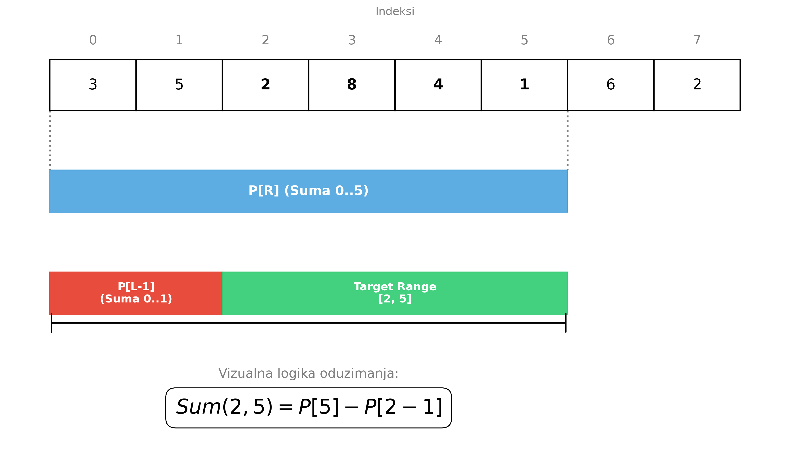
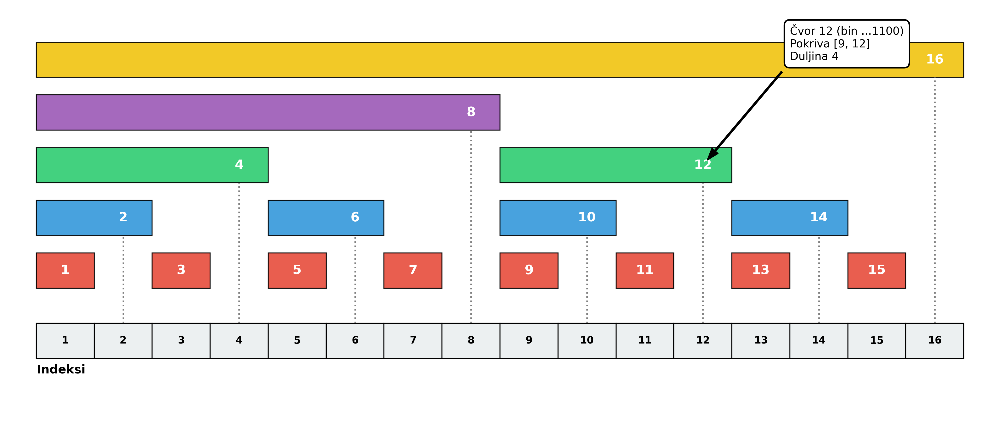
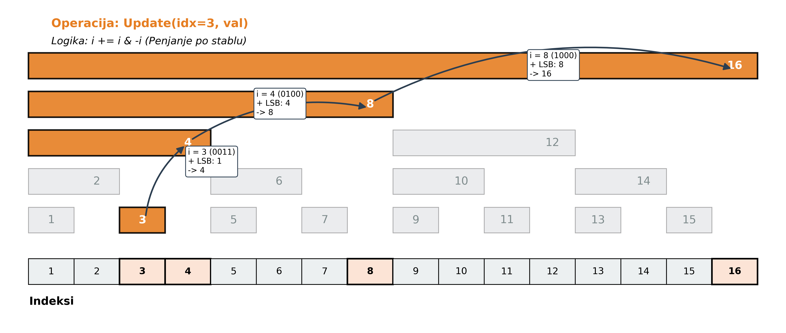
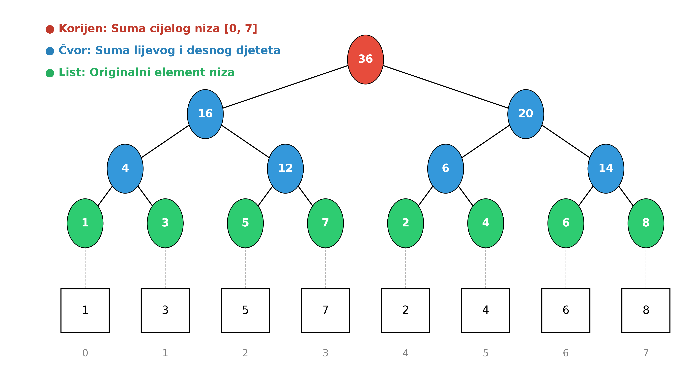
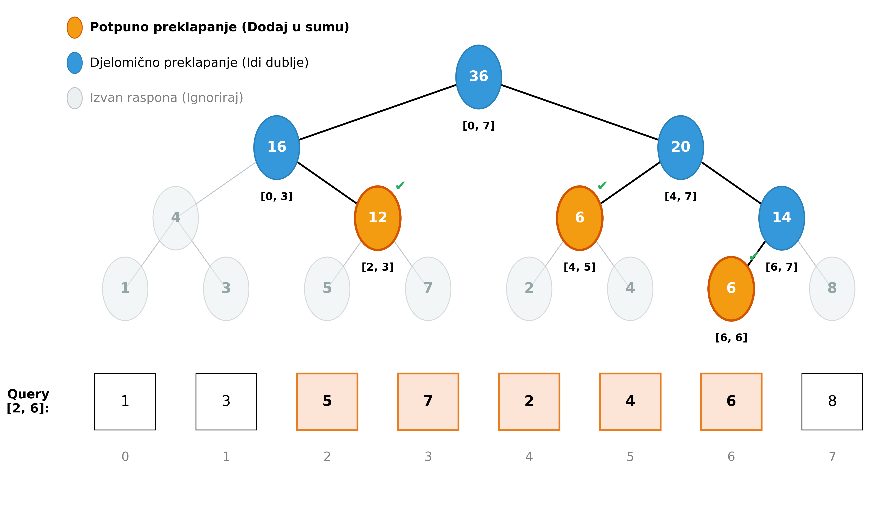
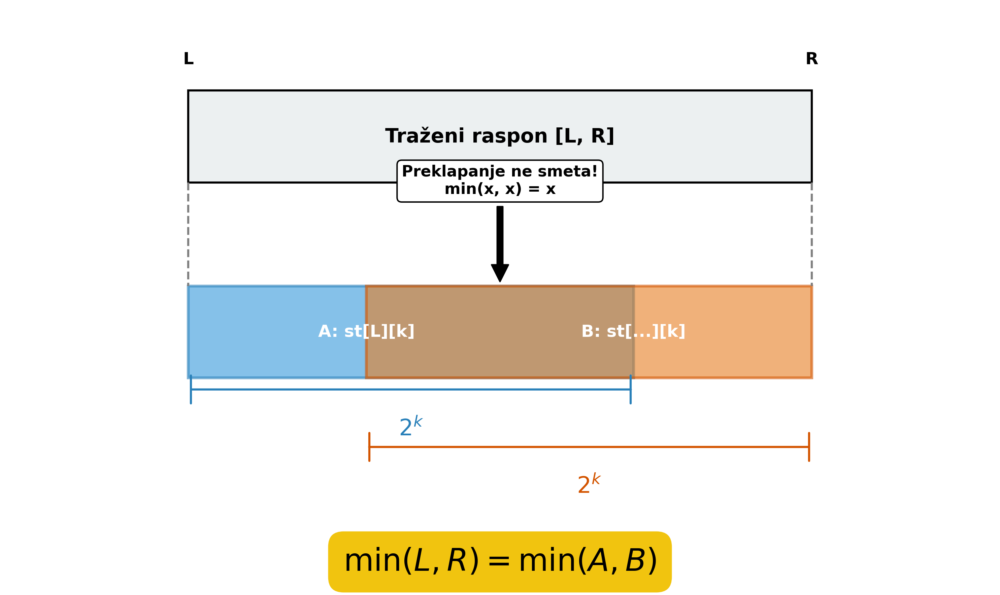

<!-- _paginate: false -->
<!-- _class: title -->

# Upiti nad rasponima

## Prefiksne sume, Fenwick stablo i segmentno stablo

---

# Sadržaj

1. **Uvod i motivacija**
   - Što su upiti nad rasponima?
   - Zašto je naivni pristup prespor?
2. **Statički upiti**
   - Prefiksne sume
3. **Dinamički upiti (ažuriranje točke)**
   - Fenwick stablo (Binary Indexed Tree)
   - Segmentno stablo
4. **Zadaci za vježbu**

---

# Uvod: što su upiti nad rasponima?

Imamo niz $A$. Želimo efikasno odgovarati na pitanja o podnizu (rasponu) $[L, R]$.

**Najčešći tipovi upita:**

1. **Sum:** zbroj elemenata od $L$ do $R$.
2. **Min/Max:** najmanji/najveći element u rasponu.
3. **Najveći zajednički djelitelj (GCD), XOR, ...:** ostale asocijativne operacije.

**Problem naivnog pristupa**

Ako za svaki upit vrtimo petlju od $L$ do $R$:

- Složenost jednog upita: $O(N)$
- Za $Q$ upita: **$O(N \cdot Q)$**
- Za $N, Q = 10^5$ to je $10^{10}$ operacija $\to$ **Time Limit Exceeded (TLE)**.

Cilj: **$O(\log N)$** ili **$O(1)$** po upitu.

---

# Statički upiti: prefiksne sume (1/2)

Ako se niz **ne mijenja**, možemo koristiti prefiksne sume.

**Ideja:** `P[i]` sadrži zbroj prvih $i$ elemenata: $A[0] + \dots + A[i-1]$.

**Izgradnja $O(N)$:**

```cpp
vector<long long> P(n + 1, 0);
for (int i = 0; i < n; ++i) {
    P[i+1] = P[i] + a[i];
}
```

**Upit $O(1)$:** zbroj raspona $[L, R]$ (inkluzivno, 0-indeksirano) je:
$$ \text{sum}(L, R) = P[R+1] - P[L] $$

---

# Statički upiti: prefiksne sume (2/2)



---

# Prefiksne sume korak po korak

Prvo gradimo `P` jednim prolazom, a zatim svaki upit rješavamo jednim oduzimanjem (indeksi od 0, raspon `[L, R]` uključivo).

<style scoped>
.rq-prefix { margin-top: 0.3em; }
.rq-prefix .chips { font-size: 20px; margin-bottom: 0.4em; }
.rq-prefix .chip { display: inline-block; min-width: 32px; text-align: center; padding: 2px 10px; margin: 0 0 6px 6px; border: 2px solid #141414; border-radius: 16px; font-weight: bold; font-size: 18px; }
.rq-prefix .chip.take { background: #9fdc9f; }
.rq-prefix .chip.skip, .rq-prefix .chip.stale { color: #b5b5b5; border-color: #ccc; text-decoration: line-through; }
.rq-prefix .chip.on { background: var(--main); border-color: var(--main); color: #fff; }
.rq-prefix .muted { color: #6e6e6e; font-style: italic; margin-left: 6px; }
.rq-prefix .row { display: flex; gap: 6px; }
.rq-prefix .cell { width: 62px; text-align: center; border: 2px solid #141414; border-radius: 6px; transition: background-color .25s, color .25s; }
.rq-prefix .idx { font-size: 15px; color: #6e6e6e; border-bottom: 1px solid #ccc; }
.rq-prefix .val { font-size: 24px; height: 38px; line-height: 38px; font-weight: bold; }
.rq-prefix .cell.todo .val { color: #b5b5b5; }
.rq-prefix .cell.rng { background: #d6e6f5; }
.rq-prefix .cell.best { background: #9fdc9f; }
.rq-prefix .cell.src { background: #f5db7e; }
.rq-prefix .cell.cur { background: var(--main); color: #fff; }
.rq-prefix .cell.cur .idx, .rq-prefix .cell.cur .val { color: #fff; }
.rq-prefix .lbl { font-size: 18px; font-weight: bold; color: #6e6e6e; margin: 0.4em 0 0.2em; }
.rq-prefix .wrap { display: flex; gap: 28px; align-items: flex-start; }
.rq-prefix .side { padding-top: 6px; }
.rq-prefix .gsvg { display: block; overflow: visible; }
.rq-prefix .e line { stroke: #9a9a9a; stroke-width: 3; transition: stroke .25s; }
.rq-prefix .e polygon { fill: #9a9a9a; }
.rq-prefix .e .w { font-size: 19px; font-weight: bold; fill: #141414; text-anchor: middle; dominant-baseline: central; paint-order: stroke; stroke: #fff; stroke-width: 6px; }
.rq-prefix .e.tree line { stroke: #2f9e44; stroke-width: 6; }
.rq-prefix .e.tree polygon { fill: #2f9e44; }
.rq-prefix .e.off line { stroke: #d5d5d5; stroke-dasharray: 6 6; }
.rq-prefix .e.off polygon { fill: #d5d5d5; }
.rq-prefix .e.off .w { fill: #b5b5b5; }
.rq-prefix .e.hid { opacity: 0; }
.rq-prefix .e.bad line { stroke: #e03131; stroke-width: 6; }
.rq-prefix .e.bad polygon { fill: #e03131; }
.rq-prefix .e.on line { stroke: var(--main); stroke-width: 6; }
.rq-prefix .e.on polygon { fill: var(--main); }
.rq-prefix .n circle { fill: #fff; stroke: #141414; stroke-width: 2.5; transition: fill .25s; }
.rq-prefix .n .id { font-size: 21px; font-weight: bold; text-anchor: middle; dominant-baseline: central; fill: #141414; }
.rq-prefix .n .sub { font-size: 19px; font-weight: bold; text-anchor: middle; dominant-baseline: central; fill: var(--main); paint-order: stroke; stroke: #fff; stroke-width: 6px; }
.rq-prefix .n.c1 circle { fill: #ffd8a8; } .rq-prefix .n.c2 circle { fill: #a5d8ff; } .rq-prefix .n.c3 circle { fill: #b2f2bb; }
.rq-prefix .n.c4 circle { fill: #fcc2d7; } .rq-prefix .n.c5 circle { fill: #d0bfff; } .rq-prefix .n.c6 circle { fill: #ffec99; }
.rq-prefix .n.done circle { fill: #9fdc9f; }
.rq-prefix .n.src circle { fill: #f5db7e; }
.rq-prefix .n.cur circle { fill: var(--main); stroke: var(--main); }
.rq-prefix .n.cur .id { fill: #fff; }
.rq-prefix .tbl { display: grid; gap: 5px; }
.rq-prefix .th { height: 40px; line-height: 40px; text-align: center; font-size: 20px; font-weight: bold; color: #6e6e6e; border-radius: 6px; }
.rq-prefix .th.hl { background: var(--main); color: #fff; }
.rq-prefix .tc { height: 40px; line-height: 36px; text-align: center; font-size: 22px; font-weight: bold; border: 2px solid #141414; border-radius: 6px; transition: background-color .25s, color .25s; }
.rq-prefix .tc.none { border-color: transparent; }
.rq-prefix .tc.k { background: #e3ecf6; }
.rq-prefix .tc.best { background: #9fdc9f; }
.rq-prefix .tc.src { background: #f5db7e; }
.rq-prefix .tc.cur { background: var(--main); color: #fff; }
.rq-prefix .line1, .rq-prefix .line2 { font-family: monospace; font-size: 21px; min-height: 1.35em; }
.rq-prefix .line1 { margin-top: 0.5em; }
.rq-prefix .line2 { font-weight: bold; }
.rq-prefix .ctrl { margin-top: 0.5em; }
.rq-prefix button { font: inherit; font-size: 18px; padding: 4px 14px; margin-right: 8px; border: 2px solid var(--main); border-radius: 6px; background: #fff; color: var(--main); cursor: pointer; }
.rq-prefix button:hover { background: var(--main); color: #fff; }
.rq-prefix .hint { font-size: 16px; color: #6e6e6e; }
.rq-prefix .tc.k2 { background: #ffe0b8; }
.rq-prefix .tc.both { background: #d9c8ef; }
</style>

<div class="rq-prefix" data-arr="3,1,4,1,5,9,2,6" data-q="2-5,0-3,4-7">
  <div class="tbl"></div>
  <div class="line1"></div>
  <div class="line2"></div>
  <div class="ctrl">
    <button data-act="prev">← Korak</button><button data-act="next">Korak →</button><button data-act="auto">Auto</button><button data-act="reset">Reset</button>
    <span class="hint">← / → koračaju kroz animaciju, Shift + ← / → mijenja slajd</span>
  </div>
</div>

<script>
(function () {
  // Ovaj blok namjerno ne sadrži znakove manje-od, veće-od ni ampersand,
  // jer ih build pretvara u HTML entitete i ruši skriptu.
  document.querySelectorAll('.rq-prefix').forEach(function (root) {
    var slide = root.closest('svg');
    var line1 = root.querySelector('.line1');
    var line2 = root.querySelector('.line2');
    var NS = 'http://www.w3.org/2000/svg';
    function mk(tag, cls, text) {
      var e = document.createElement(tag);
      if (cls) e.className = cls;
      if (text !== undefined) e.textContent = text;
      return e;
    }
    function sv(tag, attrs, parent) {
      var e = document.createElementNS(NS, tag);
      Object.keys(attrs).forEach(function (k) { e.setAttribute(k, attrs[k]); });
      if (parent) parent.appendChild(e);
      return e;
    }
    function setc(el, cls) { el.setAttribute('class', cls); }
    function show(v) { return v === Infinity ? '∞' : (v === -Infinity ? '−∞' : String(v)); }
    function lt(a, b) { return a !== b ? Math.min(a, b) === a : false; }
    function le(a, b) { return Math.min(a, b) === a; }
    function fw(w) { return lt(w, 0) ? '(' + w + ')' : String(w); }
    function makeRow(box, count, base) {
      var cells = [], vals = [];
      for (var k = 0; k !== count; k++) {
        var cell = mk('div', 'cell');
        cell.appendChild(mk('div', 'idx', k + (base || 0)));
        var v = mk('div', 'val');
        cell.appendChild(v);
        box.appendChild(cell);
        cells.push(cell);
        vals.push(v);
      }
      return { cells: cells, vals: vals };
    }
    function parsePos(s) {
      return s.trim().split(/\s+/).map(function (p) {
        var q = p.split(',').map(Number);
        return { x: q[0], y: q[1] };
      });
    }
    function parseEdges(s) {
      return s.split(',').map(function (t) {
        var q = t.trim().split(':'), ab = q[0].split('-');
        return { a: Number(ab[0]), b: Number(ab[1]), w: q.length === 2 ? Number(q[1]) : 0 };
      });
    }
    // Crta graf u SVG-u: čvorovi su numerirani od 1, bridovi su {a, b, w}
    function drawGraph(box, pos, edges, opt) {
      var R = opt.r || 22;
      var svg = sv('svg', { viewBox: '0 0 ' + opt.w + ' ' + opt.h, width: opt.w, height: opt.h, 'class': 'gsvg' }, box);
      var gE = sv('g', {}, svg), gN = sv('g', {}, svg);
      var E = edges.map(function (e) {
        var A = pos[e.a - 1], B = pos[e.b - 1];
        var dx = B.x - A.x, dy = B.y - A.y, L = Math.sqrt(dx * dx + dy * dy);
        var ux = dx / L, uy = dy / L;
        var x1 = A.x + ux * R, y1 = A.y + uy * R, x2 = B.x - ux * R, y2 = B.y - uy * R;
        var g = sv('g', { 'class': 'e' }, gE);
        sv('line', { x1: x1, y1: y1, x2: x2, y2: y2 }, g);
        if (opt.directed) {
          var bx = x2 - ux * 15, by = y2 - uy * 15;
          sv('polygon', { points: x2 + ',' + y2 + ' ' + (bx - uy * 7) + ',' + (by + ux * 7) + ' ' + (bx + uy * 7) + ',' + (by - ux * 7) }, g);
        }
        if (opt.weights) {
          var t = sv('text', { x: (A.x + B.x) / 2 - uy * 15, y: (A.y + B.y) / 2 + ux * 15, 'class': 'w' }, g);
          t.textContent = e.w;
        }
        return { g: g };
      });
      var N = pos.map(function (p, i) {
        var g = sv('g', { 'class': 'n' }, gN);
        sv('circle', { cx: p.x, cy: p.y, r: R }, g);
        var t = sv('text', { x: p.x, y: p.y, 'class': 'id' }, g);
        t.textContent = i + 1;
        var sub = sv('text', { x: p.x + (opt.subdx || 0), y: p.y + (opt.subdy === undefined ? -R - 13 : opt.subdy), 'class': 'sub' }, g);
        return { g: g, sub: sub };
      });
      return { E: E, N: N, svg: svg };
    }

    var a = root.dataset.arr.split(',').map(Number);
    var n = a.length;
    var Q = parseEdges(root.dataset.q);
    var tbl = root.querySelector('.tbl');
    tbl.style.gridTemplateColumns = '60px repeat(' + (n + 1) + ', 62px)';
    tbl.appendChild(mk('div', 'th', 'i'));
    for (var c0 = 0; c0 !== n + 1; c0++) tbl.appendChild(mk('div', 'th idxh', c0));
    tbl.appendChild(mk('div', 'th', 'a'));
    var A = [], P = [];
    for (var c1 = 0; c1 !== n + 1; c1++) A.push(tbl.appendChild(mk('div', c1 === n ? 'tc none' : 'tc')));
    tbl.appendChild(mk('div', 'th', 'P'));
    for (var c2 = 0; c2 !== n + 1; c2++) P.push(tbl.appendChild(mk('div', 'tc')));
    var pre = [0];
    a.forEach(function (x) { pre.push(pre[pre.length - 1] + x); });
    var snaps = [{ upto: 0, ar: [], as: [], pc: -1, ps: [], l1: 'P[0] = 0 (zbroj praznog prefiksa)', l2: 'P[i] = zbroj prvih i elemenata: a[0] + … + a[i − 1]' }];
    for (var i = 0; i !== n; i++) {
      snaps.push({ upto: i + 1, ar: [], as: [i], pc: i + 1, ps: [i],
        l1: 'P[' + (i + 1) + '] = P[' + i + '] + a[' + i + '] = ' + pre[i] + ' + ' + a[i] + ' = ' + pre[i + 1],
        l2: i === n - 1 ? 'Izgradnja gotova u O(N)   ✓' : '' });
    }
    Q.forEach(function (q) {
      var L = q.a, Rr = q.b, ar = [];
      for (var k = L; k !== Rr + 1; k++) ar.push(k);
      snaps.push({ upto: n, ar: ar, as: [], pc: Rr + 1, ps: [L],
        l1: 'sum(' + L + ', ' + Rr + ') = P[' + (Rr + 1) + '] − P[' + L + '] = ' + pre[Rr + 1] + ' − ' + pre[L] + ' = ' + (pre[Rr + 1] - pre[L]),
        l2: 'Provjera: ' + ar.map(function (k) { return a[k]; }).join(' + ') + ' = ' + (pre[Rr + 1] - pre[L]) + '   ✓  (jedno oduzimanje, O(1))' });
    });
    function draw(s) {
      for (var k = 0; k !== n; k++) {
        var c = 'tc';
        if (s.ar.indexOf(k) !== -1) c += ' k';
        if (s.as.indexOf(k) !== -1) c += ' src';
        setc(A[k], c);
        A[k].textContent = a[k];
      }
      for (var j = 0; j !== n + 1; j++) {
        var d = 'tc';
        if (s.ps.indexOf(j) !== -1) d += ' src';
        if (j === s.pc) d += ' cur';
        setc(P[j], d);
        P[j].textContent = Math.max(j, s.upto) === s.upto ? pre[j] : '';
      }
    }

    var step = 0, timer = null, lastStep = snaps.length - 1;
    function render() {
      var s = snaps[step];
      draw(s);
      line1.textContent = s.l1;
      line2.textContent = s.l2;
    }
    function stopAuto() { clearInterval(timer); timer = null; }
    function next() { if (step !== lastStep) { step++; render(); return true; } stopAuto(); return false; }
    function prev() { if (step !== 0) { step--; render(); return true; } return false; }
    function reset() { stopAuto(); step = 0; render(); }
    var actions = {
      next: next, prev: prev, reset: reset,
      auto: function () { if (timer) stopAuto(); else timer = setInterval(next, 900); }
    };

    root.querySelectorAll('button').forEach(function (b) {
      b.addEventListener('click', function (e) {
        e.stopPropagation(); b.blur(); actions[b.dataset.act]();
      });
    });

    // Strelice / razmaknica / klikač prvo koračaju kroz animaciju, a tek na kraju mijenjaju slajd
    window.addEventListener('keydown', function (e) {
      if (e.shiftKey || !slide || !slide.classList.contains('bespoke-marp-active')) return;
      var fwd = ['ArrowRight', 'ArrowDown', 'PageDown', ' '].indexOf(e.key) !== -1;
      var back = ['ArrowLeft', 'ArrowUp', 'PageUp'].indexOf(e.key) !== -1;
      var moved = false;
      if (fwd) moved = next();
      if (back) moved = prev();
      if (moved) {
        e.preventDefault();
        e.stopImmediatePropagation();
      }
    }, true);

    render();
  });
})();
</script>

---

# Dinamički upiti: motivacija

Što ako se vrijednosti u nizu **mijenjaju**?

- Prefiksne sume zahtijevaju ponovnu izgradnju: $O(N)$ po promjeni.
- Trebamo strukturu koja brzo podržava i **update** i **query**.

**Fenwick stablo (Binary Indexed Tree, BIT)**

- Podržava **point update** i **range sum**.
- Složenost: **$O(\log N)$** za obje operacije.
- Memorija: **$O(N)$**.
- Jako malo koda, temelji se na bitovnim operacijama.

**Intuicija:** svaki indeks $k$ pamti sumu raspona čija je duljina najveća potencija broja 2 koja dijeli $k$ (LSB). LSB (Least Significant Bit) je najdesniji bit koji je 1 u binarnom zapisu broja.

---

# Fenwick stablo



---

# Logika: tko je za što odgovoran?

Ključ razumijevanja je u **binarnom zapisu** indeksa. Svaki čvor u nizu ne čuva samo svoju vrijednost, već sumu određenog bloka.

- Duljina bloka određena je **najmanjim bitom jedinice** (LSB).
- **Pravilo:** indeks pokriva raspon `[indeks - LSB + 1, indeks]`.

**Primjeri (1-based notacija):**

- `12` (`1100`) $\rightarrow$ LSB je 4. Pokriva 4 elementa: `[9, 10, 11, 12]`.
- `6` (`0110`) $\rightarrow$ LSB je 2. Pokriva 2 elementa: `[5, 6]`.
- `7` (`0111`) $\rightarrow$ LSB je 1. Pokriva 1 element: `[7]`.

---

# Fenwick stablo: ažuriranje vrijednosti



---

# Logika kretanja: gore i dolje

Kako se krećemo po stablu ovisi o operaciji:

1. **Upit (query/read):** krećemo se **DOLJE** (prema 0).
    - Uzimamo sumu trenutnog bloka.
    - Oduzimamo duljinu bloka da skočimo na kraj prethodnog raspona.
    - *Cilj:* sakupiti sve dijelove prefiksa.

2. **Ažuriranje (update):** krećemo se **GORE** (prema N).
    - Ažuriramo trenutni čvor.
    - Dodajemo duljinu bloka da nađemo prvog "roditelja" koji nas sadrži.
    - *Cilj:* obavijestiti sve veće blokove da se dio njih promijenio.

---

# Računanje sume raspona $[L, R]$

Fenwick stablo ne može izravno vratiti sumu od $L$ do $R$. Ono uvijek vraća **prefiksnu sumu** (od početka do nekog indeksa).

Koristimo princip oduzimanja prefiksa: $Suma(L, R) = Suma(1, R) - Suma(1, L-1)$

**Vizualno:**

1. Tražimo sumu plavog dijela (od $L$ do $R$).
2. Izračunamo sumu do $R$ (`query(R)`).
3. Oduzmemo sumu do $L-1$ (`query(L-1)`).
4. Ostatak je traženi raspon.

*Vremenska složenost ostaje $O(\log N)$ jer radimo samo dva upita.*

---

# Primjer: upit za raspon $[5, 13]$ (1-based)

Želimo izračunati sumu elemenata od indeksa 5 do 13: `Rezultat = query(13) - query(4)`

**1. korak: `query(13)` (suma $[1, 13]$).** Algoritam kreće od 13 i skuplja blokove unatrag (prema 0):

- Uzima **blok 13** (pokriva samo sebe). $\rightarrow$ *skače na 12*
- Uzima **blok 12** (pokriva $[9, 12]$). $\rightarrow$ *skače na 8*
- Uzima **blok 8** (pokriva $[1, 8]$). $\rightarrow$ *skače na 0 (kraj)*

> $\text{Suma}_A = \text{tree}[13] + \text{tree}[12] + \text{tree}[8]$

**2. korak: `query(4)` (suma $[1, 4]$).** Algoritam kreće od 4 (jer je to $L-1$):

- Uzima **blok 4** (pokriva $[1, 4]$). $\rightarrow$ *skače na 0 (kraj)*

> $\text{Suma}_B = \text{tree}[4]$

**3. korak: oduzimanje.** `Rezultat` = $\text{Suma}_A - \text{Suma}_B$: od sume prvih 13 brojeva "odrezali" smo prva 4. Ostaje točno suma od 5 do 13.

---

# Fenwick stablo korak po korak

Svaka traka je jedan `bit[i]` i pokriva blok elemenata iznad kojih stoji. Upit se spušta prema 0, a update se penje prema N.

<style scoped>
.rq-fenwick { margin-top: 0.3em; }
.rq-fenwick .chips { font-size: 20px; margin-bottom: 0.4em; }
.rq-fenwick .chip { display: inline-block; min-width: 32px; text-align: center; padding: 2px 10px; margin: 0 0 6px 6px; border: 2px solid #141414; border-radius: 16px; font-weight: bold; font-size: 18px; }
.rq-fenwick .chip.take { background: #9fdc9f; }
.rq-fenwick .chip.skip, .rq-fenwick .chip.stale { color: #b5b5b5; border-color: #ccc; text-decoration: line-through; }
.rq-fenwick .chip.on { background: var(--main); border-color: var(--main); color: #fff; }
.rq-fenwick .muted { color: #6e6e6e; font-style: italic; margin-left: 6px; }
.rq-fenwick .row { display: flex; gap: 6px; }
.rq-fenwick .cell { width: 62px; text-align: center; border: 2px solid #141414; border-radius: 6px; transition: background-color .25s, color .25s; }
.rq-fenwick .idx { font-size: 15px; color: #6e6e6e; border-bottom: 1px solid #ccc; }
.rq-fenwick .val { font-size: 24px; height: 38px; line-height: 38px; font-weight: bold; }
.rq-fenwick .cell.todo .val { color: #b5b5b5; }
.rq-fenwick .cell.rng { background: #d6e6f5; }
.rq-fenwick .cell.best { background: #9fdc9f; }
.rq-fenwick .cell.src { background: #f5db7e; }
.rq-fenwick .cell.cur { background: var(--main); color: #fff; }
.rq-fenwick .cell.cur .idx, .rq-fenwick .cell.cur .val { color: #fff; }
.rq-fenwick .lbl { font-size: 18px; font-weight: bold; color: #6e6e6e; margin: 0.4em 0 0.2em; }
.rq-fenwick .wrap { display: flex; gap: 28px; align-items: flex-start; }
.rq-fenwick .side { padding-top: 6px; }
.rq-fenwick .gsvg { display: block; overflow: visible; }
.rq-fenwick .e line { stroke: #9a9a9a; stroke-width: 3; transition: stroke .25s; }
.rq-fenwick .e polygon { fill: #9a9a9a; }
.rq-fenwick .e .w { font-size: 19px; font-weight: bold; fill: #141414; text-anchor: middle; dominant-baseline: central; paint-order: stroke; stroke: #fff; stroke-width: 6px; }
.rq-fenwick .e.tree line { stroke: #2f9e44; stroke-width: 6; }
.rq-fenwick .e.tree polygon { fill: #2f9e44; }
.rq-fenwick .e.off line { stroke: #d5d5d5; stroke-dasharray: 6 6; }
.rq-fenwick .e.off polygon { fill: #d5d5d5; }
.rq-fenwick .e.off .w { fill: #b5b5b5; }
.rq-fenwick .e.hid { opacity: 0; }
.rq-fenwick .e.bad line { stroke: #e03131; stroke-width: 6; }
.rq-fenwick .e.bad polygon { fill: #e03131; }
.rq-fenwick .e.on line { stroke: var(--main); stroke-width: 6; }
.rq-fenwick .e.on polygon { fill: var(--main); }
.rq-fenwick .n circle { fill: #fff; stroke: #141414; stroke-width: 2.5; transition: fill .25s; }
.rq-fenwick .n .id { font-size: 21px; font-weight: bold; text-anchor: middle; dominant-baseline: central; fill: #141414; }
.rq-fenwick .n .sub { font-size: 19px; font-weight: bold; text-anchor: middle; dominant-baseline: central; fill: var(--main); paint-order: stroke; stroke: #fff; stroke-width: 6px; }
.rq-fenwick .n.c1 circle { fill: #ffd8a8; } .rq-fenwick .n.c2 circle { fill: #a5d8ff; } .rq-fenwick .n.c3 circle { fill: #b2f2bb; }
.rq-fenwick .n.c4 circle { fill: #fcc2d7; } .rq-fenwick .n.c5 circle { fill: #d0bfff; } .rq-fenwick .n.c6 circle { fill: #ffec99; }
.rq-fenwick .n.done circle { fill: #9fdc9f; }
.rq-fenwick .n.src circle { fill: #f5db7e; }
.rq-fenwick .n.cur circle { fill: var(--main); stroke: var(--main); }
.rq-fenwick .n.cur .id { fill: #fff; }
.rq-fenwick .tbl { display: grid; gap: 5px; }
.rq-fenwick .th { height: 40px; line-height: 40px; text-align: center; font-size: 20px; font-weight: bold; color: #6e6e6e; border-radius: 6px; }
.rq-fenwick .th.hl { background: var(--main); color: #fff; }
.rq-fenwick .tc { height: 40px; line-height: 36px; text-align: center; font-size: 22px; font-weight: bold; border: 2px solid #141414; border-radius: 6px; transition: background-color .25s, color .25s; }
.rq-fenwick .tc.none { border-color: transparent; }
.rq-fenwick .tc.k { background: #e3ecf6; }
.rq-fenwick .tc.best { background: #9fdc9f; }
.rq-fenwick .tc.src { background: #f5db7e; }
.rq-fenwick .tc.cur { background: var(--main); color: #fff; }
.rq-fenwick .line1, .rq-fenwick .line2 { font-family: monospace; font-size: 21px; min-height: 1.35em; }
.rq-fenwick .line1 { margin-top: 0.5em; }
.rq-fenwick .line2 { font-weight: bold; }
.rq-fenwick .ctrl { margin-top: 0.5em; }
.rq-fenwick button { font: inherit; font-size: 18px; padding: 4px 14px; margin-right: 8px; border: 2px solid var(--main); border-radius: 6px; background: #fff; color: var(--main); cursor: pointer; }
.rq-fenwick button:hover { background: var(--main); color: #fff; }
.rq-fenwick .hint { font-size: 16px; color: #6e6e6e; }
.rq-fenwick .tc.k2 { background: #ffe0b8; }
.rq-fenwick .tc.both { background: #d9c8ef; }
.rq-fenwick .fw { display: grid; gap: 4px; grid-auto-rows: 34px; }
.rq-fenwick .flab { font-size: 15px; font-weight: bold; color: #6e6e6e; text-align: right; padding-right: 8px; line-height: 34px; }
.rq-fenwick .bar { border: 2px solid #141414; border-radius: 5px; background: #fff; display: flex; align-items: center; justify-content: center; gap: 6px; transition: background-color .25s, color .25s; }
.rq-fenwick .bar .bi { font-size: 12px; color: #6e6e6e; }
.rq-fenwick .bar .bv { font-size: 19px; font-weight: bold; }
.rq-fenwick .bar.src2 { background: #ffe0b8; }
.rq-fenwick .bar.src { background: #f5db7e; }
.rq-fenwick .bar.cur { background: var(--main); color: #fff; }
.rq-fenwick .bar.cur .bi { color: #fff; }
.rq-fenwick .fidx { text-align: center; font-size: 17px; font-weight: bold; line-height: 1.05; padding-top: 1px; }
.rq-fenwick .fbin { font-size: 11px; font-family: monospace; color: #6e6e6e; font-weight: normal; }
.rq-fenwick .fw .tc { height: 34px; line-height: 30px; font-size: 19px; }
.rq-fenwick .line1 { margin-top: 0.3em; }
</style>

<div class="rq-fenwick" data-arr="5,2,9,1,7,3,8,4,6,2,5,7,1,9,3,4" data-ops="q5-13,u5:3,q5-13">
  <div class="fw"></div>
  <div class="line1"></div>
  <div class="line2"></div>
  <div class="ctrl">
    <button data-act="prev">← Korak</button><button data-act="next">Korak →</button><button data-act="auto">Auto</button><button data-act="reset">Reset</button>
    <span class="hint">← / → koračaju kroz animaciju, Shift + ← / → mijenja slajd</span>
  </div>
</div>

<script>
(function () {
  // Ovaj blok namjerno ne sadrži znakove manje-od, veće-od ni ampersand,
  // jer ih build pretvara u HTML entitete i ruši skriptu.
  document.querySelectorAll('.rq-fenwick').forEach(function (root) {
    var slide = root.closest('svg');
    var line1 = root.querySelector('.line1');
    var line2 = root.querySelector('.line2');
    var NS = 'http://www.w3.org/2000/svg';
    function mk(tag, cls, text) {
      var e = document.createElement(tag);
      if (cls) e.className = cls;
      if (text !== undefined) e.textContent = text;
      return e;
    }
    function sv(tag, attrs, parent) {
      var e = document.createElementNS(NS, tag);
      Object.keys(attrs).forEach(function (k) { e.setAttribute(k, attrs[k]); });
      if (parent) parent.appendChild(e);
      return e;
    }
    function setc(el, cls) { el.setAttribute('class', cls); }
    function show(v) { return v === Infinity ? '∞' : (v === -Infinity ? '−∞' : String(v)); }
    function lt(a, b) { return a !== b ? Math.min(a, b) === a : false; }
    function le(a, b) { return Math.min(a, b) === a; }
    function fw(w) { return lt(w, 0) ? '(' + w + ')' : String(w); }
    function makeRow(box, count, base) {
      var cells = [], vals = [];
      for (var k = 0; k !== count; k++) {
        var cell = mk('div', 'cell');
        cell.appendChild(mk('div', 'idx', k + (base || 0)));
        var v = mk('div', 'val');
        cell.appendChild(v);
        box.appendChild(cell);
        cells.push(cell);
        vals.push(v);
      }
      return { cells: cells, vals: vals };
    }
    function parsePos(s) {
      return s.trim().split(/\s+/).map(function (p) {
        var q = p.split(',').map(Number);
        return { x: q[0], y: q[1] };
      });
    }
    function parseEdges(s) {
      return s.split(',').map(function (t) {
        var q = t.trim().split(':'), ab = q[0].split('-');
        return { a: Number(ab[0]), b: Number(ab[1]), w: q.length === 2 ? Number(q[1]) : 0 };
      });
    }
    // Crta graf u SVG-u: čvorovi su numerirani od 1, bridovi su {a, b, w}
    function drawGraph(box, pos, edges, opt) {
      var R = opt.r || 22;
      var svg = sv('svg', { viewBox: '0 0 ' + opt.w + ' ' + opt.h, width: opt.w, height: opt.h, 'class': 'gsvg' }, box);
      var gE = sv('g', {}, svg), gN = sv('g', {}, svg);
      var E = edges.map(function (e) {
        var A = pos[e.a - 1], B = pos[e.b - 1];
        var dx = B.x - A.x, dy = B.y - A.y, L = Math.sqrt(dx * dx + dy * dy);
        var ux = dx / L, uy = dy / L;
        var x1 = A.x + ux * R, y1 = A.y + uy * R, x2 = B.x - ux * R, y2 = B.y - uy * R;
        var g = sv('g', { 'class': 'e' }, gE);
        sv('line', { x1: x1, y1: y1, x2: x2, y2: y2 }, g);
        if (opt.directed) {
          var bx = x2 - ux * 15, by = y2 - uy * 15;
          sv('polygon', { points: x2 + ',' + y2 + ' ' + (bx - uy * 7) + ',' + (by + ux * 7) + ' ' + (bx + uy * 7) + ',' + (by - ux * 7) }, g);
        }
        if (opt.weights) {
          var t = sv('text', { x: (A.x + B.x) / 2 - uy * 15, y: (A.y + B.y) / 2 + ux * 15, 'class': 'w' }, g);
          t.textContent = e.w;
        }
        return { g: g };
      });
      var N = pos.map(function (p, i) {
        var g = sv('g', { 'class': 'n' }, gN);
        sv('circle', { cx: p.x, cy: p.y, r: R }, g);
        var t = sv('text', { x: p.x, y: p.y, 'class': 'id' }, g);
        t.textContent = i + 1;
        var sub = sv('text', { x: p.x + (opt.subdx || 0), y: p.y + (opt.subdy === undefined ? -R - 13 : opt.subdy), 'class': 'sub' }, g);
        return { g: g, sub: sub };
      });
      return { E: E, N: N, svg: svg };
    }

    var a = [0].concat(root.dataset.arr.split(',').map(Number));
    var n = a.length - 1;
    function lsb(i) { var p = 1; while (i % (2 * p) === 0) p *= 2; return p; }
    var bits = n.toString(2).length;
    function bin(i) { var s = i.toString(2); while (s.length !== bits) s = '0' + s; return s; }
    var bit = [0];
    for (var i = 1; i !== n + 1; i++) { var s0 = 0; for (var j = i - lsb(i) + 1; j !== i + 1; j++) s0 += a[j]; bit.push(s0); }
    var grid = root.querySelector('.fw');
    grid.style.gridTemplateColumns = '80px repeat(' + n + ', 50px)';
    var levels = bits;
    for (var L = levels - 1; L !== -1; L--) {
      var lab = mk('div', 'flab', 'LSB ' + Math.pow(2, L));
      lab.style.gridRow = String(levels - L); lab.style.gridColumn = '1';
      grid.appendChild(lab);
    }
    var B = [null];
    for (var i2 = 1; i2 !== n + 1; i2++) {
      var Lv = Math.round(Math.log(lsb(i2)) / Math.LN2);
      var bar = mk('div', 'bar');
      bar.style.gridRow = String(levels - Lv);
      bar.style.gridColumn = (i2 - lsb(i2) + 2) + ' / ' + (i2 + 2);
      bar.appendChild(mk('span', 'bi', i2));
      var bv = mk('span', 'bv');
      bar.appendChild(bv);
      grid.appendChild(bar);
      B.push({ el: bar, v: bv });
    }
    function rowLab(text, r) { var e = mk('div', 'flab', text); e.style.gridRow = String(r); e.style.gridColumn = '1'; grid.appendChild(e); }
    rowLab('i', levels + 1); rowLab('a[i]', levels + 2);
    var IX = [null], AV = [null];
    for (var i3 = 1; i3 !== n + 1; i3++) {
      var ix = mk('div', 'fidx');
      ix.appendChild(mk('div', '', i3));
      ix.appendChild(mk('div', 'fbin', bin(i3)));
      ix.style.gridRow = String(levels + 1); ix.style.gridColumn = String(i3 + 1);
      grid.appendChild(ix); IX.push(ix);
      var av = mk('div', 'tc');
      av.style.gridRow = String(levels + 2); av.style.gridColumn = String(i3 + 1);
      grid.appendChild(av); AV.push(av);
    }

    var snaps = [];
    function snap(o) {
      var s = { bit: bit.slice(), a: a.slice(), cur: -1, v1: [], v2: [], r1: [], r2: [], l1: '', l2: '' };
      Object.keys(o).forEach(function (k) { s[k] = o[k]; });
      snaps.push(s);
    }
    function cover(list) { var r = []; list.forEach(function (i) { for (var j = i - lsb(i) + 1; j !== i + 1; j++) r.push(j); }); return r; }
    snap({ l1: 'Svaki bit[i] čuva zbroj bloka [i − LSB(i) + 1, i]; duljina bloka je najniži bit jedinice u i', l2: 'Npr. 12 = 1100₂ pa bit[12] pokriva 4 elementa: [9, 12]' });
    function query(idx, key, other, head) {
      var res = 0, vis = [], start = idx;
      while (idx !== 0) {
        var p = lsb(idx);
        res += bit[idx]; vis.push(idx);
        var o = { cur: idx, l2: head + ':  res = ' + res };
        o[key] = vis.slice(); o[key === 'v1' ? 'r1' : 'r2'] = cover(vis);
        Object.keys(other).forEach(function (k) { o[k] = other[k]; });
        o.l1 = 'idx = ' + idx + ' = ' + bin(idx) + '₂, LSB = ' + p + ':  res += bit[' + idx + '] = ' + bit[idx] + '  → idx = ' + idx + ' − ' + p + ' = ' + (idx - p);
        snap(o);
        idx -= p;
      }
      return { res: res, vis: vis };
    }
    var ops = root.dataset.ops.split(',');
    ops.forEach(function (op) {
      if (op[0] === 'q') {
        var lr = op.slice(1).split('-').map(Number), Lq = lr[0], Rq = lr[1];
        var A1 = query(Rq, 'v1', {}, 'query(' + Rq + ')');
        var A2 = query(Lq - 1, 'v2', { v1: A1.vis, r1: cover(A1.vis) }, 'query(' + (Lq - 1) + ')');
        var rng = []; for (var k = Lq; k !== Rq + 1; k++) rng.push(k);
        snap({ v1: A1.vis, v2: A2.vis, r1: rng,
          l1: 'sum(' + Lq + ', ' + Rq + ') = query(' + Rq + ') − query(' + (Lq - 1) + ') = ' + A1.res + ' − ' + A2.res + ' = ' + (A1.res - A2.res),
          l2: 'Samo ' + (A1.vis.length + A2.vis.length) + ' čitanja umjesto ' + (Rq - Lq + 1) + ' zbrajanja   ✓' });
      } else {
        var pd = op.slice(1).split(':').map(Number), idx = pd[0], delta = pd[1], vis = [], pos0 = idx;
        a[pos0] += delta;
        while (le(idx, n)) {
          var p = lsb(idx);
          bit[idx] += delta; vis.push(idx);
          snap({ cur: idx, v1: vis.slice(),
            l1: 'idx = ' + idx + ' = ' + bin(idx) + '₂, LSB = ' + p + ':  bit[' + idx + '] += ' + delta + ' → ' + bit[idx] + '  → idx = ' + idx + ' + ' + p + ' = ' + (idx + p),
            l2: 'update(' + pos0 + ', +' + delta + '): penjemo se prema većim blokovima koji sadrže a[' + pos0 + ']' });
          idx += p;
        }
        snap({ v1: vis, l1: 'idx = ' + idx + ' je veće od n = ' + n + ', kraj', l2: 'Promijenili smo ' + vis.length + ' bloka   ✓' });
      }
    });
    function draw(s) {
      for (var i = 1; i !== n + 1; i++) {
        var c = 'bar';
        if (s.v2.indexOf(i) !== -1) c += ' src2';
        if (s.v1.indexOf(i) !== -1) c += ' src';
        if (i === s.cur) c += ' cur';
        setc(B[i].el, c);
        B[i].v.textContent = s.bit[i];
        var d = 'tc';
        var in1 = s.r1.indexOf(i) !== -1, in2 = s.r2.indexOf(i) !== -1;
        if (in1) d += in2 ? ' both' : ' k';
        else if (in2) d += ' k2';
        setc(AV[i], d);
        AV[i].textContent = s.a[i];
      }
    }

    var step = 0, timer = null, lastStep = snaps.length - 1;
    function render() {
      var s = snaps[step];
      draw(s);
      line1.textContent = s.l1;
      line2.textContent = s.l2;
    }
    function stopAuto() { clearInterval(timer); timer = null; }
    function next() { if (step !== lastStep) { step++; render(); return true; } stopAuto(); return false; }
    function prev() { if (step !== 0) { step--; render(); return true; } return false; }
    function reset() { stopAuto(); step = 0; render(); }
    var actions = {
      next: next, prev: prev, reset: reset,
      auto: function () { if (timer) stopAuto(); else timer = setInterval(next, 900); }
    };

    root.querySelectorAll('button').forEach(function (b) {
      b.addEventListener('click', function (e) {
        e.stopPropagation(); b.blur(); actions[b.dataset.act]();
      });
    });

    // Strelice / razmaknica / klikač prvo koračaju kroz animaciju, a tek na kraju mijenjaju slajd
    window.addEventListener('keydown', function (e) {
      if (e.shiftKey || !slide || !slide.classList.contains('bespoke-marp-active')) return;
      var fwd = ['ArrowRight', 'ArrowDown', 'PageDown', ' '].indexOf(e.key) !== -1;
      var back = ['ArrowLeft', 'ArrowUp', 'PageUp'].indexOf(e.key) !== -1;
      var moved = false;
      if (fwd) moved = next();
      if (back) moved = prev();
      if (moved) {
        e.preventDefault();
        e.stopImmediatePropagation();
      }
    }, true);

    render();
  });
})();
</script>

---

# Fenwick stablo: implementacija (1-based)

Ključna operacija: `idx & -idx` (dohvaća LSB).

```cpp
vector<long long> bit; // Veličina n + 1, indeksi 1..n

// Dodaje 'delta' na indeks 'idx' (krećemo se GORE)
void update(int idx, long long delta) {
    for (; idx <= n; idx += idx & -idx)
        bit[idx] += delta;
}

// Vraća sumu prefiksa [1, idx] (krećemo se DOLJE)
long long query(int idx) {
    long long res = 0;
    for (; idx > 0; idx -= idx & -idx)
        res += bit[idx];
    return res;
}

// Suma raspona [l, r]
long long query(int l, int r) {
    return query(r) - query(l - 1);
}
```

---

# Napomena: 0-based varijanta

Ako baš želimo indekse od 0, formule se prilagođavaju:

- **Kretanje gore (update):** `idx = idx | (idx + 1)`
  Postavlja najniži bit koji je 0 na 1. Npr. `0011` (3) $\to$ `0111` (7) $\to$ `1111` (15)...
- **Kretanje dolje (query):** `r = (r & (r + 1)) - 1`
  Efektivno "skida" zadnji blok raspona.

```cpp
void update(int idx, long long delta) {
    for (; idx < n; idx = idx | (idx + 1)) bit[idx] += delta;
}
long long query(int r) { // Suma [0, r]
    long long res = 0;
    for (; r >= 0; r = (r & (r + 1)) - 1) res += bit[r];
    return res;
}
```

Blokovi tada nisu isti kao na slikama (1-based), pa je za učenje lakše držati se 1-based verzije.

---

# Segmentno stablo

Fleksibilnije od Fenwick stabla. Podržava:

- Sum, Min, Max, GCD, XOR...
- Čak i složenije operacije (npr. max subsegment sum).

**Struktura:**

- Binarno stablo izgrađeno nad nizom.
- **Listovi:** elementi originalnog niza.
- **Unutarnji čvorovi:** agregat (npr. zbroj) svoje djece.
- **Korijen:** agregat cijelog niza $[0, N-1]$.

**Složenost:**

- Izgradnja: $O(N)$
- Upit i ažuriranje: $O(\log N)$

---

# Segmentno stablo: vizualizacija



---

# Kako pamtimo stablo u nizu?

Iako je logička struktura stablo, fizički koristimo običan niz.
Koristimo **heap-like indeksiranje**, slično kao kod binarne gomile (binary heap).

Ako je čvor na indeksu `k`:

- Njegovo **lijevo dijete** je na `2 * k`.
- Njegovo **desno dijete** je na `2 * k + 1`.
- Korijen je na indeksu `1`.

> Zato alociramo niz veličine `4 * N`.
> *(Sigurna granica jer stablo nije uvijek savršeno popunjeno ako N nije potencija broja 2.)*

---

# Segmentno stablo: izgradnja (build)

Rekurzivno dijelimo niz na polovice dok ne dođemo do listova. Zatim se vraćamo i računamo sume.

```cpp
long long tree[4 * MAXN]; // 4x veličina niza

// Poziv: build(1, 0, n-1)
void build(int node, int start, int end) {
    if (start == end) {
        tree[node] = A[start];  // Došli smo do lista
    } else {
        int mid = (start + end) / 2;
        build(2*node, start, mid);      // Rekurzivno gradimo djecu
        build(2*node+1, mid+1, end);
        tree[node] = tree[2*node] + tree[2*node+1]; // Spajamo rezultate
    }
}
```

---

# Segmentno stablo: ažuriranje (update)

Slično binarnoj pretrazi. Tražimo list koji treba promijeniti, a pri povratku ažuriramo sve pretke.

```cpp
// Ažuriranje (point update)
void update(int node, int start, int end, int idx, long long val) {
    if (start == end) {
        tree[node] = val;
    } else {
        int mid = (start + end) / 2;
        if (idx <= mid)
            update(2*node, start, mid, idx, val);     // Lijevo
        else
            update(2*node+1, mid+1, end, idx, val);   // Desno

        tree[node] = tree[2*node] + tree[2*node+1];
    }
}
```

---

# Logika upita: tri slučaja

Kad tražimo sumu raspona $[L, R]$, svaki čvor provjerava svoj raspon $[start, end]$ u odnosu na traženi $[L, R]$.

Postoje samo 3 situacije:

1. 🔴 **Bez preklapanja:** čvor je potpuno izvan $[L, R]$.
    - *Akcija:* vratimo `0` (neutralni element).
2. 🟢 **Potpuno preklapanje:** čvor je cijeli unutar $[L, R]$.
    - *Akcija:* vratimo vrijednost čvora `tree[node]`. **Ne idemo dublje!**
3. 🟡 **Djelomično preklapanje:** dio čvora je unutra, dio vani.
    - *Akcija:* dijelimo se! Pozivamo upit za lijevo i desno dijete.

---

# Segmentno stablo: upit (kod)

Implementacija tri slučaja:

```cpp
long long query(int node, int start, int end, int l, int r) {
    // 1. Potpuno izvan (🔴)
    if (r < start || end < l) return 0;

    // 2. Potpuno unutar (🟢)
    if (l <= start && end <= r) return tree[node];

    // 3. Djelomično (🟡) -> pitamo djecu
    int mid = (start + end) / 2;
    long long p1 = query(2*node, start, mid, l, r);
    long long p2 = query(2*node+1, mid+1, end, l, r);

    return p1 + p2;
}
```

---

# Primjer izvršavanja upita

Niz: `[1, 2, 3, 4, 5, 6, 7, 8]` (indeksi 0-7).
Upit: **suma od 2 do 6** (`[2, 6]`). Očekujemo $3+4+5+6+7 = 25$.

- **Korijen [0, 7]:** djelomično $\rightarrow$ pitamo djecu.
  - **Lijevo [0, 3]:** djelomično.
    - **[0, 1]:** potpuno izvan $\rightarrow$ `0`.
    - **[2, 3]:** potpuno unutar $\rightarrow$ **7**.
    - *Lijeva suma = 0 + 7 = 7.*
  - **Desno [4, 7]:** djelomično.
    - **[4, 5]:** potpuno unutar $\rightarrow$ **11**.
    - **[6, 7]:** djelomično: **[6, 6]** unutra $\rightarrow$ **7**, **[7, 7]** vani $\rightarrow$ `0`.
    - *Desna suma = 11 + 7 = 18.*

**Konačni rezultat:** $7 + 18 = 25$.

---

# Segmentno stablo: vizualizacija upita



---

# Segmentno stablo korak po korak

Rekurzija za `query(2, 6)` i `update(3, 10)`: zeleno je potpuno unutar, crveno izvan, žuto djelomično, a obrub je trenutni čvor.

<style scoped>
.rq-segtree { margin-top: 0.3em; }
.rq-segtree .chips { font-size: 20px; margin-bottom: 0.4em; }
.rq-segtree .chip { display: inline-block; min-width: 32px; text-align: center; padding: 2px 10px; margin: 0 0 6px 6px; border: 2px solid #141414; border-radius: 16px; font-weight: bold; font-size: 18px; }
.rq-segtree .chip.take { background: #9fdc9f; }
.rq-segtree .chip.skip, .rq-segtree .chip.stale { color: #b5b5b5; border-color: #ccc; text-decoration: line-through; }
.rq-segtree .chip.on { background: var(--main); border-color: var(--main); color: #fff; }
.rq-segtree .muted { color: #6e6e6e; font-style: italic; margin-left: 6px; }
.rq-segtree .row { display: flex; gap: 6px; }
.rq-segtree .cell { width: 62px; text-align: center; border: 2px solid #141414; border-radius: 6px; transition: background-color .25s, color .25s; }
.rq-segtree .idx { font-size: 15px; color: #6e6e6e; border-bottom: 1px solid #ccc; }
.rq-segtree .val { font-size: 24px; height: 38px; line-height: 38px; font-weight: bold; }
.rq-segtree .cell.todo .val { color: #b5b5b5; }
.rq-segtree .cell.rng { background: #d6e6f5; }
.rq-segtree .cell.best { background: #9fdc9f; }
.rq-segtree .cell.src { background: #f5db7e; }
.rq-segtree .cell.cur { background: var(--main); color: #fff; }
.rq-segtree .cell.cur .idx, .rq-segtree .cell.cur .val { color: #fff; }
.rq-segtree .lbl { font-size: 18px; font-weight: bold; color: #6e6e6e; margin: 0.4em 0 0.2em; }
.rq-segtree .wrap { display: flex; gap: 28px; align-items: flex-start; }
.rq-segtree .side { padding-top: 6px; }
.rq-segtree .gsvg { display: block; overflow: visible; }
.rq-segtree .e line { stroke: #9a9a9a; stroke-width: 3; transition: stroke .25s; }
.rq-segtree .e polygon { fill: #9a9a9a; }
.rq-segtree .e .w { font-size: 19px; font-weight: bold; fill: #141414; text-anchor: middle; dominant-baseline: central; paint-order: stroke; stroke: #fff; stroke-width: 6px; }
.rq-segtree .e.tree line { stroke: #2f9e44; stroke-width: 6; }
.rq-segtree .e.tree polygon { fill: #2f9e44; }
.rq-segtree .e.off line { stroke: #d5d5d5; stroke-dasharray: 6 6; }
.rq-segtree .e.off polygon { fill: #d5d5d5; }
.rq-segtree .e.off .w { fill: #b5b5b5; }
.rq-segtree .e.hid { opacity: 0; }
.rq-segtree .e.bad line { stroke: #e03131; stroke-width: 6; }
.rq-segtree .e.bad polygon { fill: #e03131; }
.rq-segtree .e.on line { stroke: var(--main); stroke-width: 6; }
.rq-segtree .e.on polygon { fill: var(--main); }
.rq-segtree .n circle { fill: #fff; stroke: #141414; stroke-width: 2.5; transition: fill .25s; }
.rq-segtree .n .id { font-size: 21px; font-weight: bold; text-anchor: middle; dominant-baseline: central; fill: #141414; }
.rq-segtree .n .sub { font-size: 19px; font-weight: bold; text-anchor: middle; dominant-baseline: central; fill: var(--main); paint-order: stroke; stroke: #fff; stroke-width: 6px; }
.rq-segtree .n.c1 circle { fill: #ffd8a8; } .rq-segtree .n.c2 circle { fill: #a5d8ff; } .rq-segtree .n.c3 circle { fill: #b2f2bb; }
.rq-segtree .n.c4 circle { fill: #fcc2d7; } .rq-segtree .n.c5 circle { fill: #d0bfff; } .rq-segtree .n.c6 circle { fill: #ffec99; }
.rq-segtree .n.done circle { fill: #9fdc9f; }
.rq-segtree .n.src circle { fill: #f5db7e; }
.rq-segtree .n.cur circle { fill: var(--main); stroke: var(--main); }
.rq-segtree .n.cur .id { fill: #fff; }
.rq-segtree .tbl { display: grid; gap: 5px; }
.rq-segtree .th { height: 40px; line-height: 40px; text-align: center; font-size: 20px; font-weight: bold; color: #6e6e6e; border-radius: 6px; }
.rq-segtree .th.hl { background: var(--main); color: #fff; }
.rq-segtree .tc { height: 40px; line-height: 36px; text-align: center; font-size: 22px; font-weight: bold; border: 2px solid #141414; border-radius: 6px; transition: background-color .25s, color .25s; }
.rq-segtree .tc.none { border-color: transparent; }
.rq-segtree .tc.k { background: #e3ecf6; }
.rq-segtree .tc.best { background: #9fdc9f; }
.rq-segtree .tc.src { background: #f5db7e; }
.rq-segtree .tc.cur { background: var(--main); color: #fff; }
.rq-segtree .line1, .rq-segtree .line2 { font-family: monospace; font-size: 21px; min-height: 1.35em; }
.rq-segtree .line1 { margin-top: 0.5em; }
.rq-segtree .line2 { font-weight: bold; }
.rq-segtree .ctrl { margin-top: 0.5em; }
.rq-segtree button { font: inherit; font-size: 18px; padding: 4px 14px; margin-right: 8px; border: 2px solid var(--main); border-radius: 6px; background: #fff; color: var(--main); cursor: pointer; }
.rq-segtree button:hover { background: var(--main); color: #fff; }
.rq-segtree .hint { font-size: 16px; color: #6e6e6e; }
.rq-segtree .sl { stroke: #9a9a9a; stroke-width: 2; }
.rq-segtree .sn rect { fill: #fff; stroke: #141414; stroke-width: 2; transition: fill .25s; }
.rq-segtree .sn .rg { font-size: 14px; fill: #6e6e6e; text-anchor: middle; dominant-baseline: central; }
.rq-segtree .sn .sv { font-size: 21px; font-weight: bold; fill: #141414; text-anchor: middle; dominant-baseline: central; }
.rq-segtree .sn.out rect { fill: #ffc9c9; }
.rq-segtree .sn.full rect { fill: #9fdc9f; }
.rq-segtree .sn.part rect { fill: #ffec99; }
.rq-segtree .sn.cur rect { stroke: var(--main); stroke-width: 5; }
</style>

<div class="rq-segtree" data-arr="1,2,3,4,5,6,7,8" data-ops="q2-6,u3:10,q2-6">
  <div class="graph"></div>
  <div class="line1"></div>
  <div class="line2"></div>
  <div class="ctrl">
    <button data-act="prev">← Korak</button><button data-act="next">Korak →</button><button data-act="auto">Auto</button><button data-act="reset">Reset</button>
    <span class="hint">← / → koračaju kroz animaciju, Shift + ← / → mijenja slajd</span>
  </div>
</div>

<script>
(function () {
  // Ovaj blok namjerno ne sadrži znakove manje-od, veće-od ni ampersand,
  // jer ih build pretvara u HTML entitete i ruši skriptu.
  document.querySelectorAll('.rq-segtree').forEach(function (root) {
    var slide = root.closest('svg');
    var line1 = root.querySelector('.line1');
    var line2 = root.querySelector('.line2');
    var NS = 'http://www.w3.org/2000/svg';
    function mk(tag, cls, text) {
      var e = document.createElement(tag);
      if (cls) e.className = cls;
      if (text !== undefined) e.textContent = text;
      return e;
    }
    function sv(tag, attrs, parent) {
      var e = document.createElementNS(NS, tag);
      Object.keys(attrs).forEach(function (k) { e.setAttribute(k, attrs[k]); });
      if (parent) parent.appendChild(e);
      return e;
    }
    function setc(el, cls) { el.setAttribute('class', cls); }
    function show(v) { return v === Infinity ? '∞' : (v === -Infinity ? '−∞' : String(v)); }
    function lt(a, b) { return a !== b ? Math.min(a, b) === a : false; }
    function le(a, b) { return Math.min(a, b) === a; }
    function fw(w) { return lt(w, 0) ? '(' + w + ')' : String(w); }
    function makeRow(box, count, base) {
      var cells = [], vals = [];
      for (var k = 0; k !== count; k++) {
        var cell = mk('div', 'cell');
        cell.appendChild(mk('div', 'idx', k + (base || 0)));
        var v = mk('div', 'val');
        cell.appendChild(v);
        box.appendChild(cell);
        cells.push(cell);
        vals.push(v);
      }
      return { cells: cells, vals: vals };
    }
    function parsePos(s) {
      return s.trim().split(/\s+/).map(function (p) {
        var q = p.split(',').map(Number);
        return { x: q[0], y: q[1] };
      });
    }
    function parseEdges(s) {
      return s.split(',').map(function (t) {
        var q = t.trim().split(':'), ab = q[0].split('-');
        return { a: Number(ab[0]), b: Number(ab[1]), w: q.length === 2 ? Number(q[1]) : 0 };
      });
    }
    // Crta graf u SVG-u: čvorovi su numerirani od 1, bridovi su {a, b, w}
    function drawGraph(box, pos, edges, opt) {
      var R = opt.r || 22;
      var svg = sv('svg', { viewBox: '0 0 ' + opt.w + ' ' + opt.h, width: opt.w, height: opt.h, 'class': 'gsvg' }, box);
      var gE = sv('g', {}, svg), gN = sv('g', {}, svg);
      var E = edges.map(function (e) {
        var A = pos[e.a - 1], B = pos[e.b - 1];
        var dx = B.x - A.x, dy = B.y - A.y, L = Math.sqrt(dx * dx + dy * dy);
        var ux = dx / L, uy = dy / L;
        var x1 = A.x + ux * R, y1 = A.y + uy * R, x2 = B.x - ux * R, y2 = B.y - uy * R;
        var g = sv('g', { 'class': 'e' }, gE);
        sv('line', { x1: x1, y1: y1, x2: x2, y2: y2 }, g);
        if (opt.directed) {
          var bx = x2 - ux * 15, by = y2 - uy * 15;
          sv('polygon', { points: x2 + ',' + y2 + ' ' + (bx - uy * 7) + ',' + (by + ux * 7) + ' ' + (bx + uy * 7) + ',' + (by - ux * 7) }, g);
        }
        if (opt.weights) {
          var t = sv('text', { x: (A.x + B.x) / 2 - uy * 15, y: (A.y + B.y) / 2 + ux * 15, 'class': 'w' }, g);
          t.textContent = e.w;
        }
        return { g: g };
      });
      var N = pos.map(function (p, i) {
        var g = sv('g', { 'class': 'n' }, gN);
        sv('circle', { cx: p.x, cy: p.y, r: R }, g);
        var t = sv('text', { x: p.x, y: p.y, 'class': 'id' }, g);
        t.textContent = i + 1;
        var sub = sv('text', { x: p.x + (opt.subdx || 0), y: p.y + (opt.subdy === undefined ? -R - 13 : opt.subdy), 'class': 'sub' }, g);
        return { g: g, sub: sub };
      });
      return { E: E, N: N, svg: svg };
    }

    var arr = root.dataset.arr.split(',').map(Number);
    var n = arr.length, base = 0, W = 940;
    var tree = {};
    function build(v, l, r) {
      if (l === r) { tree[v] = arr[l]; return; }
      var m = Math.floor((l + r) / 2);
      build(2 * v, l, m); build(2 * v + 1, m + 1, r);
      tree[v] = tree[2 * v] + tree[2 * v + 1];
    }
    build(1, 0, n - 1);

    var TN = {};
    function lay(v, l, r, d) {
      TN[v] = { l: l, r: r, d: d };
      if (l === r) TN[v].x = (l - base + 0.5) * W / n;
      else {
        var m = Math.floor((l + r) / 2);
        lay(2 * v, l, m, d + 1); lay(2 * v + 1, m + 1, r, d + 1);
        TN[v].x = (TN[2 * v].x + TN[2 * v + 1].x) / 2;
      }
      TN[v].y = 30 + d * 74;
    }
    lay(1, base, base + n - 1, 0);
    var depth = 0;
    Object.keys(TN).forEach(function (k) { depth = Math.max(depth, TN[k].d); });
    var H = 60 + depth * 74;
    var svg = sv('svg', { viewBox: '0 0 ' + W + ' ' + H, width: W, height: H, 'class': 'gsvg' }, root.querySelector('.graph'));
    var gl = sv('g', {}, svg);
    Object.keys(TN).forEach(function (k) {
      var v = Number(k);
      if (TN[2 * v]) [2 * v, 2 * v + 1].forEach(function (c) {
        sv('line', { x1: TN[v].x, y1: TN[v].y + 24, x2: TN[c].x, y2: TN[c].y - 24, 'class': 'sl' }, gl);
      });
    });
    Object.keys(TN).forEach(function (k) {
      var t = TN[k], bw = Math.min(96, W / n - 12);
      t.g = sv('g', { 'class': 'sn' }, svg);
      sv('rect', { x: t.x - bw / 2, y: t.y - 24, width: bw, height: 48, rx: 6 }, t.g);
      sv('text', { x: t.x, y: t.y - 11, 'class': 'rg' }, t.g).textContent = t.l === t.r ? '[' + t.l + ']' : '[' + t.l + ', ' + t.r + ']';
      t.val = sv('text', { x: t.x, y: t.y + 10, 'class': 'sv' }, t.g);
    });
    function drawTree(s) {
      Object.keys(TN).forEach(function (k) {
        var c = 'sn';
        if (s.cls[k]) c += ' ' + s.cls[k];
        if (Number(k) === s.cur) c += ' cur';
        setc(TN[k].g, c);
        TN[k].val.textContent = s.tree[k];
      });
    }

    var snaps = [], cls = {}, head = '';
    function push(v, l1, l2) { snaps.push({ tree: Object.assign({}, tree), cls: Object.assign({}, cls), cur: v, l1: l1, l2: l2 === undefined ? head : l2 }); }
    function rg(l, r) { return l === r ? '[' + l + ']' : '[' + l + ', ' + r + ']'; }
    push(-1, 'Listovi su elementi niza, svaki unutarnji čvor je zbroj svoje djece', 'Korijen [0, ' + (n - 1) + '] = zbroj cijelog niza = ' + tree[1]);
    function q(v, tl, tr, l, r) {
      if (lt(r, tl) ? true : lt(tr, l)) { cls[v] = 'out'; push(v, 'Čvor ' + rg(tl, tr) + ': potpuno izvan  → vraća 0'); return 0; }
      if (le(l, tl) ? le(tr, r) : false) { cls[v] = 'full'; push(v, 'Čvor ' + rg(tl, tr) + ': potpuno unutar  → vraća ' + tree[v] + ', ne idemo dublje'); return tree[v]; }
      cls[v] = 'part';
      push(v, 'Čvor ' + rg(tl, tr) + ': djelomično preklapanje  → pitamo lijevo i desno dijete');
      var m = Math.floor((tl + tr) / 2);
      var p1 = q(2 * v, tl, m, l, r), p2 = q(2 * v + 1, m + 1, tr, l, r);
      push(v, 'Čvor ' + rg(tl, tr) + ': vraća ' + p1 + ' + ' + p2 + ' = ' + (p1 + p2));
      return p1 + p2;
    }
    function upd(v, tl, tr, idx, val) {
      cls[v] = 'part';
      if (tl === tr) { tree[v] = val; cls[v] = 'full'; push(v, 'List [' + tl + ']: nova vrijednost ' + val); return; }
      var m = Math.floor((tl + tr) / 2), left = le(idx, m);
      push(v, 'Čvor ' + rg(tl, tr) + ': indeks ' + idx + (left ? ' je lijevo (≤ ' + m + ')' : ' je desno (veći od ' + m + ')'));
      if (left) upd(2 * v, tl, m, idx, val); else upd(2 * v + 1, m + 1, tr, idx, val);
      tree[v] = tree[2 * v] + tree[2 * v + 1];
      push(v, 'Čvor ' + rg(tl, tr) + ': ponovno računamo ' + tree[2 * v] + ' + ' + tree[2 * v + 1] + ' = ' + tree[v]);
    }
    root.dataset.ops.split(',').forEach(function (op) {
      cls = {};
      if (op[0] === 'q') {
        var lr = op.slice(1).split('-').map(Number);
        head = 'query(' + lr[0] + ', ' + lr[1] + ')';
        var res = q(1, 0, n - 1, lr[0], lr[1]);
        push(-1, 'Zbrojili smo samo zelene čvorove; crveni su izvan, žuti djelomični', head + ' = ' + res + '   ✓');
      } else {
        var iv = op.slice(1).split(':').map(Number);
        head = 'update(' + iv[0] + ', ' + iv[1] + ')';
        upd(1, 0, n - 1, iv[0], iv[1]);
        push(-1, 'Promijenili smo samo čvorove na putu od lista do korijena: O(log N)', head + ' gotov   ✓');
      }
    });
    function draw(s) { drawTree(s); }

    var step = 0, timer = null, lastStep = snaps.length - 1;
    function render() {
      var s = snaps[step];
      draw(s);
      line1.textContent = s.l1;
      line2.textContent = s.l2;
    }
    function stopAuto() { clearInterval(timer); timer = null; }
    function next() { if (step !== lastStep) { step++; render(); return true; } stopAuto(); return false; }
    function prev() { if (step !== 0) { step--; render(); return true; } return false; }
    function reset() { stopAuto(); step = 0; render(); }
    var actions = {
      next: next, prev: prev, reset: reset,
      auto: function () { if (timer) stopAuto(); else timer = setInterval(next, 900); }
    };

    root.querySelectorAll('button').forEach(function (b) {
      b.addEventListener('click', function (e) {
        e.stopPropagation(); b.blur(); actions[b.dataset.act]();
      });
    });

    // Strelice / razmaknica / klikač prvo koračaju kroz animaciju, a tek na kraju mijenjaju slajd
    window.addEventListener('keydown', function (e) {
      if (e.shiftKey || !slide || !slide.classList.contains('bespoke-marp-active')) return;
      var fwd = ['ArrowRight', 'ArrowDown', 'PageDown', ' '].indexOf(e.key) !== -1;
      var back = ['ArrowLeft', 'ArrowUp', 'PageUp'].indexOf(e.key) !== -1;
      var moved = false;
      if (fwd) moved = next();
      if (back) moved = prev();
      if (moved) {
        e.preventDefault();
        e.stopImmediatePropagation();
      }
    }, true);

    render();
  });
})();
</script>

---

<!-- _class: title -->
# Zadaci za vježbu

---

<!-- _class: title -->

# CSES: Static Range Sum Queries

## Uvod u prefiksne sume

---

# Zadatak: Static Range Sum Queries

**Problem:**
Zadan je niz od $N$ cijelih brojeva. Trebamo odgovoriti na $Q$ upita.
Svaki upit traži zbroj elemenata u rasponu $[a, b]$.

**Ulaz:**

- $N, Q$ ($1 \le N, Q \le 2 \cdot 10^5$)
- Niz vrijednosti $x_i$ ($1 \le x_i \le 10^9$)
- $Q$ linija s parovima $(a, b)$.

**Izlaz:**

- Zbroj elemenata za svaki upit.

---

# Zašto naivni pristup ne radi?

Naivno rješenje bi za svaki upit vrtjelo petlju od $a$ do $b$.

```cpp
// Naivno rješenje
for (int i = 0; i < q; ++i) {
    long long sum = 0;
    for (int j = a; j <= b; ++j) sum += x[j]; // O(N) u najgorem slučaju
    cout << sum << "\n";
}
```

**Analiza složenosti:**

- Jedan upit: $O(N)$
- $Q$ upita: $O(N \cdot Q)$
- Uvrštavanje ograničenja: $(2 \cdot 10^5) \times (2 \cdot 10^5) = 4 \cdot 10^{10}$ operacija.
- Limit je 1 sekunda ($\approx 10^8$ operacija). Ovo je **presporo (TLE)**.

---

# Rješenje: prefiksne sume

Budući da se niz **ne mijenja** (statičan je), možemo unaprijed izračunati zbrojeve.

Definiramo niz `P` (prefiksne sume) gdje je:
$$ P[i] = x[1] + x[2] + \dots + x[i] $$
*(zbroj prvih $i$ elemenata)*.

**Rekurzivna formula:**
$$ P[i] = P[i-1] + x[i] $$
(uzimamo zbroj svega prije i dodamo trenutni element).

---

# Intuicija: oduzimanje raspona

Kako dobiti zbroj od $a$ do $b$ koristeći samo `P`?

Zbroj $[a, b]$ je zapravo:
(zbroj svega od 1 do $b$) **MANJE** (zbroj svega od 1 do $a-1$).

$$ \text{Sum}(a, b) = P[b] - P[a-1] $$

**Složenost:**

- **Izgradnja P:** $O(N)$ (jedan prolaz kroz niz).
- **Upit:** $O(1)$ (samo jedno oduzimanje).
- **Ukupno:** $O(N + Q)$. Ovo je vrlo brzo.

---

# Implementacija: detalji

1. **Indeksiranje:** zadatak koristi 1-based indeksiranje ($1 \dots N$). Najlakše je alocirati niz veličine `N+1` i postaviti `P[0] = 0`. Tako formula `P[b] - P[a-1]` radi i kada je $a=1$.
2. **Tip podataka:** maksimalni zbroj može biti $2 \cdot 10^5 \times 10^9 = 2 \cdot 10^{14}$. To ne stane u `int`. **Obavezno koristite `long long`**.

---

# Kod rješenja (C++)

```cpp
int main() {
    // Brži I/O
    ios_base::sync_with_stdio(false);
    cin.tie(NULL);

    int n, q;
    cin >> n >> q;

    // P[i] čuva sumu x[1]...x[i], P[0] je 0
    vector<long long> P(n + 1, 0);

    for (int i = 1; i <= n; i++) {
        int x;
        cin >> x;
        P[i] = P[i-1] + x; // Trenutni prefiks = prethodni prefiks + trenutna vrijednost
    }

    while (q--) {
        int a, b;
        cin >> a >> b;
        cout << P[b] - P[a-1] << "\n"; // Formula za sumu raspona
    }

    return 0;
}
```

---

# Osvrt: Static Range Sum Queries

**Ključne lekcije**

1. **Long long:** zbroj niza od $2 \cdot 10^5$ elemenata veličine $10^9$ može biti $2 \cdot 10^{14}$. To ne stane u `int`.
2. **1-based indeksiranje:** iako C++ koristi 0-based, kod prefiksnih suma često je lakše koristiti 1-based (`P[0]=0`), kako bi formula `P[R] - P[L-1]` radila i za $L=1$ bez dodatnih `if` uvjeta.
3. **Ograničenje:** ova metoda radi isključivo za **statične** nizove. Ako se dogodi *update*, moramo ponovno izračunati cijeli niz $P$ u $O(N)$.

---

<!-- _class: title -->

# CSES: Static Range Minimum Queries

## Uvod u Sparse Table

---

# Zadatak: Static Range Minimum Queries

**Problem:**
Zadan je niz od $N$ cijelih brojeva. Trebamo odgovoriti na $Q$ upita.
Svaki upit traži **minimalnu vrijednost** u rasponu $[a, b]$.

**Ograničenja:**

- $N, Q \le 2 \cdot 10^5$.
- Niz je statičan (nema `update` operacija).

**Zašto ne prefiksne sume?**
Kod zbrajanja vrijedi `sum(a, b) = P[b] - P[a-1]`.
Kod minimuma **ne postoji inverzna operacija**. Minimum ne možemo "oduzeti".
$$ \min(a, b) \neq \text{prefMin}[b] - \text{prefMin}[a-1] $$

---

# Rješenje: Sparse Table

Za statičke upite nad operacijama kao što su `min`, `max`, `gcd` (tzv. idempotentne operacije) **Sparse Table** je najmoćnija struktura.

**Performanse:**

- **Izgradnja:** $O(N \log N)$
- **Upit:** $O(1)$ (konstantno vrijeme!)

**Ideja:**
Unaprijed izračunamo minimum za sve raspone čija je duljina **potencija broja 2**.
`st[i][j]` = minimum raspona koji počinje na indeksu `i` i ima duljinu $2^j$.

Raspon pokriven s `st[i][j]` je $[i, i + 2^j - 1]$.

---

# Izgradnja tablice (precomputation)

Koristimo dinamičko programiranje.
Raspon duljine $2^j$ možemo podijeliti na dva raspona duljine $2^{j-1}$.

**Rekurzivna veza:**
Minimum raspona duljine $2^j$ je manji od minimuma:

1. Prve polovice (duljina $2^{j-1}$, počinje na $i$)
2. Druge polovice (duljina $2^{j-1}$, počinje na $i + 2^{j-1}$)

$$ st[i][j] = \min(st[i][j-1], \quad st[i + 2^{j-1}][j-1]) $$

---

# Implementacija izgradnje

```cpp
const int MAXN = 200005;
const int K = 20;     // Dovoljno jer 2^20 > 2*10^5
int st[MAXN][K];      // Sparse Table
int logs[MAXN];       // Za brzo računanje logaritma ("log" bi se sudario sa std::log)

// 1. Inicijalizacija (bazni slučaj: duljina 2^0 = 1)
for (int i = 0; i < n; i++)
    st[i][0] = a[i];

// 2. DP gradnja
for (int j = 1; j < K; j++) {             // Za svaku potenciju j
    for (int i = 0; i + (1 << j) <= n; i++) {
        // Kombiniramo dvije polovice
        st[i][j] = min(st[i][j-1], st[i + (1 << (j-1))][j-1]);
    }
}
```

---

# Kako odgovoriti na upit u $O(1)$? (1/2)

Želimo minimum u $[L, R]$. Duljina raspona je $len = R - L + 1$.
Nađemo najveću potenciju $k$ takvu da je $2^k \le len$.

Cijeli raspon $[L, R]$ možemo pokriti s **dva preklapajuća** raspona duljine $2^k$:

1. Prvi počinje na $L$: pokriva $[L, L + 2^k - 1]$
2. Drugi završava na $R$: pokriva $[R - 2^k + 1, R]$

Budući da je $\min(A, B) = \min(A, B, B)$ (preklapanje ne smeta), rješenje je:

$$ \min(st[L][k], \quad st[R - 2^k + 1][k]) $$

---

# Kako odgovoriti na upit u $O(1)$? (2/2)



---

# Sparse Table korak po korak

Svaki redak udvostručuje duljinu raspona. Upit pokrivamo s dva bloka iste duljine (plavi i narančasti, preklop je ljubičast).

<style scoped>
.rq-sparse { margin-top: 0.3em; }
.rq-sparse .chips { font-size: 20px; margin-bottom: 0.4em; }
.rq-sparse .chip { display: inline-block; min-width: 32px; text-align: center; padding: 2px 10px; margin: 0 0 6px 6px; border: 2px solid #141414; border-radius: 16px; font-weight: bold; font-size: 18px; }
.rq-sparse .chip.take { background: #9fdc9f; }
.rq-sparse .chip.skip, .rq-sparse .chip.stale { color: #b5b5b5; border-color: #ccc; text-decoration: line-through; }
.rq-sparse .chip.on { background: var(--main); border-color: var(--main); color: #fff; }
.rq-sparse .muted { color: #6e6e6e; font-style: italic; margin-left: 6px; }
.rq-sparse .row { display: flex; gap: 6px; }
.rq-sparse .cell { width: 62px; text-align: center; border: 2px solid #141414; border-radius: 6px; transition: background-color .25s, color .25s; }
.rq-sparse .idx { font-size: 15px; color: #6e6e6e; border-bottom: 1px solid #ccc; }
.rq-sparse .val { font-size: 24px; height: 38px; line-height: 38px; font-weight: bold; }
.rq-sparse .cell.todo .val { color: #b5b5b5; }
.rq-sparse .cell.rng { background: #d6e6f5; }
.rq-sparse .cell.best { background: #9fdc9f; }
.rq-sparse .cell.src { background: #f5db7e; }
.rq-sparse .cell.cur { background: var(--main); color: #fff; }
.rq-sparse .cell.cur .idx, .rq-sparse .cell.cur .val { color: #fff; }
.rq-sparse .lbl { font-size: 18px; font-weight: bold; color: #6e6e6e; margin: 0.4em 0 0.2em; }
.rq-sparse .wrap { display: flex; gap: 28px; align-items: flex-start; }
.rq-sparse .side { padding-top: 6px; }
.rq-sparse .gsvg { display: block; overflow: visible; }
.rq-sparse .e line { stroke: #9a9a9a; stroke-width: 3; transition: stroke .25s; }
.rq-sparse .e polygon { fill: #9a9a9a; }
.rq-sparse .e .w { font-size: 19px; font-weight: bold; fill: #141414; text-anchor: middle; dominant-baseline: central; paint-order: stroke; stroke: #fff; stroke-width: 6px; }
.rq-sparse .e.tree line { stroke: #2f9e44; stroke-width: 6; }
.rq-sparse .e.tree polygon { fill: #2f9e44; }
.rq-sparse .e.off line { stroke: #d5d5d5; stroke-dasharray: 6 6; }
.rq-sparse .e.off polygon { fill: #d5d5d5; }
.rq-sparse .e.off .w { fill: #b5b5b5; }
.rq-sparse .e.hid { opacity: 0; }
.rq-sparse .e.bad line { stroke: #e03131; stroke-width: 6; }
.rq-sparse .e.bad polygon { fill: #e03131; }
.rq-sparse .e.on line { stroke: var(--main); stroke-width: 6; }
.rq-sparse .e.on polygon { fill: var(--main); }
.rq-sparse .n circle { fill: #fff; stroke: #141414; stroke-width: 2.5; transition: fill .25s; }
.rq-sparse .n .id { font-size: 21px; font-weight: bold; text-anchor: middle; dominant-baseline: central; fill: #141414; }
.rq-sparse .n .sub { font-size: 19px; font-weight: bold; text-anchor: middle; dominant-baseline: central; fill: var(--main); paint-order: stroke; stroke: #fff; stroke-width: 6px; }
.rq-sparse .n.c1 circle { fill: #ffd8a8; } .rq-sparse .n.c2 circle { fill: #a5d8ff; } .rq-sparse .n.c3 circle { fill: #b2f2bb; }
.rq-sparse .n.c4 circle { fill: #fcc2d7; } .rq-sparse .n.c5 circle { fill: #d0bfff; } .rq-sparse .n.c6 circle { fill: #ffec99; }
.rq-sparse .n.done circle { fill: #9fdc9f; }
.rq-sparse .n.src circle { fill: #f5db7e; }
.rq-sparse .n.cur circle { fill: var(--main); stroke: var(--main); }
.rq-sparse .n.cur .id { fill: #fff; }
.rq-sparse .tbl { display: grid; gap: 5px; }
.rq-sparse .th { height: 40px; line-height: 40px; text-align: center; font-size: 20px; font-weight: bold; color: #6e6e6e; border-radius: 6px; }
.rq-sparse .th.hl { background: var(--main); color: #fff; }
.rq-sparse .tc { height: 40px; line-height: 36px; text-align: center; font-size: 22px; font-weight: bold; border: 2px solid #141414; border-radius: 6px; transition: background-color .25s, color .25s; }
.rq-sparse .tc.none { border-color: transparent; }
.rq-sparse .tc.k { background: #e3ecf6; }
.rq-sparse .tc.best { background: #9fdc9f; }
.rq-sparse .tc.src { background: #f5db7e; }
.rq-sparse .tc.cur { background: var(--main); color: #fff; }
.rq-sparse .line1, .rq-sparse .line2 { font-family: monospace; font-size: 21px; min-height: 1.35em; }
.rq-sparse .line1 { margin-top: 0.5em; }
.rq-sparse .line2 { font-weight: bold; }
.rq-sparse .ctrl { margin-top: 0.5em; }
.rq-sparse button { font: inherit; font-size: 18px; padding: 4px 14px; margin-right: 8px; border: 2px solid var(--main); border-radius: 6px; background: #fff; color: var(--main); cursor: pointer; }
.rq-sparse button:hover { background: var(--main); color: #fff; }
.rq-sparse .hint { font-size: 16px; color: #6e6e6e; }
.rq-sparse .tc.k2 { background: #ffe0b8; }
.rq-sparse .tc.both { background: #d9c8ef; }
</style>

<div class="rq-sparse" data-arr="4,6,1,5,7,3,8,2" data-q="1-6,3-4">
  <div class="tbl"></div>
  <div class="line1"></div>
  <div class="line2"></div>
  <div class="ctrl">
    <button data-act="prev">← Korak</button><button data-act="next">Korak →</button><button data-act="auto">Auto</button><button data-act="reset">Reset</button>
    <span class="hint">← / → koračaju kroz animaciju, Shift + ← / → mijenja slajd</span>
  </div>
</div>

<script>
(function () {
  // Ovaj blok namjerno ne sadrži znakove manje-od, veće-od ni ampersand,
  // jer ih build pretvara u HTML entitete i ruši skriptu.
  document.querySelectorAll('.rq-sparse').forEach(function (root) {
    var slide = root.closest('svg');
    var line1 = root.querySelector('.line1');
    var line2 = root.querySelector('.line2');
    var NS = 'http://www.w3.org/2000/svg';
    function mk(tag, cls, text) {
      var e = document.createElement(tag);
      if (cls) e.className = cls;
      if (text !== undefined) e.textContent = text;
      return e;
    }
    function sv(tag, attrs, parent) {
      var e = document.createElementNS(NS, tag);
      Object.keys(attrs).forEach(function (k) { e.setAttribute(k, attrs[k]); });
      if (parent) parent.appendChild(e);
      return e;
    }
    function setc(el, cls) { el.setAttribute('class', cls); }
    function show(v) { return v === Infinity ? '∞' : (v === -Infinity ? '−∞' : String(v)); }
    function lt(a, b) { return a !== b ? Math.min(a, b) === a : false; }
    function le(a, b) { return Math.min(a, b) === a; }
    function fw(w) { return lt(w, 0) ? '(' + w + ')' : String(w); }
    function makeRow(box, count, base) {
      var cells = [], vals = [];
      for (var k = 0; k !== count; k++) {
        var cell = mk('div', 'cell');
        cell.appendChild(mk('div', 'idx', k + (base || 0)));
        var v = mk('div', 'val');
        cell.appendChild(v);
        box.appendChild(cell);
        cells.push(cell);
        vals.push(v);
      }
      return { cells: cells, vals: vals };
    }
    function parsePos(s) {
      return s.trim().split(/\s+/).map(function (p) {
        var q = p.split(',').map(Number);
        return { x: q[0], y: q[1] };
      });
    }
    function parseEdges(s) {
      return s.split(',').map(function (t) {
        var q = t.trim().split(':'), ab = q[0].split('-');
        return { a: Number(ab[0]), b: Number(ab[1]), w: q.length === 2 ? Number(q[1]) : 0 };
      });
    }
    // Crta graf u SVG-u: čvorovi su numerirani od 1, bridovi su {a, b, w}
    function drawGraph(box, pos, edges, opt) {
      var R = opt.r || 22;
      var svg = sv('svg', { viewBox: '0 0 ' + opt.w + ' ' + opt.h, width: opt.w, height: opt.h, 'class': 'gsvg' }, box);
      var gE = sv('g', {}, svg), gN = sv('g', {}, svg);
      var E = edges.map(function (e) {
        var A = pos[e.a - 1], B = pos[e.b - 1];
        var dx = B.x - A.x, dy = B.y - A.y, L = Math.sqrt(dx * dx + dy * dy);
        var ux = dx / L, uy = dy / L;
        var x1 = A.x + ux * R, y1 = A.y + uy * R, x2 = B.x - ux * R, y2 = B.y - uy * R;
        var g = sv('g', { 'class': 'e' }, gE);
        sv('line', { x1: x1, y1: y1, x2: x2, y2: y2 }, g);
        if (opt.directed) {
          var bx = x2 - ux * 15, by = y2 - uy * 15;
          sv('polygon', { points: x2 + ',' + y2 + ' ' + (bx - uy * 7) + ',' + (by + ux * 7) + ' ' + (bx + uy * 7) + ',' + (by - ux * 7) }, g);
        }
        if (opt.weights) {
          var t = sv('text', { x: (A.x + B.x) / 2 - uy * 15, y: (A.y + B.y) / 2 + ux * 15, 'class': 'w' }, g);
          t.textContent = e.w;
        }
        return { g: g };
      });
      var N = pos.map(function (p, i) {
        var g = sv('g', { 'class': 'n' }, gN);
        sv('circle', { cx: p.x, cy: p.y, r: R }, g);
        var t = sv('text', { x: p.x, y: p.y, 'class': 'id' }, g);
        t.textContent = i + 1;
        var sub = sv('text', { x: p.x + (opt.subdx || 0), y: p.y + (opt.subdy === undefined ? -R - 13 : opt.subdy), 'class': 'sub' }, g);
        return { g: g, sub: sub };
      });
      return { E: E, N: N, svg: svg };
    }

    var a = root.dataset.arr.split(',').map(Number);
    var n = a.length;
    var K = 1; while (le(Math.pow(2, K), n)) K++;
    var Q = parseEdges(root.dataset.q);
    var tbl = root.querySelector('.tbl');
    tbl.style.gridTemplateColumns = '120px repeat(' + n + ', 62px)';
    tbl.appendChild(mk('div', 'th', 'i'));
    for (var c0 = 0; c0 !== n; c0++) tbl.appendChild(mk('div', 'th', c0));
    var T = [];
    for (var j = 0; j !== K; j++) {
      tbl.appendChild(mk('div', 'th', 'j = ' + j + ' (' + Math.pow(2, j) + ')'));
      var row = [];
      for (var i = 0; i !== n; i++) row.push(tbl.appendChild(mk('div', 'tc')));
      T.push(row);
    }
    var st = [];
    for (var j1 = 0; j1 !== K; j1++) { var r1 = []; for (var i1 = 0; i1 !== n; i1++) r1.push(null); st.push(r1); }
    var snaps = [];
    function snap(o) {
      var s = { st: st.map(function (r) { return r.slice(); }), cur: null, src: [], ra: [], rb: [], l1: '', l2: '' };
      Object.keys(o).forEach(function (k) { s[k] = o[k]; });
      snaps.push(s);
    }
    function span(i, j) { var r = []; for (var x = i; x !== i + Math.pow(2, j); x++) r.push(x); return r; }
    for (var i2 = 0; i2 !== n; i2++) st[0][i2] = a[i2];
    snap({ l1: 'Razina j = 0: st[i][0] = a[i] (rasponi duljine 1)', l2: 'st[i][j] = minimum raspona [i, i + 2^j − 1]' });
    for (var j2 = 1; j2 !== K; j2++) {
      var h = Math.pow(2, j2 - 1);
      for (var i3 = 0; le(i3 + 2 * h, n); i3++) {
        st[j2][i3] = Math.min(st[j2 - 1][i3], st[j2 - 1][i3 + h]);
        snap({ cur: [j2, i3], src: [[j2 - 1, i3], [j2 - 1, i3 + h]], ra: span(i3, j2),
          l1: 'st[' + i3 + '][' + j2 + '] = min(st[' + i3 + '][' + (j2 - 1) + '], st[' + (i3 + h) + '][' + (j2 - 1) + ']) = min(' + st[j2 - 1][i3] + ', ' + st[j2 - 1][i3 + h] + ') = ' + st[j2][i3],
          l2: 'Pokriva [' + i3 + ', ' + (i3 + 2 * h - 1) + ']: dvije polovice duljine ' + h });
      }
    }
    Q.forEach(function (q) {
      var L = q.a, R = q.b, len = R - L + 1, k = 0;
      while (le(Math.pow(2, k + 1), len)) k++;
      var p = Math.pow(2, k), x = st[k][L], y = st[k][R - p + 1];
      var hd = 'Upit min[' + L + ', ' + R + ']: len = ' + len + ', k = ' + k + ' jer je 2^' + k + ' = ' + p + ' najveća potencija ≤ ' + len;
      snap({ l1: hd, l2: 'Raspon pokrivamo s dva bloka duljine ' + p + ' koja se smiju preklapati' });
      snap({ src: [[k, L]], ra: span(L, k), l1: 'Prvi blok počinje na L: st[' + L + '][' + k + '] = ' + x + '  pokriva [' + L + ', ' + (L + p - 1) + ']', l2: hd });
      snap({ src: [[k, L], [k, R - p + 1]], ra: span(L, k), rb: span(R - p + 1, k),
        l1: 'Drugi blok završava na R: st[' + (R - p + 1) + '][' + k + '] = ' + y + '  pokriva [' + (R - p + 1) + ', ' + R + ']',
        l2: 'min(' + x + ', ' + y + ') = ' + Math.min(x, y) + '   ✓  (preklapanje ne smeta jer je min(A, A) = A)' });
    });
    function draw(s) {
      for (var j = 0; j !== K; j++) {
        for (var i = 0; i !== n; i++) {
          var c = 'tc', v = s.st[j][i];
          if (le(i + Math.pow(2, j), n)) {
            if (j === 0) {
              var ia = s.ra.indexOf(i) !== -1, ib = s.rb.indexOf(i) !== -1;
              if (ia) c += ib ? ' both' : ' k';
              else if (ib) c += ' k2';
            }
            s.src.forEach(function (p) { if (p[0] === j ? p[1] === i : false) c += ' src'; });
            if (s.cur ? (s.cur[0] === j ? s.cur[1] === i : false) : false) c += ' cur';
          } else c += ' none';
          setc(T[j][i], c);
          T[j][i].textContent = v === null ? '' : v;
        }
      }
    }

    var step = 0, timer = null, lastStep = snaps.length - 1;
    function render() {
      var s = snaps[step];
      draw(s);
      line1.textContent = s.l1;
      line2.textContent = s.l2;
    }
    function stopAuto() { clearInterval(timer); timer = null; }
    function next() { if (step !== lastStep) { step++; render(); return true; } stopAuto(); return false; }
    function prev() { if (step !== 0) { step--; render(); return true; } return false; }
    function reset() { stopAuto(); step = 0; render(); }
    var actions = {
      next: next, prev: prev, reset: reset,
      auto: function () { if (timer) stopAuto(); else timer = setInterval(next, 900); }
    };

    root.querySelectorAll('button').forEach(function (b) {
      b.addEventListener('click', function (e) {
        e.stopPropagation(); b.blur(); actions[b.dataset.act]();
      });
    });

    // Strelice / razmaknica / klikač prvo koračaju kroz animaciju, a tek na kraju mijenjaju slajd
    window.addEventListener('keydown', function (e) {
      if (e.shiftKey || !slide || !slide.classList.contains('bespoke-marp-active')) return;
      var fwd = ['ArrowRight', 'ArrowDown', 'PageDown', ' '].indexOf(e.key) !== -1;
      var back = ['ArrowLeft', 'ArrowUp', 'PageUp'].indexOf(e.key) !== -1;
      var moved = false;
      if (fwd) moved = next();
      if (back) moved = prev();
      if (moved) {
        e.preventDefault();
        e.stopImmediatePropagation();
      }
    }, true);

    render();
  });
})();
</script>

---

# Implementacija: priprema konstanti

```cpp
#include <iostream>
#include <vector>
#include <algorithm>
using namespace std;

const int MAXN = 200005; // Maksimalni N (2e5 + 5, da smo sigurni)
const int K = 20;        // Broj razina: 2^20 > 200 000 (dovoljno je i 18)

int st[MAXN][K]; // Glavna tablica
int logs[MAXN];  // Tablica za brzi logaritam
```

---

# Implementacija: glavni dio

```cpp
int main() {
    int n, q; cin >> n >> q;
    // Učitavamo i postavljamo nultu razinu (duljina 1)
    for (int i = 0; i < n; i++) cin >> st[i][0];

    // Precompute: logs[i] = floor(log2(i))
    logs[1] = 0;
    for (int i = 2; i <= n; i++) logs[i] = logs[i/2] + 1;

    // Gradimo Sparse Table
    for (int j = 1; j < K; j++)
        for (int i = 0; i + (1 << j) <= n; i++)
            st[i][j] = min(st[i][j-1], st[i + (1 << (j-1))][j-1]);

    while (q--) {
        int L, R; cin >> L >> R;
        L--; R--; // Prilagodba na 0-based indeksiranje
        int j = logs[R - L + 1];
        // O(1) upit preklapanjem
        cout << min(st[L][j], st[R - (1 << j) + 1][j]) << "\n";
    }
}
```

---

# Alternativa: segmentno stablo

Ovaj zadatak može se riješiti i **segmentnim stablom**.

- **Složenost:** $O(N)$ izgradnja, $O(\log N)$ upit.
- **Prednost:** radi i ako se niz mijenja (dinamička ažuriranja).
- **Nedostatak:** sporije od Sparse Table za statičke podatke (zbog rekurzije i $\log N$ faktora).

Za ovaj zadatak ($2 \cdot 10^5$ upita) Sparse Table je elegantnije rješenje, ali i segmentno stablo prolazi unutar limita.

---

<!-- _class: title -->

# CSES: Dynamic Range Sum Queries

## Fenwickovo stablo (Binary Indexed Tree)

---

# Zadatak: Dynamic Range Sum Queries

**Problem:**

Zadan je niz od $N$ cijelih brojeva. Trebamo obraditi $Q$ upita dva tipa:

1. **Update:** vrijednost na poziciji $k$ postaje $u$.
2. **Sum:** zbroj u rasponu $[a, b]$.

**Ograničenja:**

- $N, Q \le 2 \cdot 10^5$.
- Vremenski limit: 1 s.

**Ključna razlika od prošlog zadatka:**

Vrijednosti se **mijenjaju**.

- Prefiksne sume trebale bi $O(N)$ za svaki update $\to$ presporo ($O(NQ)$).
- Običan niz trebao bi $O(N)$ za svaki zbroj $\to$ presporo.

---

# Rješenje: Fenwickovo stablo (BIT)

Trebamo strukturu koja obje operacije (update i query) radi u **$O(\log N)$**.
Fenwickovo stablo savršen je kandidat za probleme sume.

**Ideja:**
Pamtimo parcijalne sume na indeksima definiranim binarnim zapisom broja.
Svaki indeks `i` pokriva raspon duljine $2^k$, gdje je $k$ broj nula na kraju binarnog zapisa od `i`.

**Operacije:**

- **Update:** dodajemo vrijednost na indeks `i` i sve njegove "roditelje" u BIT-u (krećemo se gore).
- **Query(i):** zbrajamo vrijednosti spuštajući se po stablu (oduzimamo LSB).

---

# Implementacija BIT-a (1-based)

Fenwick stablo prirodno radi s indeksima od 1 do $N$, što odgovara ulazu zadatka.
Kod je isti kao u uvodnom dijelu:

```cpp
vector<long long> bit;
int n;

// Dodaje 'delta' na indeks 'idx' (i na sve relevantne nad-segmente)
void update(int idx, long long delta) {
    for (; idx <= n; idx += idx & -idx)
        bit[idx] += delta;
}

// Vraća zbroj prefiksa [1, idx]
long long query(int idx) {
    long long sum = 0;
    for (; idx > 0; idx -= idx & -idx)
        sum += bit[idx];
    return sum;
}
```

---

# Zamka: "set" vs. "add"

Zadatak traži: "vrijednost na indeksu $k$ postaje $u$" (**assignment**).
BIT podržava: "dodaj $x$ na indeks $k$" (**increment**).

Kako to pomiriti?

1. Trenutno stanje niza pamtimo u običnom polju `arr`.
2. Izračunamo razliku: `diff = nova_vrijednost - stara_vrijednost`.
3. Ažuriramo BIT tom razlikom.
4. Ažuriramo `arr`.

```cpp
// Update upit: k, u
long long diff = u - arr[k];
update(k, diff);
arr[k] = u;
```

---

# Upit za raspon $[a, b]$

BIT funkcija `query(i)` vraća sumu prefiksa $[1, i]$.
Zbroj raspona $[a, b]$ dobivamo isto kao kod prefiksnih suma:

$$ \text{Sum}(a, b) = \text{query}(b) - \text{query}(a - 1) $$

---

# Potpuni kod rješenja: inicijalizacija

```cpp
#include <iostream>
#include <vector>
using namespace std;

int n;
vector<long long> bit;
vector<int> arr; // Pamtimo trenutne vrijednosti

void update(int idx, long long delta) {
    for (; idx <= n; idx += idx & -idx) bit[idx] += delta;
}

long long query(int idx) {
    long long sum = 0;
    for (; idx > 0; idx -= idx & -idx) sum += bit[idx];
    return sum;
}
```

---

# Potpuni kod rješenja

```cpp
int main() {
    int q; cin >> n >> q;
    bit.resize(n + 1, 0);
    arr.resize(n + 1);

    // Inicijalna izgradnja
    for (int i = 1; i <= n; i++) {
        cin >> arr[i];
        update(i, arr[i]);
    }

    while (q--) {
        int type; cin >> type;
        if (type == 1) { // Update
            int k, u; cin >> k >> u;
            update(k, (long long)u - arr[k]); // Dodajemo razliku
            arr[k] = u;                       // Ažuriramo lokalno polje
        } else {         // Query
            int a, b; cin >> a >> b;
            cout << query(b) - query(a - 1) << "\n";
        }
    }
}
```

---

# Alternativa: segmentno stablo

Ovaj zadatak može se riješiti i **segmentnim stablom**.

- **Prednosti:** intuitivnije za "set value" operaciju (ne treba računati razliku), lakše se proširuje na složenije upite (min/max).
- **Mane:** više koda, veća potrošnja memorije ($4N$ vs. $N$), malo sporija konstanta.

Za sumu s ažuriranjem točke **Fenwick stablo** je obično preferirani izbor u natjecateljskom programiranju zbog brzine pisanja.

---

<!-- _class: title -->

# CSES: Dynamic Range Minimum Queries

---

# Zadatak: Dynamic Range Minimum Queries

**Problem:**
Zadan je niz od $N$ cijelih brojeva. Trebamo obraditi $Q$ upita dva tipa:

1. **Update:** vrijednost na poziciji $k$ postaje $u$.
2. **Minimum:** minimalna vrijednost u rasponu $[a, b]$.

**Ograničenja:**

- $N, Q \le 2 \cdot 10^5$.
- Vremenski limit: 1 s.

**Zašto ne prethodne metode?**

- **Prefiksne sume/BIT:** operacija `min` nema inverz (minimum ne možemo "oduzeti").
- **Sparse Table:** ne podržava efikasno ažuriranje vrijednosti (zahtijeva ponovnu izgradnju).

Rješenje: **segmentno stablo**.

---

# Segmentno stablo: struktura

Segmentno stablo je binarno stablo izgrađeno nad nizom.

- **Listovi:** sadrže elemente originalnog niza.
- **Unutarnji čvorovi:** sadrže minimum svoje djece.
    `tree[v] = min(tree[2*v], tree[2*v+1])`

**Svojstva:**

- Visina stabla je $O(\log N)$.
- Svaki raspon $[a, b]$ može se rastaviti na $O(\log N)$ čvorova stabla.
- Promjena elementa utječe samo na put od lista do korijena ($O(\log N)$ čvorova).

---

# Implementacija: izgradnja (build)

Koristimo polje `tree` veličine $4N$.
Funkcija `build` rekurzivno gradi stablo.

```cpp
const int INF = 1e9 + 7;
vector<int> tree;
vector<int> arr;

// v = indeks čvora u stablu, tl/tr = granice raspona koji čvor pokriva
void build(int v, int tl, int tr) {
    if (tl == tr) {
        tree[v] = arr[tl]; // List
    } else {
        int tm = (tl + tr) / 2;
        build(2*v, tl, tm);       // Lijevo dijete
        build(2*v+1, tm+1, tr);   // Desno dijete
        // Operacija spajanja: MINIMUM
        tree[v] = min(tree[2*v], tree[2*v+1]);
    }
}
```

---

# Implementacija: ažuriranje (update)

Vrijednost na poziciji `pos` postaje `new_val`.
Tražimo put do lista koji pokriva `pos`, ažuriramo ga, a pri povratku iz rekurzije ažuriramo roditelje.

```cpp
void update(int v, int tl, int tr, int pos, int new_val) {
    if (tl == tr) {
        tree[v] = new_val; // Ažuriramo list
    } else {
        int tm = (tl + tr) / 2;
        if (pos <= tm)
            update(2*v, tl, tm, pos, new_val);
        else
            update(2*v+1, tm+1, tr, pos, new_val);

        // Ponovno računamo vrijednost roditelja
        tree[v] = min(tree[2*v], tree[2*v+1]);
    }
}
```

---

# Implementacija: upit (query)

Tražimo minimum u rasponu $[l, r]$. Ova varijanta pri spuštanju **sužava** $[l, r]$ na raspon djeteta, pa se slučaj "potpuno izvan" prepoznaje kao $l > r$:

1. Potpuno izvan ($l > r$): vraćamo neutralni element (`INF`).
2. Potpuno unutar: vraćamo vrijednost čvora.
3. Djelomično preklapanje: pozivamo rekurzivno za djecu i uzimamo `min`.

```cpp
int query(int v, int tl, int tr, int l, int r) {
    if (l > r)
        return INF;     // Neutralni element za min
    if (l == tl && r == tr)
        return tree[v]; // Potpuno preklapanje

    int tm = (tl + tr) / 2;
    return min(
        query(2*v, tl, tm, l, min(r, tm)),
        query(2*v+1, tm+1, tr, max(l, tm+1), r)
    );
}
```

---

# Glavni program

Pazite na indeksiranje! CSES koristi 1-based indekse, pa i segmentno stablo interno koristi 1-based (`tl, tr`).

```cpp
int main() {
    int n, q;
    cin >> n >> q;
    arr.resize(n + 1);
    tree.resize(4 * n + 1);
    for (int i = 1; i <= n; i++) cin >> arr[i];
    build(1, 1, n); // Korijen je 1, pokriva [1, n]
    while (q--) {
        int type;
        cin >> type;
        if (type == 1) {
            int k, u; cin >> k >> u;
            update(1, 1, n, k, u);
        } else {
            int a, b; cin >> a >> b;
            cout << query(1, 1, n, a, b) << "\n";
        }
    }
}
```

---

# Sažetak složenosti

Za niz veličine $N$ i $Q$ upita:

- **Build:** $O(N)$ (posjećujemo svaki čvor jednom).
- **Update:** $O(\log N)$ (visina stabla).
- **Query:** $O(\log N)$ (u najgorem slučaju posjećujemo 4 čvora po razini).

Segmentno stablo je **univerzalan alat**.
Promjenom jedne linije koda (`min` u `+`, `max`, `gcd`, `xor`) rješavamo potpuno druge probleme.

---

<!-- _class: title -->

# CSES: Range Xor Queries

## Prefiksne sume s XOR operacijom

---

# Zadatak: Range Xor Queries

**Problem:**
Zadan je niz od $N$ cijelih brojeva. Trebamo odgovoriti na $Q$ upita.
Svaki upit traži **XOR sumu** vrijednosti u rasponu $[a, b]$.
$$ x_a \oplus x_{a+1} \oplus \dots \oplus x_b $$

**Ograničenja:**

- $N, Q \le 2 \cdot 10^5$.
- Niz je statičan (nema izmjena).

**Pitanje:**
Možemo li koristiti segmentno stablo?
Da, ali to je $O(Q \log N)$. Budući da je niz statičan, možemo li brže?

---

# Svojstva XOR operacije

Prisjetimo se ključnih svojstava XOR-a ($\oplus$):

1. **Komutativnost i asocijativnost:** redoslijed nije bitan.
2. **Inverz:** broj XOR-an sam sa sobom daje 0.
    $$ A \oplus A = 0 $$
3. **Neutralni element:** $A \oplus 0 = A$.

**Zaključak:**
XOR se ponaša slično kao zbrajanje/oduzimanje.
Ako je $A \oplus B = C$, onda je $C \oplus B = A$.
Utjecaj nekog broja možemo "poništiti" ponovnim XOR-anjem.

---

# Rješenje: prefiksni XOR

Definiramo niz `P` (prefiksni XOR):
`P[i]` = $x_1 \oplus x_2 \oplus \dots \oplus x_i$

Kako dobiti XOR sumu raspona $[a, b]$?

$$ \text{XorSum}(a, b) = P[b] \oplus P[a-1] $$

**Zašto ovo radi?**
$$ P[b] = (x_1 \oplus \dots \oplus x_{a-1}) \oplus (x_a \oplus \dots \oplus x_b) $$
$$ P[a-1] = (x_1 \oplus \dots \oplus x_{a-1}) $$

U $P[b] \oplus P[a-1]$ dio $(x_1 \dots x_{a-1})$ pojavljuje se dvaput i poništava se (postaje 0), pa ostaje samo željeni raspon $(x_a \dots x_b)$.

---

# Implementacija

```cpp
int main() {
    ios_base::sync_with_stdio(false);
    cin.tie(NULL);

    int n, q;
    cin >> n >> q;
    vector<int> P(n + 1, 0); // P[i] sadrži XOR sumu x[1]...x[i]

    for (int i = 1; i <= n; i++) {
        int x; cin >> x;
        P[i] = P[i-1] ^ x;
    }

    while (q--) {
        int a, b;
        cin >> a >> b;
        cout << (P[b] ^ P[a-1]) << "\n"; // O(1) upit
    }
    return 0;
}
```

---

# Što ako bi niz bio dinamičan?

Ako bi zadatak imao **update** operacije ("vrijednost na indeksu $k$ postaje ..."), prefiksni niz više ne bi bio efikasan ($O(N)$ update).

Tada bismo koristili **Fenwickovo stablo** ili **segmentno stablo**.

Jedina promjena u odnosu na "Range Sum Queries":

- Umjesto `+` koristimo `^` (XOR).
- Kod Fenwick stabla `update` operacija je: `add(k, val ^ current_val)`.

Segmentno stablo za XOR:

```cpp
tree[v] = tree[2*v] ^ tree[2*v+1]; // Merge funkcija u segmentnom stablu
```

---

# Zadatak: Hotel Queries

**Pretraživanje po segmentnom stablu (tree descent)**

**Problem:**
Imamo $N$ hotela. Za svaki hotel znamo broj slobodnih soba ($h_i$).
Dolazi $M$ grupa turista. Svaka grupa traži $r_j$ soba.
Pravilo dodjele: grupa ide u **prvi** (najljeviji) hotel koji ima **dovoljno** soba ($h_i \ge r_j$).
Nakon dodjele broj soba u tom hotelu se smanjuje.

**Ulaz:**

- $N, M \le 2 \cdot 10^5$.
- Kapaciteti do $10^9$.

**Izlaz:**

- Za svaku grupu indeks hotela (ili 0 ako nema mjesta).

---

# Zašto naivni pristup ne radi?

Za svaku grupu morali bismo prolaziti kroz hotele od 1 do $N$ dok ne nađemo prvi slobodan.

```cpp
// Naivno rješenje
for (int i = 0; i < m; ++i) {         // Za svaku grupu
    int assigned = 0;
    for (int j = 1; j <= n; ++j) {    // Prolazimo hotele
        if (hotels[j] >= required) {
            hotels[j] -= required;
            assigned = j;
            break;
        }
    }
    cout << assigned << " ";
}
```

**Složenost:** $O(N \cdot M)$. Za $N, M = 2 \cdot 10^5$ to je $4 \cdot 10^{10}$ operacija $\to$ **TLE**.
Trebamo rješenje brže od linearnog pretraživanja, idealno **$O(\log N)$** po grupi.

---

# Intuicija: max segmentno stablo (1/2)

Kako brzo naći prvi broj $\ge X$?
Ako u čvoru segmentnog stabla pamtimo **MAKSIMUM** raspona, možemo donositi odluke:

`tree[v]` = maksimalni broj slobodnih soba u rasponu koji čvor `v` pokriva.

**Logika spuštanja (tree walk):**
Stojimo u čvoru. Trebamo hotel s barem $r$ soba.

1. Ako je `tree[v] < r`, u ovom rasponu nema dovoljno velikog hotela (vraćamo 0).
2. Inače rješenje sigurno postoji. Gdje je *prvi* takav?
   - Gledamo **lijevo dijete**: ako je `tree[2*v] >= r`, rješenje je lijevo (prednost lijevom jer tražimo prvi indeks).
   - Inače rješenje mora biti **desno** (znamo da postoji u trenutnom čvoru, a nije lijevo).

---

# Intuicija: max segmentno stablo (2/2)


---

# Hotel Queries: spuštanje po stablu

`build` i `update` su isti kao kod Dynamic Range Minimum Queries, samo s `max` umjesto `min`.

```cpp
// Vraća indeks prvog hotela s barem r slobodnih soba (0 ako ga nema)
int find_first(int v, int tl, int tr, int r) {
    if (tree[v] < r) return 0;      // Nema dovoljno velikog hotela
    if (tl == tr) return tl;        // List: to je traženi hotel

    int tm = (tl + tr) / 2;
    if (tree[2*v] >= r)             // Prednost lijevom djetetu
        return find_first(2*v, tl, tm, r);
    return find_first(2*v+1, tm+1, tr, r);
}
```

---

# Hotel Queries korak po korak

Primjer iz CSES-a. Spuštamo se lijevo kad god lijevo dijete ima dovoljno soba, inače desno; nakon dodjele ažuriramo maksimume.

<style scoped>
.rq-hotel { margin-top: 0.3em; }
.rq-hotel .chips { font-size: 20px; margin-bottom: 0.4em; }
.rq-hotel .chip { display: inline-block; min-width: 32px; text-align: center; padding: 2px 10px; margin: 0 0 6px 6px; border: 2px solid #141414; border-radius: 16px; font-weight: bold; font-size: 18px; }
.rq-hotel .chip.take { background: #9fdc9f; }
.rq-hotel .chip.skip, .rq-hotel .chip.stale { color: #b5b5b5; border-color: #ccc; text-decoration: line-through; }
.rq-hotel .chip.on { background: var(--main); border-color: var(--main); color: #fff; }
.rq-hotel .muted { color: #6e6e6e; font-style: italic; margin-left: 6px; }
.rq-hotel .row { display: flex; gap: 6px; }
.rq-hotel .cell { width: 62px; text-align: center; border: 2px solid #141414; border-radius: 6px; transition: background-color .25s, color .25s; }
.rq-hotel .idx { font-size: 15px; color: #6e6e6e; border-bottom: 1px solid #ccc; }
.rq-hotel .val { font-size: 24px; height: 38px; line-height: 38px; font-weight: bold; }
.rq-hotel .cell.todo .val { color: #b5b5b5; }
.rq-hotel .cell.rng { background: #d6e6f5; }
.rq-hotel .cell.best { background: #9fdc9f; }
.rq-hotel .cell.src { background: #f5db7e; }
.rq-hotel .cell.cur { background: var(--main); color: #fff; }
.rq-hotel .cell.cur .idx, .rq-hotel .cell.cur .val { color: #fff; }
.rq-hotel .lbl { font-size: 18px; font-weight: bold; color: #6e6e6e; margin: 0.4em 0 0.2em; }
.rq-hotel .wrap { display: flex; gap: 28px; align-items: flex-start; }
.rq-hotel .side { padding-top: 6px; }
.rq-hotel .gsvg { display: block; overflow: visible; }
.rq-hotel .e line { stroke: #9a9a9a; stroke-width: 3; transition: stroke .25s; }
.rq-hotel .e polygon { fill: #9a9a9a; }
.rq-hotel .e .w { font-size: 19px; font-weight: bold; fill: #141414; text-anchor: middle; dominant-baseline: central; paint-order: stroke; stroke: #fff; stroke-width: 6px; }
.rq-hotel .e.tree line { stroke: #2f9e44; stroke-width: 6; }
.rq-hotel .e.tree polygon { fill: #2f9e44; }
.rq-hotel .e.off line { stroke: #d5d5d5; stroke-dasharray: 6 6; }
.rq-hotel .e.off polygon { fill: #d5d5d5; }
.rq-hotel .e.off .w { fill: #b5b5b5; }
.rq-hotel .e.hid { opacity: 0; }
.rq-hotel .e.bad line { stroke: #e03131; stroke-width: 6; }
.rq-hotel .e.bad polygon { fill: #e03131; }
.rq-hotel .e.on line { stroke: var(--main); stroke-width: 6; }
.rq-hotel .e.on polygon { fill: var(--main); }
.rq-hotel .n circle { fill: #fff; stroke: #141414; stroke-width: 2.5; transition: fill .25s; }
.rq-hotel .n .id { font-size: 21px; font-weight: bold; text-anchor: middle; dominant-baseline: central; fill: #141414; }
.rq-hotel .n .sub { font-size: 19px; font-weight: bold; text-anchor: middle; dominant-baseline: central; fill: var(--main); paint-order: stroke; stroke: #fff; stroke-width: 6px; }
.rq-hotel .n.c1 circle { fill: #ffd8a8; } .rq-hotel .n.c2 circle { fill: #a5d8ff; } .rq-hotel .n.c3 circle { fill: #b2f2bb; }
.rq-hotel .n.c4 circle { fill: #fcc2d7; } .rq-hotel .n.c5 circle { fill: #d0bfff; } .rq-hotel .n.c6 circle { fill: #ffec99; }
.rq-hotel .n.done circle { fill: #9fdc9f; }
.rq-hotel .n.src circle { fill: #f5db7e; }
.rq-hotel .n.cur circle { fill: var(--main); stroke: var(--main); }
.rq-hotel .n.cur .id { fill: #fff; }
.rq-hotel .tbl { display: grid; gap: 5px; }
.rq-hotel .th { height: 40px; line-height: 40px; text-align: center; font-size: 20px; font-weight: bold; color: #6e6e6e; border-radius: 6px; }
.rq-hotel .th.hl { background: var(--main); color: #fff; }
.rq-hotel .tc { height: 40px; line-height: 36px; text-align: center; font-size: 22px; font-weight: bold; border: 2px solid #141414; border-radius: 6px; transition: background-color .25s, color .25s; }
.rq-hotel .tc.none { border-color: transparent; }
.rq-hotel .tc.k { background: #e3ecf6; }
.rq-hotel .tc.best { background: #9fdc9f; }
.rq-hotel .tc.src { background: #f5db7e; }
.rq-hotel .tc.cur { background: var(--main); color: #fff; }
.rq-hotel .line1, .rq-hotel .line2 { font-family: monospace; font-size: 21px; min-height: 1.35em; }
.rq-hotel .line1 { margin-top: 0.5em; }
.rq-hotel .line2 { font-weight: bold; }
.rq-hotel .ctrl { margin-top: 0.5em; }
.rq-hotel button { font: inherit; font-size: 18px; padding: 4px 14px; margin-right: 8px; border: 2px solid var(--main); border-radius: 6px; background: #fff; color: var(--main); cursor: pointer; }
.rq-hotel button:hover { background: var(--main); color: #fff; }
.rq-hotel .hint { font-size: 16px; color: #6e6e6e; }
.rq-hotel .sl { stroke: #9a9a9a; stroke-width: 2; }
.rq-hotel .sn rect { fill: #fff; stroke: #141414; stroke-width: 2; transition: fill .25s; }
.rq-hotel .sn .rg { font-size: 14px; fill: #6e6e6e; text-anchor: middle; dominant-baseline: central; }
.rq-hotel .sn .sv { font-size: 21px; font-weight: bold; fill: #141414; text-anchor: middle; dominant-baseline: central; }
.rq-hotel .sn.out rect { fill: #ffc9c9; }
.rq-hotel .sn.full rect { fill: #9fdc9f; }
.rq-hotel .sn.part rect { fill: #ffec99; }
.rq-hotel .sn.cur rect { stroke: var(--main); stroke-width: 5; }
</style>

<div class="rq-hotel" data-h="3,2,4,1,5,5,2,6" data-r="4,4,7,1,1">
  <div class="graph"></div>
  <div class="line1"></div>
  <div class="line2"></div>
  <div class="ctrl">
    <button data-act="prev">← Korak</button><button data-act="next">Korak →</button><button data-act="auto">Auto</button><button data-act="reset">Reset</button>
    <span class="hint">← / → koračaju kroz animaciju, Shift + ← / → mijenja slajd</span>
  </div>
</div>

<script>
(function () {
  // Ovaj blok namjerno ne sadrži znakove manje-od, veće-od ni ampersand,
  // jer ih build pretvara u HTML entitete i ruši skriptu.
  document.querySelectorAll('.rq-hotel').forEach(function (root) {
    var slide = root.closest('svg');
    var line1 = root.querySelector('.line1');
    var line2 = root.querySelector('.line2');
    var NS = 'http://www.w3.org/2000/svg';
    function mk(tag, cls, text) {
      var e = document.createElement(tag);
      if (cls) e.className = cls;
      if (text !== undefined) e.textContent = text;
      return e;
    }
    function sv(tag, attrs, parent) {
      var e = document.createElementNS(NS, tag);
      Object.keys(attrs).forEach(function (k) { e.setAttribute(k, attrs[k]); });
      if (parent) parent.appendChild(e);
      return e;
    }
    function setc(el, cls) { el.setAttribute('class', cls); }
    function show(v) { return v === Infinity ? '∞' : (v === -Infinity ? '−∞' : String(v)); }
    function lt(a, b) { return a !== b ? Math.min(a, b) === a : false; }
    function le(a, b) { return Math.min(a, b) === a; }
    function fw(w) { return lt(w, 0) ? '(' + w + ')' : String(w); }
    function makeRow(box, count, base) {
      var cells = [], vals = [];
      for (var k = 0; k !== count; k++) {
        var cell = mk('div', 'cell');
        cell.appendChild(mk('div', 'idx', k + (base || 0)));
        var v = mk('div', 'val');
        cell.appendChild(v);
        box.appendChild(cell);
        cells.push(cell);
        vals.push(v);
      }
      return { cells: cells, vals: vals };
    }
    function parsePos(s) {
      return s.trim().split(/\s+/).map(function (p) {
        var q = p.split(',').map(Number);
        return { x: q[0], y: q[1] };
      });
    }
    function parseEdges(s) {
      return s.split(',').map(function (t) {
        var q = t.trim().split(':'), ab = q[0].split('-');
        return { a: Number(ab[0]), b: Number(ab[1]), w: q.length === 2 ? Number(q[1]) : 0 };
      });
    }
    // Crta graf u SVG-u: čvorovi su numerirani od 1, bridovi su {a, b, w}
    function drawGraph(box, pos, edges, opt) {
      var R = opt.r || 22;
      var svg = sv('svg', { viewBox: '0 0 ' + opt.w + ' ' + opt.h, width: opt.w, height: opt.h, 'class': 'gsvg' }, box);
      var gE = sv('g', {}, svg), gN = sv('g', {}, svg);
      var E = edges.map(function (e) {
        var A = pos[e.a - 1], B = pos[e.b - 1];
        var dx = B.x - A.x, dy = B.y - A.y, L = Math.sqrt(dx * dx + dy * dy);
        var ux = dx / L, uy = dy / L;
        var x1 = A.x + ux * R, y1 = A.y + uy * R, x2 = B.x - ux * R, y2 = B.y - uy * R;
        var g = sv('g', { 'class': 'e' }, gE);
        sv('line', { x1: x1, y1: y1, x2: x2, y2: y2 }, g);
        if (opt.directed) {
          var bx = x2 - ux * 15, by = y2 - uy * 15;
          sv('polygon', { points: x2 + ',' + y2 + ' ' + (bx - uy * 7) + ',' + (by + ux * 7) + ' ' + (bx + uy * 7) + ',' + (by - ux * 7) }, g);
        }
        if (opt.weights) {
          var t = sv('text', { x: (A.x + B.x) / 2 - uy * 15, y: (A.y + B.y) / 2 + ux * 15, 'class': 'w' }, g);
          t.textContent = e.w;
        }
        return { g: g };
      });
      var N = pos.map(function (p, i) {
        var g = sv('g', { 'class': 'n' }, gN);
        sv('circle', { cx: p.x, cy: p.y, r: R }, g);
        var t = sv('text', { x: p.x, y: p.y, 'class': 'id' }, g);
        t.textContent = i + 1;
        var sub = sv('text', { x: p.x + (opt.subdx || 0), y: p.y + (opt.subdy === undefined ? -R - 13 : opt.subdy), 'class': 'sub' }, g);
        return { g: g, sub: sub };
      });
      return { E: E, N: N, svg: svg };
    }

    var arr = root.dataset.h.split(',').map(Number);
    var groups = root.dataset.r.split(',').map(Number);
    var n = arr.length, base = 1, W = 940;
    arr.unshift(0);
    var tree = {};
    function build(v, l, r) {
      if (l === r) { tree[v] = arr[l]; return; }
      var m = Math.floor((l + r) / 2);
      build(2 * v, l, m); build(2 * v + 1, m + 1, r);
      tree[v] = Math.max(tree[2 * v], tree[2 * v + 1]);
    }
    build(1, 1, n);

    var TN = {};
    function lay(v, l, r, d) {
      TN[v] = { l: l, r: r, d: d };
      if (l === r) TN[v].x = (l - base + 0.5) * W / n;
      else {
        var m = Math.floor((l + r) / 2);
        lay(2 * v, l, m, d + 1); lay(2 * v + 1, m + 1, r, d + 1);
        TN[v].x = (TN[2 * v].x + TN[2 * v + 1].x) / 2;
      }
      TN[v].y = 30 + d * 74;
    }
    lay(1, base, base + n - 1, 0);
    var depth = 0;
    Object.keys(TN).forEach(function (k) { depth = Math.max(depth, TN[k].d); });
    var H = 60 + depth * 74;
    var svg = sv('svg', { viewBox: '0 0 ' + W + ' ' + H, width: W, height: H, 'class': 'gsvg' }, root.querySelector('.graph'));
    var gl = sv('g', {}, svg);
    Object.keys(TN).forEach(function (k) {
      var v = Number(k);
      if (TN[2 * v]) [2 * v, 2 * v + 1].forEach(function (c) {
        sv('line', { x1: TN[v].x, y1: TN[v].y + 24, x2: TN[c].x, y2: TN[c].y - 24, 'class': 'sl' }, gl);
      });
    });
    Object.keys(TN).forEach(function (k) {
      var t = TN[k], bw = Math.min(96, W / n - 12);
      t.g = sv('g', { 'class': 'sn' }, svg);
      sv('rect', { x: t.x - bw / 2, y: t.y - 24, width: bw, height: 48, rx: 6 }, t.g);
      sv('text', { x: t.x, y: t.y - 11, 'class': 'rg' }, t.g).textContent = t.l === t.r ? '[' + t.l + ']' : '[' + t.l + ', ' + t.r + ']';
      t.val = sv('text', { x: t.x, y: t.y + 10, 'class': 'sv' }, t.g);
    });
    function drawTree(s) {
      Object.keys(TN).forEach(function (k) {
        var c = 'sn';
        if (s.cls[k]) c += ' ' + s.cls[k];
        if (Number(k) === s.cur) c += ' cur';
        setc(TN[k].g, c);
        TN[k].val.textContent = s.tree[k];
      });
    }

    var snaps = [], cls = {}, out = [];
    function push(v, l1, l2) { snaps.push({ tree: Object.assign({}, tree), cls: Object.assign({}, cls), cur: v, l1: l1, l2: l2 }); }
    function rg(l, r) { return l === r ? 'hotel ' + l : '[' + l + ', ' + r + ']'; }
    push(-1, 'Svaki čvor pamti MAKSIMUM slobodnih soba u svom rasponu hotela', 'Ispis: ');
    function walk(v, tl, tr, r, hd) {
      if (lt(tree[v], r)) { cls[v] = 'out'; push(v, rg(tl, tr) + ': max = ' + tree[v] + ' manji od ' + r + '  → nema hotela, ispis 0', hd); return 0; }
      if (tl === tr) { cls[v] = 'full'; push(v, rg(tl, tr) + ': ima ' + tree[v] + ' soba ≥ ' + r + '  → grupa ide u hotel ' + tl, hd); return tl; }
      cls[v] = 'part';
      var goLeft = le(r, tree[2 * v]);
      push(v, rg(tl, tr) + ': lijevo dijete ima max ' + tree[2 * v] + (goLeft ? ' ≥ ' + r + '  → idemo lijevo' : ', manje od ' + r + '  → idemo desno'), hd);
      var m = Math.floor((tl + tr) / 2);
      return goLeft ? walk(2 * v, tl, m, r, hd) : walk(2 * v + 1, m + 1, tr, r, hd);
    }
    function upd(v, tl, tr, idx) {
      cls[v] = tl === tr ? 'full' : 'part';
      if (tl === tr) { tree[v] = arr[idx]; return; }
      var m = Math.floor((tl + tr) / 2);
      if (le(idx, m)) upd(2 * v, tl, m, idx); else upd(2 * v + 1, m + 1, tr, idx);
      tree[v] = Math.max(tree[2 * v], tree[2 * v + 1]);
    }
    groups.forEach(function (r, g) {
      cls = {};
      var hd = 'Grupa ' + (g + 1) + ' traži ' + r + ' soba.  Ispis: ' + out.join(' ');
      var h = walk(1, 1, n, r, hd);
      out.push(h);
      if (h !== 0) {
        var old = arr[h];
        arr[h] -= r;
        cls = {};
        upd(1, 1, n, h);
        push(-1, 'Hotel ' + h + ': ' + old + ' − ' + r + ' = ' + arr[h] + ' soba; ažuriramo maksimume na putu do korijena', 'Ispis: ' + out.join(' '));
      } else {
        push(-1, 'Grupa ne dobiva hotel, stablo se ne mijenja', 'Ispis: ' + out.join(' '));
      }
    });
    snaps[snaps.length - 1].l2 += '   ✓';
    function draw(s) { drawTree(s); }

    var step = 0, timer = null, lastStep = snaps.length - 1;
    function render() {
      var s = snaps[step];
      draw(s);
      line1.textContent = s.l1;
      line2.textContent = s.l2;
    }
    function stopAuto() { clearInterval(timer); timer = null; }
    function next() { if (step !== lastStep) { step++; render(); return true; } stopAuto(); return false; }
    function prev() { if (step !== 0) { step--; render(); return true; } return false; }
    function reset() { stopAuto(); step = 0; render(); }
    var actions = {
      next: next, prev: prev, reset: reset,
      auto: function () { if (timer) stopAuto(); else timer = setInterval(next, 900); }
    };

    root.querySelectorAll('button').forEach(function (b) {
      b.addEventListener('click', function (e) {
        e.stopPropagation(); b.blur(); actions[b.dataset.act]();
      });
    });

    // Strelice / razmaknica / klikač prvo koračaju kroz animaciju, a tek na kraju mijenjaju slajd
    window.addEventListener('keydown', function (e) {
      if (e.shiftKey || !slide || !slide.classList.contains('bespoke-marp-active')) return;
      var fwd = ['ArrowRight', 'ArrowDown', 'PageDown', ' '].indexOf(e.key) !== -1;
      var back = ['ArrowLeft', 'ArrowUp', 'PageUp'].indexOf(e.key) !== -1;
      var moved = false;
      if (fwd) moved = next();
      if (back) moved = prev();
      if (moved) {
        e.preventDefault();
        e.stopImmediatePropagation();
      }
    }, true);

    render();
  });
})();
</script>

---

# Glavni program: Hotel Queries

Logika za svaku grupu:

1. Indeks hotela pronađemo pomoću `find_first`.
2. Ako postoji, smanjimo kapacitet tog hotela i ažuriramo segmentno stablo.
3. Ispišemo indeks (ili 0).

```cpp
for (int i = 0; i < m; i++) {
    int r; cin >> r;
    int h = find_first(1, 1, n, r);
    if (h != 0) {
        arr[h] -= r;
        update(1, 1, n, h, arr[h]); // Max segmentno stablo
    }
    cout << h << " ";
}
cout << "\n";
```

---

# Analiza složenosti

- **Izgradnja:** $O(N)$.
- **Upit (spuštanje):** od korijena do lista. U svakom koraku radimo jednu usporedbu i idemo lijevo ili desno. Visina stabla je $\log N$ $\to O(\log N)$.
- **Ažuriranje:** standardno $O(\log N)$.
- **Ukupno:** $O(M \log N)$.

Za $N, M = 2 \cdot 10^5$ je $\log N \approx 18$.
Ukupno je to $\approx 3,6 \cdot 10^6$ operacija, što je znatno ispod limita od $10^8$.

---

# Sažetak: segment tree walk

Ovo je moćna tehnika. Umjesto binarnog pretraživanja *nad rješenjem* ($O(\log^2 N)$) koristimo strukturu stabla za binarno pretraživanje ($O(\log N)$).

Ključni uvjeti:

1. Čvor mora sadržavati dovoljno informacija da odlučimo "lijevo" ili "desno" (ovdje: max).
2. Problem mora tražiti "prvi" ili "k-ti" element s nekim svojstvom.

---

<!-- _class: title -->

# Zaključak

## Pregled današnjih vježbi

---

# Koju strukturu odabrati?

| Struktura | Update | Query | Izgradnja | Memorija | Koristite kad... |
| :--- | :--- | :--- | :--- | :--- | :--- |
| **Prefiksne sume** | Sporo $O(N)$ | $O(1)$ | $O(N)$ | $O(N)$ | Niz je statičan, traži se suma/XOR. |
| **Sparse Table** | Nije podržan | $O(1)$ | $O(N \log N)$ | $O(N \log N)$ | Statičan niz, traži se min/max/GCD. |
| **Fenwick (BIT)** | $O(\log N)$ | $O(\log N)$ | $O(N \log N)$ | $O(N)$ | Dinamičan niz, traži se prefiksna suma. Malo koda. |
| **Segmentno stablo** | $O(\log N)$ | $O(\log N)$ | $O(N)$ | $O(N)$ (niz od $4N$) | Dinamičan niz, složeni upiti (min/max na rasponu). |